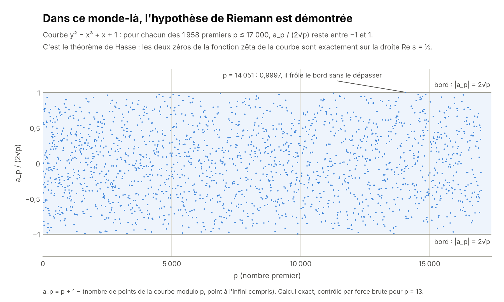
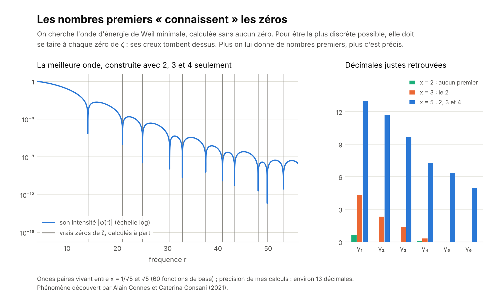
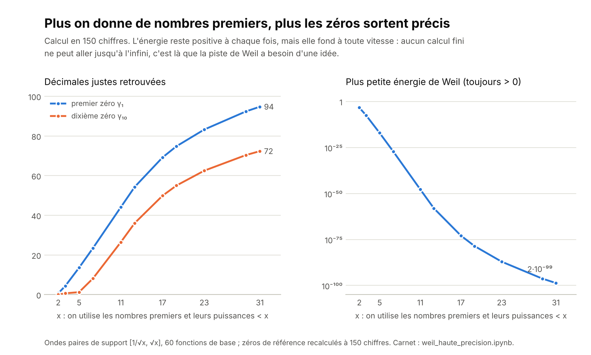

# Où en est l'hypothèse de Riemann ? (novembre 2026)

Ce dossier complète la page *La musique des nombres premiers*. Il résume où en est la recherche, explique pourquoi l'hypothèse résiste, et propose une expérience à refaire soi-même dans Colab.

> **À lire d'abord.** Rien ici ne démontre l'hypothèse de Riemann. Elle reste ouverte.

 Le carnet `weil_haute_precision.ipynb` refait l'expérience en haute précision, en moins d'une minute.

## Ce qui a bougé en 2026

- **Août, Claude (Anthropic).** Une version de recherche de Claude a trouvé et rédigé une preuve que plus des deux tiers des zéros (67,25 %) sont simples et sur la droite critique. Le record précédent était 5/12, soit 41,7 %. Levent Alpöge et Ralph Furman ont vérifié la preuve, puis Youness Lamzouri (Université de Lorraine) l'a redémontrée autrement, plus simplement.
- **Octobre, OpenAI.** OpenAI a annoncé une preuve de l'« hypothèse de quasi-Riemann » : tous les zéros auraient une partie réelle comprise entre 1/12 et 11/12, au lieu de 0 et 1. Une version plus forte, entre 1/8 et 7/8, a été vérifiée par ordinateur avec le logiciel Lean. Selon *Quanta Magazine*, les spécialistes pensent que c'est juste, mais ils n'ont pas fini de vérifier.

Ni l'une ni l'autre n'est l'hypothèse. Même 100 % des zéros « en proportion » laisserait la place à une infinité de zéros hors de la droite, s'ils sont assez rares. Et la bande doit encore se réduire à la seule droite ½.

## Dans ce monde-là, l'hypothèse est démontrée

Pour la courbe y² = x³ + x + 1, on compte ses points modulo chaque nombre premier p, ce qui donne un nombre a_p. Dans ce monde, l'hypothèse de Riemann dit |a_p| ≤ 2√p : les deux zéros de la fonction zêta de la courbe sont pile sur la droite Re s = ½. Sur les 1 958 premiers jusqu'à 17 000, aucun point ne sort de la bande ; le plus proche du bord est p = 14 051, à 0,9997.

Le calcul ne prouve rien : c'est un théorème qui le garantit pour tous les p (Hasse dans les années 1930, Weil pour toutes les courbes en 1948, Deligne en 1974). La preuve repose sur deux ingrédients :
- le « Frobenius », une symétrie qui élève chaque coordonnée à la puissance p ;
- une inégalité de positivité sur la surface « courbe × courbe ».

Pour les nombres entiers, personne ne sait ce qui joue le rôle de la courbe, de la surface ou du Frobenius. C'est ce que cherche le programme d'Alain Connes.

## Les nombres premiers « connaissent » les zéros

On prend une onde qui ne vit qu'entre 1/√x et √x. Son *énergie de Weil* se calcule de deux façons, qui donnent le même nombre :
- avec les seuls nombres premiers inférieurs à x (et leurs puissances), plus quelques constantes comme π ;
- ou comme la somme, sur tous les zéros, du carré du « son » de l'onde à chaque fréquence γ.

Si l'hypothèse est vraie, c'est une somme de carrés, donc jamais négative. Weil a montré la réciproque : si l'énergie est positive pour toutes les ondes, l'hypothèse est vraie.

On cherche alors l'onde d'énergie la plus petite, calculée **sans aucun zéro**. Pour être la plus discrète possible, elle doit se taire à chaque zéro de ζ, et ses creux tombent dessus.

En haute précision (150 chiffres, 60 ondes de base), on va beaucoup plus loin :

| x | Premiers et puissances utilisés | Plus petite énergie | Décimales justes de γ₁ | de γ₁₀ |
|---|---|---|---|---|
| 2 | aucun | 5·10⁻⁴ | 0 | 0 |
| 3 | 2 | 3·10⁻⁸ | 4 | 0 |
| 5 | 2, 3, 4 | 8·10⁻¹⁸ | 13 | 1 |
| 7 | 2, 3, 4, 5 | 8·10⁻²⁸ | 23 | 8 |
| 11 | jusqu'à 9 | 2·10⁻⁴⁸ | 44 | 26 |
| 13 | jusqu'à 11 | 9·10⁻⁵⁹ | 54 | 36 |
| 17 | jusqu'à 16 | 1·10⁻⁷³ | 69 | 49 |
| 19 | jusqu'à 17 | 3·10⁻⁷⁹ | 74 | 54 |
| 23 | jusqu'à 19 | 8·10⁻⁸⁸ | 83 | 62 |
| 29 | jusqu'à 27 | 5·10⁻⁹⁷ | 92 | 70 |
| 31 | jusqu'à 29 | 2·10⁻⁹⁹ | 94 | 72 |

À chaque fois, la matrice de l'énergie est définie positive (factorisation de Cholesky) : la positivité de Weil tient pour ces ondes. Avec les nombres premiers jusqu'à 29, le premier zéro sort avec 94 décimales justes, γ₁ = 14,134725141734693790457251983562470270784257115699… Pour x = 11, notre plus petite énergie est du même ordre que celle mesurée par Connes et Consani (2,4·10⁻⁴⁸).

Ce n'est pas une découverte : le phénomène a été mis au jour par Alain Connes et Caterina Consani en 2021, et nous le refaisons en petit.

## Pourquoi on ne peut pas aller plus loin

1. **L'infini.** Le critère de Weil exige la positivité pour des ondes aussi longues qu'on veut, donc pour x aussi grand qu'on veut. Or la marge fond à toute vitesse : 2·10⁻⁹⁹ dès x = 31, et environ 10⁻⁵³⁵ vers x = 100 selon l'estimation de Groskin. Aucun calcul n'atteint l'infini : il faut une *raison* pour laquelle c'est positif.
2. **Le cercle vicieux.** Dans l'énergie, chaque nombre premier n pèse 1/√n. C'est exactement l'échelle √x où se jouent les irrégularités des premiers, celle que l'hypothèse contrôle. Pour démontrer la positivité, il faudrait donc déjà savoir ce que l'hypothèse affirme.
3. **La symétrie ne suffit pas.** Davenport et Heilbronn ont construit une fonction qui a la même symétrie miroir que ζ, mais des zéros hors de la droite. Une preuve doit donc utiliser ce qui rend ζ unique : son produit d'Euler, c'est-à-dire les nombres premiers comme briques de base. Personne ne sait transformer ce produit en positivité.

S'y ajoute un piège : il n'y a aucune marge. Vers la hauteur 7005, deux zéros consécutifs ne sont séparés que de 0,038 (la « paire de Lehmer », 7005,06266… et 7005,10056…). Rodgers et Tao ont montré que si l'hypothèse est vraie, elle l'est de justesse. Les méthodes par approximation, qui ont besoin d'un peu de jeu, n'ont donc aucune chance : il faut une raison exacte.

## Ce qu'il faudrait ajouter

- **Une géométrie** qui écrive l'énergie comme une somme de carrés, comme la surface « courbe × courbe » le fait pour les courbes modulo p. C'est le rêve du « corps à un élément » et le programme d'Alain Connes.
- **Un instrument** : un opérateur dont les fréquences propres seraient exactement les γ, ce qui les mettrait forcément sur la droite (idée de Hilbert et Pólya). Connes, Consani et Moscovici (2025) en construisent des approximations à partir des seuls nombres premiers ≤ x. Avec les premiers jusqu'à 13, ils retrouvent déjà le premier zéro à 10⁻⁵⁵ près. Ils écrivent qu'une preuve rigoureuse que leur construction converge établirait l'hypothèse.
- **Une idée analytique nouvelle.** 2026 rappelle que les murs tombent parfois : si la « quasi-Riemann » est confirmée, une barrière vieille de plus d'un siècle est tombée.

## La carte des pistes

| Piste | L'idée | Où on en est | Ce qui bloque |
|---|---|---|---|
| Compter les zéros sur la droite | Une part toujours plus grande des notes est « accordée » | Plus des 2/3 (2026) | Une proportion, même 100 %, ne suffit pas |
| Rétrécir la bande | Interdire aux zéros de trop s'éloigner | Bande 1/12–11/12 annoncée (2026) ; Guth et Maynard (2024) : les zéros hors de la droite, s'il y en a, sont plus rares qu'on ne savait le montrer | Réduire la bande à la droite elle-même |
| Vérifier par calcul | Contrôler les notes une à une | Tous les zéros jusqu'à la hauteur 3·10¹² sont sur la droite, soit plus de 10 000 milliards | Il en restera toujours une infinité |
| La « chaleur » (de Bruijn–Newman) | On fait diffuser la fonction comme de la chaleur ; ses zéros deviennent réels à partir d'un instant Λ | 0 ≤ Λ ≤ 0,2 ; l'hypothèse revient à Λ = 0 | Faire descendre 0,2 jusqu'à 0 |
| La positivité (Weil) | Une énergie toujours positive | Équivalent exact ; vérifiée ici jusqu'à x = 31 | Il faut toutes les ondes, x → ∞ |
| L'instrument caché (Hilbert–Pólya, Connes) | Les zéros comme fréquences propres | Écarts entre zéros semblables aux niveaux d'énergie des noyaux lourds (Montgomery, Odlyzko) | Personne n'a trouvé l'opérateur |
| Les courbes modulo p (Hasse, Weil, Deligne) | Le même énoncé dans un autre monde | **Démontré** | Aucun équivalent connu pour les entiers |

## Projets pour continuer

1. **Pousser Weil plus loin** avec le carnet : augmenter la précision, le nombre d'ondes et x, essayer d'autres familles d'ondes.
2. **Voir pourquoi la symétrie ne suffit pas** : calculer la fonction de Davenport–Heilbronn, traquer ses zéros hors de la droite, et regarder son « énergie » devenir négative.
3. **Là où l'hypothèse a failli tomber** : zoomer sur la paire de Lehmer, à la hauteur 7005.
4. **Lire** : *La Symphonie des nombres premiers* de Marcus du Sautoy, et *Prime Numbers and the Riemann Hypothesis* de Barry Mazur et William Stein (en anglais).

## Sources

- *Quanta Magazine*, 19 octobre 2026 : [l'hypothèse de quasi-Riemann](https://quantamagazine.org/ai-proved-the-quasi-riemann-hypothesis-what-happens-now-20261019)
- L. Alpöge, R. Furman : [arXiv 2608.13637](https://arxiv.org/pdf/2608.13637) ; Y. Lamzouri : [arXiv 2609.02882](https://arxiv.org/pdf/2609.02882)
- A. Connes, C. Consani : [arXiv 2106.01715](https://arxiv.org/abs/2106.01715) ; A. Connes, C. Consani, H. Moscovici : [arXiv 2511.22755](https://arxiv.org/abs/2511.22755)
- A. Groskin : [arXiv 2605.20224](https://arxiv.org/abs/2605.20224)
- D. Platt, T. Trudgian : [arXiv 2004.09765](https://arxiv.org/abs/2004.09765) ; L. Guth, J. Maynard : [Annals of Mathematics](https://annals.math.princeton.edu/2026/203-2/p06)
- [Paire de Lehmer](https://en.wikipedia.org/wiki/Lehmer_pair) ; [fonction de Davenport–Heilbronn](https://arxiv.org/pdf/1602.06328)

Réalisé avec l'aide de Claude (Anthropic).
