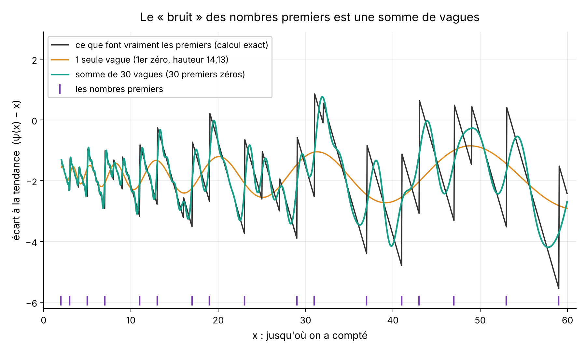
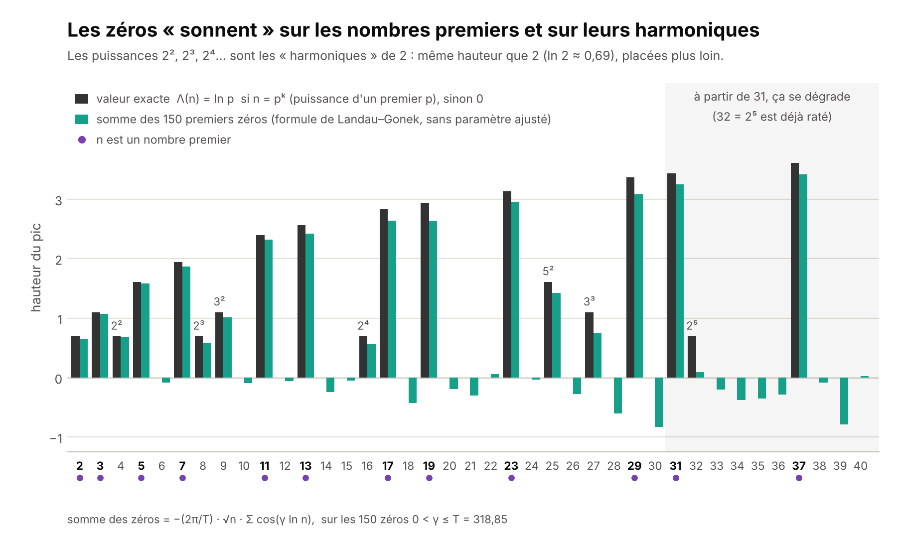

# La musique des nombres premiers

Une page interactive, en un seul fichier, pour **voir** comment les zéros de la fonction ζ de Riemann fabriquent les nombres premiers : chaque zéro est une note, et en ajoutant les notes une à une on retrouve les sauts des nombres premiers.

> **À lire d'abord.** Rien ici ne démontre l'hypothèse de Riemann. C'est une mise en images de résultats connus (la formule explicite de Riemann et von Mangoldt) et de calculs numériques sur les 150 premiers zéros.

**Ouvrir la page :** télécharger `index.html` et l'ouvrir dans un navigateur, ou activer GitHub Pages sur le dépôt.

## Ce que fait la page

1. **Ajoute les notes, une par une.** Un curseur règle le nombre K de notes : la ligne grise est ce que font vraiment les nombres premiers, la ligne bleue est la somme des K premières ondes. Quand K grandit, la bleue épouse la grise.
2. **Et si une note sortait de la droite ?** Un zéro s'écrit σ + iγ ; son onde grandit comme x^σ. Avec σ = ½ (la « droite critique »), toutes les ondes grandissent au même rythme, √x, et aucune n'écrase les autres. On peut pousser un zéro hors de la droite et voir son onde finir par dominer. L'hypothèse de Riemann affirme que cela n'arrive jamais.
3. **Écoute les notes.** Le bouton « Écouter » joue les K notes en même temps : chaque zéro devient un son pur de 10 × γ hertz (141 Hz pour le premier, 3 189 Hz pour le 150ᵉ), d'autant plus doux qu'il est aigu, comme le poids 1/|ρ| de la formule.

## La vague



*En gris : ce que font vraiment les nombres premiers (l'écart ψ(x) − x, qui saute vers le haut à chaque premier et à chaque puissance de premier ; les premiers sont repérés en violet). En orange : une seule vague, celle du premier zéro (hauteur γ₁ = 14,13). En vert : la somme des 30 premières vagues. Plus on ajoute de vagues, plus la courbe verte colle à la grise.*

## L'analogie : monter sur la vague

Pour expliquer la relativité, on peut s'imaginer sur un rayon de lumière, au sommet d'une vague, et regarder le monde depuis la vague. Même geste ici :

- **Sur la vague d'un zéro, on n'entend qu'une note.** Un balancement régulier (la courbe orange). Les nombres premiers n'y sont pas : ni dans cette vague, ni dans aucune autre prise seule.
- **Ils sont dans la somme.** Il faut descendre de la vague et écouter toutes les vagues ensemble : avec 30, les sauts apparaissent ; avec 150, des pics se dressent sur les premiers (figure suivante).
- **Le parallèle : tout le monde sur le même pied.** En relativité, la lumière a la même vitesse pour tous les observateurs. Avec Riemann, si l'hypothèse est vraie, toutes les vagues grandissent au même rythme (√x) : aucune n'a de privilège. Si un zéro quittait la droite, sa vague finirait par écraser les autres, et l'écart entre le vrai nombre de premiers et son estimation dépasserait nettement √x.
- **Limite de l'image.** La relativité est un principe vérifié par l'expérience. L'hypothèse de Riemann est une affirmation mathématique **non démontrée**. L'image aide à voir, pas à conclure.

## Et les harmoniques ?

En musique, une note s'accompagne de ses harmoniques, des notes plus aiguës et de plus en plus faibles. L'idée revient deux fois ici.

**Les harmoniques d'un premier, ce sont ses puissances.** Dans la formule, chaque puissance pᵏ compte comme un premier de plus : un pic de même hauteur ln p, placé plus loin (4 = 2², 8 = 2³, 16 = 2⁴ pour le nombre 2). Riemann, lui, les compte de moins en moins fort : pᵏ pèse 1/k dans sa fonction J(x) = π(x) + ½π(x^(1/2)) + ⅓π(x^(1/3)) + …, comme des harmoniques qui s'affaiblissent.

**Les zéros, eux, ne sont pas des harmoniques** au sens strict : 14,13 ; 21,02 ; 25,01 ; 30,42… ne sont pas des multiples d'une fondamentale, et leurs écarts ne sont pas réguliers. Ils se repoussent un peu comme les niveaux d'énergie d'un noyau lourd (conjecture de Montgomery, 1973, confortée par les calculs d'Odlyzko). « Les notes » est une image, pas un instrument de musique.



*En gris foncé : la valeur exacte Λ(n), égale à ln p si n est une puissance pᵏ d'un premier p, et à 0 sinon. En vert : la somme des 150 premiers zéros, −(2π/T)·√n·Σ cos(γ ln n), sans rien ajuster (formule de Landau–Gonek). Un point violet marque les nombres premiers ; 2², 2³, 2⁴… (les « harmoniques » de 2) ont la même hauteur que 2.*

**Qu'en faire ?**

- **Reconstruire.** Additionner 150 zéros suffit à faire ressortir les premiers et leurs puissances. Jusqu'à n = 30, un simple seuil à 0,3 retrouve les 29 entiers sans erreur (les puissances de premiers sortent entre 0,56 et 3,09, les autres restent entre −0,83 et +0,06). Ensuite ça se dégrade : 32 = 2⁵ est déjà raté. Il faudrait plus de zéros, plus on regarde loin (règle empirique, pas un théorème : des zéros jusqu'à quelques fois 2π·n).
- **Tester l'hypothèse.** Un zéro hors de la droite serait un harmonique « trop fort », qui finirait par couvrir les autres (section 2 de la page).
- **Les écouter.** C'est le bouton « Écouter » de la page. Le son est la somme des ondes, divisée par √x et parcourue en accéléré (ln x avance de 20π par seconde) : les petits nombres premiers passent dans le premier vingtième de seconde, ensuite on n'entend plus que les zéros. Leurs fréquences ne sont pas des multiples d'une même note : c'est comme pour une cloche, pas comme pour une corde.

## Ce que ça ne montre pas

- Aucune preuve. Les zéros calculés à ce jour sont tous sur la droite, mais ce n'est pas une démonstration : il y en a une infinité.
- Seuls les 150 premiers zéros sont utilisés. C'est assez pour des figures parlantes, pas pour de grands nombres.
- Dans la page, le « monde orange » (un zéro poussé hors de la droite) est un jeu : un vrai zéro hors de la droite viendrait avec un jumeau symétrique, que la page laisse de côté.

## Données et vérification

- `index.html` contient tout : mise en page, calculs (JavaScript, sans bibliothèque), son (Web Audio) et les 150 zéros. Seule dépendance externe : les polices (Google Fonts).
- `zeros150.json` : les 150 premiers zéros γ (9 décimales), de γ₁ = 14,134725… à γ₁₅₀ = 318,853104…. Calculés par changements de signe de la fonction Z de Hardy, puis bissection. Avec ces 9 décimales, |ζ(½ + iγ)| reste sous 3·10⁻⁹ pour chacun, et on compte 150 changements de signe entre 10 et 319, pour ≈ 149,5 attendus par la formule de Riemann–von Mangoldt.
- Pour retrouver les pics de la deuxième figure, en dix lignes :

```python
import json, math

z = json.load(open("zeros150.json"))
T = z[-1]

def somme(n):  # somme des 150 ondes, formule de Landau–Gonek
    return -(2 * math.pi / T) * math.sqrt(n) * sum(math.cos(g * math.log(n)) for g in z)

for n in range(2, 11):
    print(n, round(somme(n), 2))
# 2 0.65 · 3 1.07 · 4 0.68 · 5 1.59 · 6 -0.09 · 7 1.87 · 8 0.58 · 9 1.01 · 10 -0.1
# les pics sont sur 2, 3, 4, 5, 7, 8, 9 (premiers et puissances) ; 6 et 10 restent à 0
```

## Où en est la recherche ? (novembre 2026)

Le dossier [`exploration/`](exploration/) résume les avancées de 2026, explique pourquoi l'hypothèse résiste, et propose une expérience en haute précision à refaire dans Colab : à partir des seuls nombres premiers, retrouver les zéros de ζ avec des dizaines de décimales.

Nouveau : peut-on raisonner par récurrence ? Et une page pour refaire soi-même, dans le navigateur, le calcul du [contre-exemple de Pólya](https://geremiaa.github.io/Musique-Des-Premiers/exploration/polya.html).

## Pour aller plus loin

- Bernhard Riemann, *Über die Anzahl der Primzahlen unter einer gegebenen Grösse* (1859) ; Hans von Mangoldt (1895) pour la formule explicite de ψ.
- La formule de Landau (1911), rendue uniforme en x par Gonek : [MathWorld, « Landau's formula »](https://mathworld.wolfram.com/LandausFormula.html).
- Polices : Newsreader et IBM Plex Mono (Google Fonts, licence OFL) ; figures : Inter.

Réalisé avec l'aide de Claude (Anthropic).
