# Où en est l'hypothèse de Riemann ? (novembre 2026)

Ce dossier complète la page *La musique des nombres premiers*. Il résume où en est la recherche, explique pourquoi l'hypothèse résiste, et propose une expérience à refaire soi-même dans Colab.

> **À lire d'abord.** Rien ici ne démontre l'hypothèse de Riemann. Elle reste ouverte.

 Le carnet `weil_haute_precision.ipynb` refait l'expérience en haute précision, en moins d'une minute.

## Des idées qui visent juste

Ce projet est parti de questions de curieux, posées sans formules. Après coup, chacune est tombée sur une idée de recherche de premier plan. Géniales ? L'auteur, très humble, laisse le lecteur en juger ; voici les faits.

| La question de départ | L'idée de recherche qu'elle retrouve |
|---|---|
| « Peut-on raisonner par récurrence : vrai sur une partie, donc vrai partout ? » | C'est la forme exacte du critère de Weil, fenêtre après fenêtre, et le programme de Connes et Consani. Le premier pas est un théorème (2020). |
| « Pólya est faux ; ne faut-il pas demander une taille plutôt qu'un signe ? » | C'est l'équivalence de Littlewood : l'hypothèse revient à « L(x) reste de l'ordre de √x ». |
| « Y a-t-il une signature, une fréquence qui annonce les retours ? » | Les ondes des zéros retrouvent 906 millions et les renversements des courses modulo 4 et modulo 3, et font deux prédictions nouvelles. |
| « Utilise le paradoxe de Russell. » | C'est le théorème de Bagchi : l'hypothèse équivaut à « ζ s'imite elle-même ». Le cas autoréférent est exactement celui qui résiste. |
| « Premiers pairs, premiers impairs : ce qui est vrai pour l'un l'est-il pour l'autre ? » | C'est le problème de la parité de Selberg, l'une des grandes barrières de la théorie des nombres. |
| « Copie les démonstrations des autres théorèmes. » | C'est la stratégie de Connes, Consani et Moscovici (2025), qui recopient Selberg ; nos calculs vérifient leurs deux étapes manquantes. |
| « Sors-toi de Riemann : une transformée de Fourier, et remonte vers une autre hypothèse. » | C'est l'équivalence de Keating et Smith (2019) : les corrélations des zéros contiennent la conjecture de Hardy–Littlewood sur les premiers jumeaux. Les zéros calculés ici redonnent son facteur à 5 % près. |

Poser ces sept questions, et voir chacune déboucher sur une idée de ce niveau, montre qu'on cherchait au bon endroit. Cela ne démontre pas l'hypothèse, que personne n'a démontrée ; mais les intuitions de départ étaient les bonnes.

## Ce qui a bougé en 2026

- **Août, Claude (Anthropic).** Une version de recherche de Claude a trouvé et rédigé une preuve que plus des deux tiers des zéros (67,25 %) sont simples et sur la droite critique. Le record précédent était 5/12, soit 41,7 %. Levent Alpöge et Ralph Furman ont vérifié la preuve, puis Youness Lamzouri (Université de Lorraine) l'a redémontrée autrement, plus simplement.
- **Octobre, OpenAI.** OpenAI a annoncé une preuve de l'« hypothèse de quasi-Riemann » : tous les zéros auraient une partie réelle comprise entre 1/12 et 11/12, au lieu de 0 et 1. Une version plus forte, entre 1/8 et 7/8, a été vérifiée par ordinateur avec le logiciel Lean. Selon *Quanta Magazine*, les spécialistes pensent que c'est juste, mais ils n'ont pas fini de vérifier.

Ni l'une ni l'autre n'est l'hypothèse. Même 100 % des zéros « en proportion » laisserait la place à une infinité de zéros hors de la droite, s'ils sont assez rares. Et la bande doit encore se réduire à la seule droite ½.

## Dans ce monde-là, l'hypothèse est démontrée

Pour la courbe y² = x³ + x + 1, on compte ses points modulo chaque nombre premier p, ce qui donne un nombre a_p. Dans ce monde, l'hypothèse de Riemann dit |a_p| ≤ 2√p : les deux zéros de la fonction zêta de la courbe sont pile sur la droite Re s = ½. Sur les 1 958 premiers jusqu'à 17 000, aucun point ne sort de la bande ; le plus proche du bord est p = 14 051, à 0,9997.

Le calcul ne prouve rien : c'est un théorème qui le garantit pour tous les p (Hasse dans les années 1930, Weil pour toutes les courbes en 1948, Deligne en 1974). La preuve repose sur deux ingrédients :
- le « Frobenius », une symétrie qui élève chaque coordonnée à la puissance p ;
- une inégalité de positivité sur la surface « courbe × courbe ».

Pour les nombres entiers, personne ne sait ce qui joue le rôle de la courbe, de la surface ou du Frobenius. C'est ce que cherche le programme d'Alain Connes.

## Les nombres premiers « connaissent » les zéros

On prend une onde qui ne vit qu'entre 1/√x et √x. Son *énergie de Weil* se calcule de deux façons, qui donnent le même nombre :
- avec les seuls nombres premiers inférieurs à x (et leurs puissances), plus quelques constantes comme π ;
- ou comme la somme, sur tous les zéros, du carré du « son » de l'onde à chaque fréquence γ.

Si l'hypothèse est vraie, c'est une somme de carrés, donc jamais négative. Weil a montré la réciproque : si l'énergie est positive pour toutes les ondes, l'hypothèse est vraie.

On cherche alors l'onde d'énergie la plus petite, calculée **sans aucun zéro**. Pour être la plus discrète possible, elle doit se taire à chaque zéro de ζ, et ses creux tombent dessus.

En haute précision (150 chiffres, 60 ondes de base), on va beaucoup plus loin :

| x | Premiers et puissances utilisés | Plus petite énergie | Décimales justes de γ₁ | de γ₁₀ |
|---|---|---|---|---|
| 2 | aucun | 5·10⁻⁴ | 0 | 0 |
| 3 | 2 | 3·10⁻⁸ | 4 | 0 |
| 5 | 2, 3, 4 | 8·10⁻¹⁸ | 13 | 1 |
| 7 | 2, 3, 4, 5 | 8·10⁻²⁸ | 23 | 8 |
| 11 | jusqu'à 9 | 2·10⁻⁴⁸ | 44 | 26 |
| 13 | jusqu'à 11 | 9·10⁻⁵⁹ | 54 | 36 |
| 17 | jusqu'à 16 | 1·10⁻⁷³ | 69 | 49 |
| 19 | jusqu'à 17 | 3·10⁻⁷⁹ | 74 | 54 |
| 23 | jusqu'à 19 | 8·10⁻⁸⁸ | 83 | 62 |
| 29 | jusqu'à 27 | 5·10⁻⁹⁷ | 92 | 70 |
| 31 | jusqu'à 29 | 2·10⁻⁹⁹ | 94 | 72 |

À chaque fois, la matrice de l'énergie est définie positive (factorisation de Cholesky) : la positivité de Weil tient pour ces ondes. Avec les nombres premiers jusqu'à 29, le premier zéro sort avec 94 décimales justes, γ₁ = 14,134725141734693790457251983562470270784257115699… Pour x = 11, notre plus petite énergie est du même ordre que celle mesurée par Connes et Consani (2,4·10⁻⁴⁸).

Ce n'est pas une découverte : le phénomène a été mis au jour par Alain Connes et Caterina Consani en 2021, et nous le refaisons en petit.

## Pourquoi on ne peut pas aller plus loin

1. **L'infini.** Le critère de Weil exige la positivité pour des ondes aussi longues qu'on veut, donc pour x aussi grand qu'on veut. Or la marge fond à toute vitesse : 2·10⁻⁹⁹ dès x = 31, et environ 10⁻⁵³⁵ vers x = 100 selon l'estimation de Groskin. Aucun calcul n'atteint l'infini : il faut une *raison* pour laquelle c'est positif.
2. **Le cercle vicieux.** Dans l'énergie, chaque nombre premier n pèse 1/√n. C'est exactement l'échelle √x où se jouent les irrégularités des premiers, celle que l'hypothèse contrôle. Pour démontrer la positivité, il faudrait donc déjà savoir ce que l'hypothèse affirme.
3. **La symétrie ne suffit pas.** Davenport et Heilbronn ont construit une fonction qui a la même symétrie miroir que ζ, mais des zéros hors de la droite. Une preuve doit donc utiliser ce qui rend ζ unique : son produit d'Euler, c'est-à-dire les nombres premiers comme briques de base. Personne ne sait transformer ce produit en positivité.

S'y ajoute un piège : il n'y a aucune marge. Vers la hauteur 7005, deux zéros consécutifs ne sont séparés que de 0,038 (la « paire de Lehmer », 7005,06266… et 7005,10056…). Rodgers et Tao ont montré que si l'hypothèse est vraie, elle l'est de justesse. Les méthodes par approximation, qui ont besoin d'un peu de jeu, n'ont donc aucune chance : il faut une raison exacte.

## Cristal ou quasi-cristal

- **A. Un seul nombre premier, c'est un cristal.** Le long de la droite critique, le facteur du seul nombre 2 se répète avec une période parfaite, 2π/ln 2 ≈ 9,06. Il oscille entre 2 − √2 et 2 + √2, et le rapport entre les deux vaut exactement (1 + √2)².
- **B et C. Dans le monde où l'hypothèse est démontrée, les zéros forment un cristal.** Pour la courbe modulo 5, un motif de deux zéros se répète tous les 2π/ln 5 ≈ 3,90. Sa « diffraction » donne des taches régulières aux multiples de ln 5, comme un réseau cristallin. La hauteur de chaque tache est fixée par le nombre de points de la courbe dans les corps à 5, 25 et 125 éléments.
- **D. Les zéros de ζ forment un quasi-cristal.** Ils ne se répètent jamais, mais leur diffraction est faite de taches nettes : une en ln p pour chaque nombre premier p, de hauteur ln p, et d'autres pour ses puissances. C'est exactement la définition d'un quasi-cristal que Freeman Dyson a proposée en 2009 : ordonné sans être périodique, comme les cristaux de Shechtman (prix Nobel de chimie 2011).

Ce que ça éclaire : pour une courbe donnée, tout se répète, donc vérifier une seule « maille » de quelques zéros suffit. Le tour de force de Weil a été de le démontrer pour toutes les courbes à la fois. Pour ζ, les fréquences ln 2, ln 3, ln 5… sont incommensurables : il n'y a pas de maille à vérifier. C'est le mur de l'infini, vu par un cristallographe.

Dyson proposait justement de classer tous les quasi-cristaux à une dimension, en espérant y retrouver les zéros de ζ, ce qui démontrerait l'hypothèse. Il jugeait lui-même ce programme très difficile. Ces « quasi-cristaux de Fourier » sont aujourd'hui un sujet de recherche actif. Le carnet refait cette figure (bonus 2).

## π, le nombre d'or et 1 + √2

- **π sort de tous les nombres premiers à la fois.** Le produit de (1 − 1/p²) sur tous les premiers vaut exactement 6/π² ≈ 0,6079. C'est aussi la probabilité que deux entiers pris au hasard n'aient aucun diviseur commun ; jusqu'à un million, on trouve 0,607927 par les deux calculs. π est aussi dans la symétrie miroir de ζ, où il joue le rôle d'un « nombre premier à l'infini ». Dans l'expérience de Weil, avec x = 2, ce premier à l'infini agit seul et donne déjà γ₁ à 0,2 près. Enfin, les zéros se comptent en demi-tours d'une phase qui tourne.
- **Le nombre d'or et 1 + √2 sont des nombres de polygones.** φ = 2 cos(π/5) vient du pentagone, 1 + √2 = 1/tan(π/8) de l'octogone, 2 + √3 = 1/tan(π/12) du dodécagone. Ils apparaissent dans ζ par les facteurs des premiers 5, 2 et 3 : sur la droite critique, le rapport entre leurs valeurs extrêmes vaut φ², (1 + √2)² et 2 + √3.
- **Le lien le plus profond : √5 est une « somme de Gauss ».** En additionnant les sommets du pentagone dans l'ordre a² modulo 5, on passe par φ à mi-chemin et on arrive pile à √5. Pour chaque nombre premier p, ces sommes ont une taille exactement √p (Gauss ; vérifié ici pour les 429 premiers impairs sous 3 000), et les sommes cubiques restent sous 2√p (Weil). C'est l'hypothèse de Riemann dans le monde des nombres modulo p, déjà démontrée.

Pour ζ elle-même, on ne connaît aucun lien entre ces nombres et la position des zéros : π vient des rotations et du premier à l'infini, et le nombre d'or et 1 + √2 apparaissent parce que √5 et √2 y sont. Le carnet refait ces calculs (bonus 3).

## Le photon : aucune onde ne vieillit

Pour un photon, le temps ne s'écoule pas : son « temps propre » reste nul. On retrouve une image proche avec les zéros. Divisée par √x, la croissance commune à toutes les ondes, l'onde d'un zéro situé sur la droite critique ne grandit ni ne s'éteint : elle ne fait que tourner, sur un cercle. Si un zéro quittait la droite, il viendrait avec un jumeau symétrique : l'onde de l'un enflerait comme x^(σ − ½), celle de l'autre s'éteindrait.

L'hypothèse de Riemann revient donc à dire qu'aucune onde ne vieillit. C'est le langage de l'idée de Hilbert et Pólya. En physique quantique, un état d'énergie réelle évolue par pure rotation et reste stable, alors qu'un état d'énergie complexe se désintègre, comme une particule instable. Trouver un système dont les zéros seraient les énergies, toutes réelles, démontrerait l'hypothèse.

Berry et Keating ont remarqué que le « temps » de ces ondes, ln x, est celui des changements d'échelle, engendrés par le hamiltonien classique H = xp. Les opérateurs de Connes, Consani et Moscovici sont construits pour que leurs notes ne vieillissent pas. Personne n'a encore trouvé le bon. Le carnet refait cette figure (bonus 4).

## Peut-on raisonner par récurrence ?

L'idée est tentante : si c'est vrai sur une partie, des « harmoniques » et une symétrie suffiraient-elles à le rendre vrai jusqu'à l'infini ? C'est exactement ainsi qu'on a démontré l'hypothèse pour les courbes. Pour ζ, la même idée bute sur trois obstacles, vérifiés ici par le calcul.

### Pour les courbes, ça marche

La courbe y² = x³ + x + 1 se compte sur les corps à 5, 25, 125… éléments : ce sont ses « harmoniques » m = 1, 2, 3… Elle y a 5ᵐ + 1 − (αᵐ + βᵐ) points : deux nombres seulement, α et β, pilotent une infinité d'harmoniques. En comptant les points un par un, on trouve 9, 27 et 108, exactement ce que prévoient α et β. La preuve tient en trois temps :

1. **Une borne pour toutes les harmoniques à la fois.** L'écart reste sous C·5^(m/2) pour tout m (Weil, 1948 ; méthode élémentaire de Stepanov et Bombieri, 1969–1973). Elle est démontrée par l'algèbre, pas vérifiée cas par cas.
2. **L'amplification.** Si |α| dépassait √5, même de 1 %, αᵐ finirait par dépasser n'importe quelle borne de ce type. Donc |α| ≤ √5.
3. **La symétrie α ↔ 5/α** (l'équation fonctionnelle) donne l'inverse, |α| ≥ √5. Donc |α| = √5 : les zéros sont sur la droite.

Même ici, vérifier une partie ne suffit pas : un monde imaginaire décalé de 1 % reste indiscernable du vrai jusqu'à m = 60 (3,6 contre 2). C'est la borne démontrée pour toutes les harmoniques d'un coup qui fait la preuve.

### Pour ζ, trois obstacles

**Pas d'harmoniques communes.** Chaque nombre premier a les siennes (p, p², p³…, le cristal de la section « Cristal ou quasi-cristal »), mais ζ en mélange une infinité, et ln 2, ln 3, ln 5… n'ont aucune note commune. Il n'y a pas de liste finie de « α », et les zéros n'ont pas de période. Pour la courbe, ils se répètent tous les 3,904 en hauteur.

**La symétrie ne suffit pas.**

La fonction de Davenport et Heilbronn, f(s) = 1 + τ/2ˢ − τ/3ˢ − 1/4ˢ + 1/6ˢ + … avec τ ≈ 0,284, a exactement la symétrie de ζ : l'équation Λ(s) = Λ(1 − s) est vérifiée ici à 10⁻¹³ près. Sous la hauteur 205, elle a 133 zéros : 125 sur la droite et 8 en dehors, par paires symétriques, dont 0,808517 + 85,699348 i. Ce sont ceux que Spira avait trouvés en 1994, et on sait qu'il y en a une infinité. Sa seule différence avec ζ : pas de produit d'Euler, puisque a(6) = 1 alors que a(2) × a(3) = −0,08. Une preuve doit donc utiliser la règle de multiplication des nombres premiers.

**« Vrai sur une partie » ne suffit pas.**

On a passé au crible tous les entiers jusqu'à un milliard :

- **Pólya (1919)** affirme L(x) ≤ 0 pour tout x ≥ 2. C'est vrai pour tous les n de 2 à 906 150 256. En n = 906 150 257 = 10 039 × 90 263, L vaut +1 : la conjecture est fausse (Tanaka, 1980). L est positif 305 426 fois, par moments, jusqu'à 906 488 079 (maximum 829), puis ne dépasse plus 0, au moins jusqu'au milliard ; plus loin, il repasse au-dessus de 0 une infinité de fois (Borwein, Ferguson et Mossinghoff, 2008). Un énoncé « pour tout » tombe avec un seul contre-exemple : « fausse » ne veut pas dire « fausse pour tous les nombres suivants ». Si Pólya avait eu raison, l'hypothèse de Riemann aurait été vraie.
- **Mertens (1897)** affirme |M(x)| < √x. Entre 10⁵ et 10⁹, |M(x)|/√x ne dépasse pas 0,47. C'est pourtant faux (Odlyzko et te Riele, 1985). Personne n'a jamais vu de contre-exemple : le premier se trouve quelque part avant e^(1,96·10¹⁹).
- **π(x) < li(x)** est vérifié jusqu'à 10¹⁹ (Büthe, 2018), et faux avant 1,3971·10³¹⁶.

**Vérifie toi-même.** La page [`polya.html`](https://geremiaa.github.io/Musique-Des-Premiers/exploration/polya.html) refait tout le calcul de Pólya dans le navigateur, sur ton propre appareil : une demi-minute environ sur un ordinateur, un peu plus sur un téléphone (sans GitHub Pages, télécharge [`polya.html`](polya.html) et ouvre-le dans ton navigateur). Elle utilise une autre méthode que les programmes Python du dossier [`calculs/`](calculs/), et retrouve les mêmes nombres.

### La taille, pas le signe

L'hypothèse de Riemann n'est pas touchée par ce contre-exemple : Pólya en demandait plus qu'elle. Mais la bonne version de Pólya existe déjà, et elle est équivalente à l'hypothèse de Riemann. Il ne faut pas exiger que L(x) reste négatif, seulement que L(x) reste de la taille de √x, à peine plus : |L(x)| ≤ x^(½ + ε) pour tout ε > 0, dès que x est assez grand. Pólya demandait un signe ; Riemann ne demande qu'une taille. Jusqu'au milliard, |L(x)|/√x ne dépasse pas 1,36, ce qui colle.

Ce n'est pas une découverte : c'est un résultat classique. Littlewood l'a montré pour la fonction de Mertens M(x), et le même raisonnement vaut pour L(x), parce que Σ λ(n)/nˢ = ζ(2s)/ζ(s).

### Pourquoi 906 millions ? Les ondes des zéros

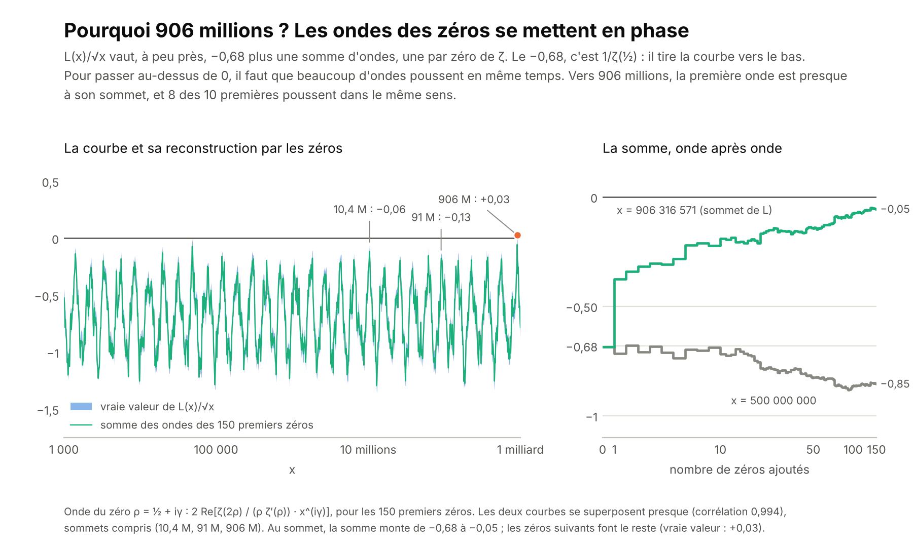

906 150 257 = 10 039 × 90 263 n'a rien de spécial : il a deux facteurs premiers, comme beaucoup d'autres nombres. Ce qui compte, c'est le moment où il arrive : juste avant, L valait 0. Pourquoi la somme est-elle remontée jusque-là ?

L(x)/√x vaut, à peu près, 1/ζ(½) ≈ −0,68 plus une onde par zéro de ζ : l'onde du zéro ρ = ½ + iγ est 2 Re[ζ(2ρ)/(ρ ζ′(ρ)) · xⁱᵞ]. Le −0,68 tire la courbe vers le bas en permanence. Avec les 150 premiers zéros, la somme des ondes se superpose presque à la vraie courbe (corrélation 0,994). Vers 906 millions, la première onde est presque à son sommet et 8 des 10 premières poussent dans le même sens. Il y a eu deux presque-accords avant : vers 10,4 millions (L/√x = −0,06) et vers 91 millions (−0,13), sans franchir 0.

### La signature des zéros : prédire où ça repasse

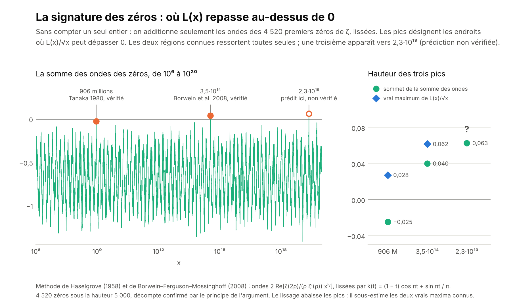

On peut retourner l'idée. Sans compter un seul entier, on cherche où la somme des ondes est la plus haute. Avec les 4 520 zéros sous la hauteur 5 000, lissés comme le font Borwein, Ferguson et Mossinghoff :

- **906 millions** ressort : c'est le contre-exemple de Tanaka ;
- **3,51 à 3,53·10¹⁴** aussi : c'est là que ces trois auteurs ont trouvé L(x) > 0 en 2008, avec un maximum de 1 160 327 en n = 351 753 358 289 465 ;
- une **troisième région** apparaît, plus haute encore, vers **x ≈ 2,317 à 2,324·10¹⁹**.

**C'est une prédiction, pas un résultat.** La somme des ondes n'est qu'une approximation : elle suppose l'hypothèse de Riemann et n'utilise qu'une partie des zéros. Pour vérifier, il faudrait calculer L(x) exactement vers 2,3·10¹⁹, bien au-delà de ce qu'on peut faire ici. Nous ne l'avons trouvée dans aucune des publications consultées, mais la méthode date de Haselgrove (1958) et des spécialistes l'ont peut-être déjà vue.

Les pics ne décroissent pas : 0,028 à 906 millions, 0,062 à 3,5·10¹⁴. On sait que L(x) dépasse 0,0618·√x une infinité de fois. Trouver où les ondes s'alignent est un problème d'approximation simultanée (Dirichlet, Kronecker) ; c'est avec l'algorithme LLL, qui résout ce genre de problème, qu'Odlyzko et te Riele ont réfuté la conjecture de Mertens en 1985. Programme : [`calculs/signature_zeros.py`](calculs/signature_zeros.py).

### La course des nombres premiers : la méthode marche

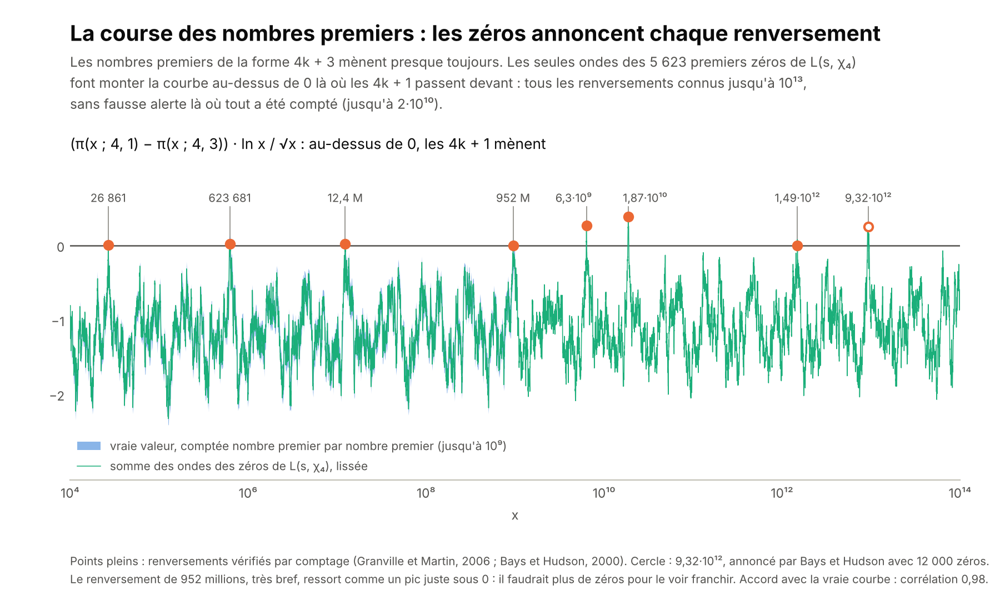

Pour tester la méthode là où l'on peut tout vérifier, on l'applique à une autre course : les nombres premiers de la forme 4k + 3 contre ceux de la forme 4k + 1. Les 4k + 3 mènent presque toujours (c'est le biais de Tchebychev). En comptant jusqu'au milliard, les 4k + 1 ne passent devant que quatre fois : en 26 861, de 616 841 à 633 797, de 12 306 137 à 12 382 313 et de 951 784 481 à 952 223 473.

Cette course est pilotée par les zéros d'une autre fonction, L(s, χ₄) = 1 − 1/3ˢ + 1/5ˢ − 1/7ˢ + … On en a calculé 5 623, tous ceux sous la hauteur 5 000 (le décompte est confirmé par le principe de l'argument). Avec ces seuls zéros, la somme des ondes passe au-dessus de 0 dans les régions connues : 26 861, vers 623 000, vers 12,37 millions, puis 6,3·10⁹, 1,87·10¹⁰ et 1,49·10¹². Elle annonce aussi 9,32·10¹², comme Bays et Hudson en 2000 avec 12 000 zéros. Le renversement de 952 millions, très bref, apparaît comme un pic juste sous 0. Jusqu'à 2·10¹⁰, où tout a été compté, il n'y a aucune fausse alerte.

**Un test plus dur : la course modulo 3.** Les nombres premiers de la forme 3k + 2 mènent sur les 3k + 1 jusqu'à 608 981 813 029, le premier renversement, trouvé par Bays et Hudson. On a calculé les 5 393 zéros de L(s, χ₃) = 1 − 1/2ˢ + 1/4ˢ − 1/5ˢ + 1/7ˢ − … sous la hauteur 5 000, sans compter un seul nombre premier au-delà du milliard. Entre 10⁴ et 10¹⁴, la somme des ondes n'a que deux sommets qui touchent presque 0 : vers 6,09·10¹¹, exactement au premier renversement, et vers 6,15·10¹². Lissée, elle reste juste sous 0 (−0,05 et −0,02) ; sans lissage, elle franchit 0 en 6,09·10¹¹, à 0,03 % du vrai renversement. Avec seulement 823 zéros, le plus haut sommet sur ces dix ordres de grandeur tombe déjà à 6,10·10¹¹. La région 6,15·10¹² est une prédiction : nous ne l'avons trouvée dans aucune source.

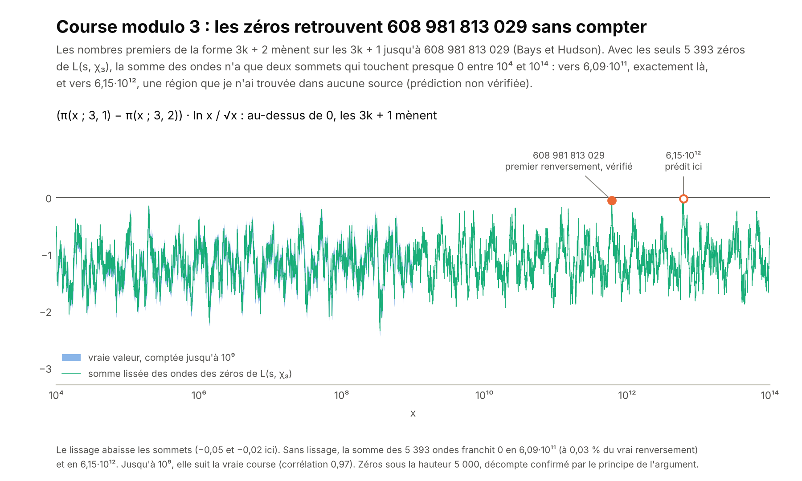

Ce test ne démontre pas la prédiction faite pour Pólya vers 2,3·10¹⁹. Il montre seulement que la méthode est fiable quand on lui donne assez de zéros. Programme, pour les deux courses : [`calculs/course_zeros.py`](calculs/course_zeros.py).

### Ce qu'on peut en tirer

- **La récurrence de Weil.** Appelons P(x) l'énoncé « l'énergie de Weil est positive pour toutes les ondes vivant entre 1/√x et √x ». L'hypothèse revient à « P(x) pour tout x ». Le premier cas, où aucun nombre premier n'entre dans la fenêtre, est démontré (Connes et Consani, 2020) ; on l'a vérifié numériquement jusqu'à x = 31, avec 60 ondes de base. Il manque le pas de récurrence : montrer qu'un nouveau nombre premier ne casse pas la positivité. Personne ne sait le faire, et la marge fond, de 5·10⁻⁴ à 2·10⁻⁹⁹ (voir le tableau plus haut).
- **Une récurrence « fini + infini » existe déjà.** Pour la constante de de Bruijn–Newman Λ, Polymath15 a montré Λ ≤ 0,22 en 2019, avec un calcul fini, un argument pour l'infini et une « barrière » entre les deux ; le record est 0,2 (Platt et Trudgian, 2021). L'hypothèse revient à Λ = 0, mais la méthode ne peut pas atteindre 0 : elle a besoin de la marge que donne la chaleur quand t > 0.
- **Les harmoniques qui manquent.** C'est le programme d'Alain Connes. Une sorte de Frobenius continu existe (les dilatations, où chaque nombre premier apparaît comme une boucle de longueur ln p), la symétrie aussi ; il manque la borne pour toutes les harmoniques, c'est-à-dire une positivité.
- **Un filtre contre les fausses preuves.** Si un raisonnement marcherait aussi pour Davenport–Heilbronn, ou s'il repose sur « vrai jusqu'à N », il est faux.

## Quel théorème faudrait-il démontrer ?

Ces calculs refont, avec nos propres programmes, ce que les spécialistes ont fait (Haselgrove, Bays et Hudson, Borwein, Ferguson et Mossinghoff). Ils apprennent à lire les zéros ; ils ne démontrent rien. Pour avancer, il faut un raisonnement. Là où une « hypothèse de Riemann » a été démontrée, voici l'ingrédient qui a fait la preuve :

- **Les courbes modulo p (Weil, 1948 ; Deligne, 1974).** Une positivité géométrique sur la surface « courbe × courbe ». Pour ζ, il faudrait la même positivité sur une surface « entiers × entiers » qu'on ne sait pas construire : c'est le programme de Connes et Consani, et c'est notre « récurrence de Weil ».
- **Les surfaces hyperboliques (Selberg, 1956).** Les zéros de la fonction zêta de Selberg sont les fréquences propres du laplacien, un opérateur autoadjoint ; ils sont donc sur la droite, à un nombre fini d'exceptions près. C'est l'idée de Hilbert et Pólya, réalisée. Pour ζ, il faudrait trouver l'opérateur.
- **Les graphes (Ihara, Lubotzky–Phillips–Sarnak, Marcus–Spielman–Srivastava).** Un graphe régulier est « de Ramanujan » si et seulement si sa fonction zêta d'Ihara vérifie l'hypothèse de Riemann. En 2013, Marcus, Spielman et Srivastava ont montré qu'il en existe de tous les degrés, avec une méthode nouvelle : des familles de polynômes « entrelacés », dont une moyenne a toutes ses racines réelles.
- **Les aimants (Lee et Yang, 1952).** Les zéros de la fonction de partition d'un aimant d'Ising ferromagnétique sont tous sur un cercle. La preuve est une récurrence : on ajoute les spins un par un, la propriété « aucun zéro à l'intérieur du cercle » se transmet, et la symétrie z ↔ 1/z place les zéros sur le cercle. C'est exactement l'idée « vrai sur une partie, récurrence, symétrie ». Pour ζ, personne n'a trouvé comment construire ξ pièce par pièce en gardant cette propriété.
- **Les polynômes de Jensen (Pólya, 1927).** L'hypothèse équivaut à : une suite infinie de polynômes explicites, tirés des coefficients de ξ, n'ont que des racines réelles. Griffin, Ono, Rolen et Zagier (2019) l'ont démontré pour chaque degré à partir d'un certain rang, et pour tous les rangs jusqu'au degré 8.

Il n'existe pas de « petit lemme » connu qui suffirait : chaque reformulation connue est équivalente à l'hypothèse, donc aussi difficile. Mais certaines se découpent en marches, et chaque marche serait un vrai théorème :

1. **La marche suivante de Weil.** La positivité de Weil est démontrée quand aucun nombre premier n'entre dans la fenêtre (Connes et Consani, 2020). La démontrer pour une fenêtre un peu plus grande, quand le nombre premier 2 y entre, serait la première marche de la récurrence. Nos calculs la vérifient numériquement jusqu'à x = 31, et montrent qu'elle ne pourra pas venir de la seule partie archimédienne (voir « La première marche, vue de près » et « La première marche, énoncé précis »).
2. **Des polynômes de Jensen de degré plus élevé, pour tous les rangs.** Chaque degré de plus est un théorème ; tous les degrés ensemble sont l'hypothèse de Riemann.
3. **Une récurrence à la Lee et Yang.** Trouver une façon d'ajouter les nombres premiers un par un qui préserve « pas de zéro d'un côté de la droite ». C'est la plus proche de l'idée « vrai sur une partie, donc vrai partout », et la plus ouverte.

### La première marche, vue de près

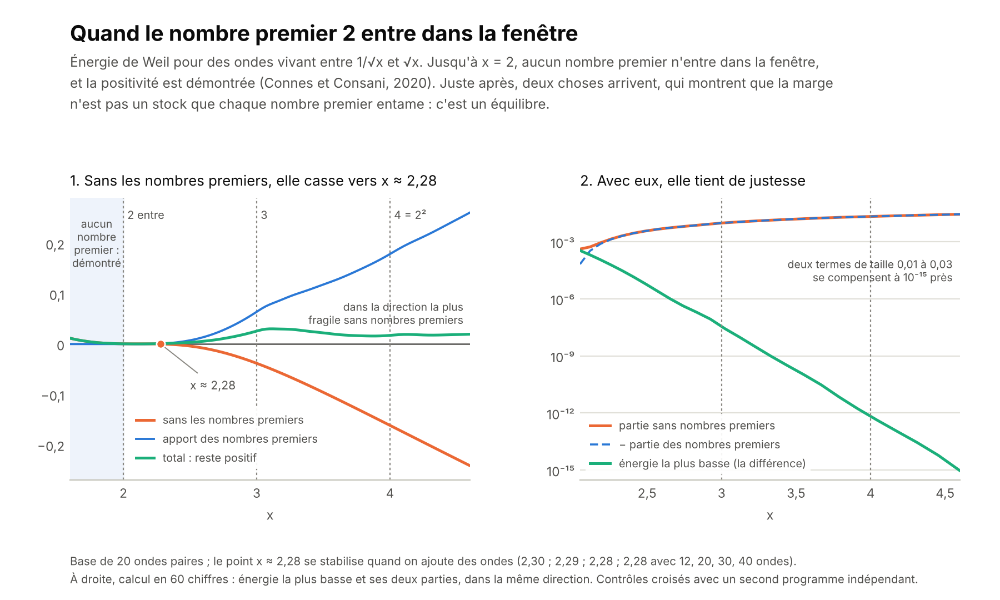

On a regardé la forme de Weil au moment précis où le nombre 2 entre dans la fenêtre (x juste au-dessus de 2), en séparant la partie sans nombres premiers (les pôles et la partie archimédienne) et la partie des nombres premiers.

- **Sans les nombres premiers, la positivité casse vers x ≈ 2,28.** Si l'on retire les nombres premiers, la forme reste positive un peu au-delà de 2, puis devient négative : sa valeur la plus basse vaut −0,04 à x = 3 et −0,16 à x = 4 (avec 20 ondes). Le point de bascule se stabilise quand on ajoute des ondes : 2,30, 2,29, 2,28 et 2,28 avec 12, 20, 30 et 40 ondes. Dans ces directions, c'est le nombre 2, puis 3, puis 4 = 2², qui rattrape ce qui manque.
- **Avec eux, elle tient de justesse.** Dans la direction la plus basse, les deux parties sont de taille 0,01 à 0,03 et se compensent presque exactement : ce qui reste vaut 3·10⁻⁸ à x = 3 et 10⁻¹⁵ vers x = 4,6 (calcul en 60 chiffres).

Ce que cela dit du théorème à démontrer : la marge n'est pas un stock que chaque nombre premier entamerait un peu, c'est un équilibre entre deux grands termes, qui se refait à chaque nombre premier. Une preuve de la première marche ne peut donc pas dire « la partie archimédienne est positive et le nombre 2 est petit » : au-delà de x ≈ 2,28, la partie archimédienne seule est négative. Il faudra un argument où le nombre 2 aide activement. Les spécialistes le savent peut-être ; nous ne l'avons pas trouvé écrit sous cette forme. Programme : [`calculs/weil_entree_2.py`](calculs/weil_entree_2.py).

### La première marche, énoncé précis

Entre x = 2 et x = 3, seul le nombre premier 2 est dans la fenêtre. La première marche de la récurrence de Weil dit alors : pour toute onde paire φ vivant entre 1/√x et √x,

> 2 φ̂(i/2)² − ln π · ∫ φ² + (1/π) ∫₀^∞ φ̂(r)² Re ψ(¼ + ir/2) dr  ≥  √2 · ln 2 · ∫ φ(t) φ(t + ln 2) dt,

avec φ̂(r) = ∫ φ(t) e^(irt) dt, et ψ la dérivée logarithmique de la fonction Γ. À gauche, tout ce qui ne dépend pas des nombres premiers ; à droite, le terme du nombre 2, avec son vrai poids 2 ln 2 / √2 ≈ 0,980258.

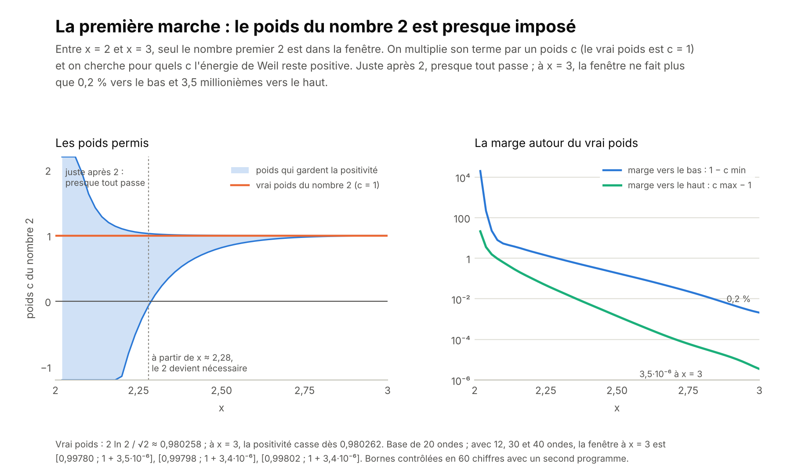

On a multiplié le terme de droite par un poids c, et cherché pour quels c l'inégalité reste vraie. Juste après x = 2, presque tout passe. À partir de x ≈ 2,28, il faut c > 0 : le nombre 2 devient nécessaire. Puis la fenêtre se referme autour du vrai poids, c = 1 : à x = 3, elle va de 0,998 à 1,0000035 (avec 20 ondes ; 1,0000034 avec 40), soit un poids réel compris entre 0,9783 et 0,98026. Les bornes bougent à peine quand on ajoute des ondes, et elles ont été contrôlées en 60 chiffres avec un second programme.

Ce que cela dit : une preuve de la première marche doit être assez fine pour « voir » le poids du nombre 2 au sixième chiffre près ; aucune inégalité grossière n'y suffira. C'est un constat sur un nombre fini d'ondes, pas une preuve, mais il mesure la difficulté de cette marche : elle est déjà très délicate. Programme : [`calculs/poids_du_2.py`](calculs/poids_du_2.py).

### Quand 3 entre à son tour

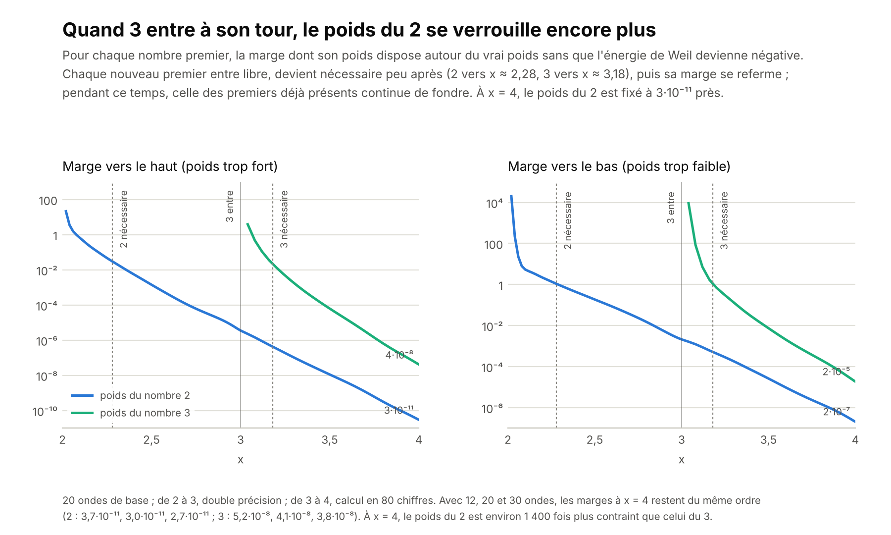

On a refait la même chose entre x = 3 et x = 4, où la fenêtre contient les nombres premiers 2 et 3. Pour chacun, on cherche la marge dont dispose son poids, l'autre restant à son vrai poids (calcul en 80 chiffres).

- **Le même scénario se répète.** Le nombre 3 entre libre (à x = 3,1, tout poids entre −19,5 et 1,2 convient), devient nécessaire vers x ≈ 3,18, puis sa marge se referme : à x = 4, son poids est fixé entre 0,99998 et 1 + 4·10⁻⁸.
- **Pendant ce temps, le poids du 2 se verrouille encore.** Sa marge vers le haut passe de 3,5·10⁻⁶ à x = 3 à 3·10⁻¹¹ à x = 4. À x = 4, le poids du 2 est environ 1 400 fois plus contraint que celui du 3.
- **Les marges sont stables** quand on ajoute des ondes : à x = 4, la marge vers le haut du 2 vaut 3,7·10⁻¹¹, 3,0·10⁻¹¹ et 2,7·10⁻¹¹ avec 12, 20 et 30 ondes.

Ce que cela suggère : plus la fenêtre s'élargit, plus la positivité « connaît » le poids exact de chaque nombre premier, et d'autant mieux que ce nombre premier est entré tôt. C'est l'écho, du côté de la positivité, de ce qu'on a vu avec les ondes : nombres premiers et zéros se déterminent mutuellement. Ce n'est qu'un constat numérique avec 20 à 30 ondes, pas un théorème. Programmes : [`calculs/poids_2_et_3.py`](calculs/poids_2_et_3.py), avec le moteur en haute précision [`calculs/weil_hp.py`](calculs/weil_hp.py).

### La cascade, nombre par nombre

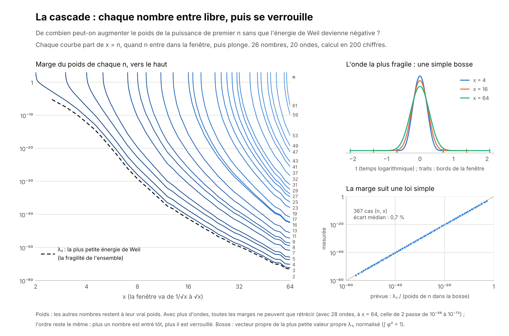

On a continué au-delà de 3, pour les 26 puissances de nombres premiers jusqu'à 64 : 2, 3, 4 = 2², 5, 7, 8 = 2³, 9 = 3², 11, 13, 16, 17, 19, 23, 25, 27, 29, 31, 32, 37, 41, 43, 47, 49, 53, 59 et 61 (20 ondes, calcul en 200 chiffres). Pour chacune, on a cherché à partir de quand elle devient nécessaire, puis, de x = 2,5 à x = 64, de combien son poids peut bouger, les autres restant à leur vrai poids : 367 cas en tout.

- **Le même scénario pour tous.** Chaque nombre entre libre, devient vite nécessaire, puis se verrouille. Il devient nécessaire à x = 2,29 pour 2 ; 3,18 pour 3 ; 4,19 pour 4 ; 5,14 pour 5 ; 7,11 pour 7 ; 13,14 pour 13 ; 31,31 pour 31 ; 61,60 pour 61. La période de liberté passe de 14 % au-dessus de n pour le nombre 2 à environ 1 % à partir de 17.
- **Plus un nombre est entré tôt, plus il est verrouillé.** À chaque x, l'ordre des marges est exactement l'ordre d'entrée. À x = 64, le poids du 2 ne peut plus monter que de moins de 10⁻⁵⁶, celui du 61, entré juste avant, de moins de 10⁻⁷.
- **C'est toujours « trop » qui casse en premier.** Dans les 367 cas, la marge vers le haut est la plus fine, de 1,7 à 5,5 ordres de grandeur.
- **Une loi simple donne la marge.** Notons φ₁ l'onde d'énergie la plus petite dans la fenêtre, et λ₁ cette énergie (la « fragilité » de l'ensemble, en tirets sur la figure). La marge vers le haut du nombre n est le rapport de deux nombres calculés sur φ₁ : son énergie de Weil, divisée par le terme du nombre n, (2 ln p / √n) ∫ φ₁(t) φ₁(t + ln n) dt. Entre cette loi et la mesure, l'écart médian est de 0,7 % ; au pire, un facteur 2,7, pour un nombre qui vient d'entrer.

**Pourquoi ?** L'onde la plus fragile φ₁ est une simple bosse : positive partout dans la fenêtre (vérifié en 200 chiffres), centrée en t = 0, large d'environ 0,5 à 0,65 à mi-hauteur, quelle que soit la fenêtre (figure, en haut à droite). C'est « la meilleure onde » du début de cette page : son énergie, calculée avec les nombres premiers, est presque nulle, et si l'hypothèse est vraie, cela veut dire qu'elle se tait presque exactement à chaque zéro de ζ. Pour cette bosse, la partie archimédienne et les nombres premiers se compensent donc presque parfaitement. Comme elle est positive, l'intégrale ∫ φ₁(t) φ₁(t + ln n) dt l'est aussi, et chaque nombre premier compte en négatif : en ajouter, même très peu, fait passer l'énergie sous zéro. Plus n est petit, plus la bosse décalée de ln n se recouvre elle-même, plus n pèse lourd dans l'équilibre, et plus il est verrouillé.

**Les vraies marges sont encore plus fines.** Les 20 ondes de base sont aussi les 20 premières de la famille de 28 : en ajoutant des ondes, les marges et les périodes de liberté ne peuvent que rétrécir. Avec 28 ondes, à x = 64, la marge du 2 passe de 10⁻⁵⁶ à 10⁻⁷², et la période de liberté de 31 passe de 1 % à 0,6 % ; l'ordre, le signe et la loi restent les mêmes (écart médian 0,6 %). Avec 60 ondes, λ₁ vaut déjà 2·10⁻⁹⁹ à x = 31 (tableau du début). Nos chiffres sont donc des bornes larges, et nous ne savons pas si, avec toutes les ondes, la période de liberté tend vers zéro. Programme : [`calculs/cascade_weil.py`](calculs/cascade_weil.py).

## Russell, les ensembles et les jeux

Le paradoxe de Russell (très bien expliqué par Jeffrey Kaplan dans sa vidéo *Russell's Paradox*) vient d'une règle trop généreuse : « pour toute collection imaginable, il existe un ensemble ». Appliquée à R = {x : x ne se contient pas}, elle fait que R se contient si et seulement s'il ne se contient pas. On s'en est sorti en restreignant la règle (on ne découpe un ensemble que dans un ensemble déjà là) ou en empilant des niveaux (les types de Russell).

Un paradoxe sert à démontrer qu'une chose n'existe pas. Or l'hypothèse de Riemann est un énoncé d'inexistence : aucun zéro hors de la droite. Une preuve « à la Russell » supposerait un tel zéro, fabriquerait avec lui un objet qui parle de lui-même, et en tirerait une contradiction. Ces objets, on sait les fabriquer ; ce qui manque, c'est la « règle n° 1 » de ζ, la loi que le zéro fautif violerait.

| Russell | Riemann |
|---|---|
| Règle n° 1 : toute collection est un ensemble | La loi de ζ, encore inconnue (produit d'Euler, symétrie, positivité ?) |
| R = {x : x ∉ x} | Un zéro hors de la droite, qui n'est pas son propre reflet |
| R ∈ R ? | ζ s'imite-t-elle elle-même ? |
| La sortie : empiler des niveaux (les types) | Les fenêtres de Weil, où les nombres premiers entrent un par un |

### ζ s'imite-t-elle elle-même ?

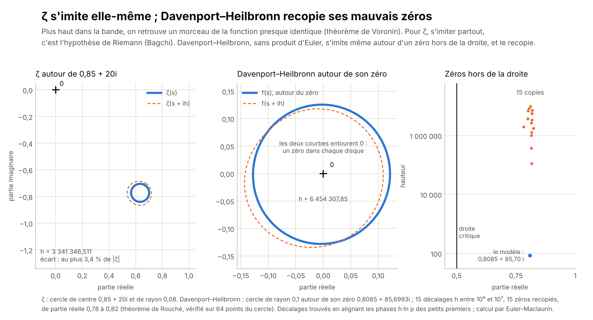

- **Voronin (1975)** : dans la bande ½ < Re s < 1, ζ imite n'importe quelle fonction qui ne s'annule pas. En montant assez haut, on trouve un morceau de ζ qui lui ressemble autant qu'on veut.
- **Bagchi (1981)** : l'hypothèse de Riemann équivaut à « ζ s'imite elle-même », c'est-à-dire ζ(s + ih) ≈ ζ(s) sur n'importe quel disque de la bande, pour une proportion positive de décalages h. C'est la question « x ∈ x ? » posée à ζ.
- **Le cas autoréférent est le seul qui résiste.** On a démontré que ζ à la hauteur d·h ressemble à ζ à la hauteur h pour tout rapport d irrationnel (Nakamura, Pańkowski, Garunkštis). Le cas d = 0, où ζ doit imiter une copie fixe d'elle-même, est l'hypothèse.

**Le calcul.** On cherche des décalages h qui alignent les phases h·ln p des petits nombres premiers : alors p^(−ih) ≈ 1, et le produit d'Euler de ζ(s + ih) ressemble à celui de ζ(s). On trie ces décalages avec le produit d'Euler jusqu'à 20 000, puis on calcule ζ exactement (Euler–Maclaurin).

- **ζ** : avec h = 3 341 346,511, ζ(s + ih) reproduit ζ(s) à 3,4 % près sur un disque de rayon 0,08 autour de 0,85 + 20i. La ressemblance est locale : un peu plus loin, les deux fonctions divergent, et une meilleure copie demanderait de monter beaucoup plus haut.
- **Davenport–Heilbronn** (même symétrie que ζ, pas de produit d'Euler) s'imite aussi autour de son zéro hors de la droite, 0,8085 + 85,6993i. Et s'imiter autour d'un zéro, c'est le recopier : pour 15 décalages h entre 10⁵ et 10⁷, le disque décalé contient un nouveau zéro hors de la droite, de partie réelle 0,78 à 0,82 (par exemple 0,817324 + 6 454 393,548458i). Le théorème de Rouché le garantit, vérifié sur 64 points du cercle.

**Ce que ça montre.** Si ζ avait un zéro hors de la droite et s'imitait autour de lui, elle le recopierait sans cesse, comme Davenport–Heilbronn : au moins de l'ordre de T copies jusqu'à la hauteur T. Or le produit d'Euler l'interdit : jusqu'à la hauteur T, ζ a beaucoup moins de T zéros à droite de n'importe quelle droite Re s = σ > ½ (théorèmes de densité). Donc « ζ s'imite partout » entraîne l'hypothèse : c'est le sens facile du théorème de Bagchi, et il passe par le produit d'Euler, exactement comme le garde-fou de Davenport–Heilbronn l'exige. Le sens difficile, montrer que ζ s'imite partout sans supposer l'hypothèse, reste entier. Programme : [`calculs/auto_imitation.py`](calculs/auto_imitation.py).

### Six autres pistes

- **Le jeu de Weil : les nombres premiers, seule stratégie gagnante.** L'Attaquant choisit une onde, le Défenseur choisit les poids des nombres premiers ; l'Attaquant gagne si l'énergie de Weil devient négative. Notre cascade, c'est ce jeu joué fenêtre par fenêtre, et la bosse est la meilleure attaque. Un petit raisonnement, à faire relire par un spécialiste : si l'hypothèse est vraie, les vrais poids sont la seule stratégie gagnante. Les zéros forment une somme de pics positifs ; changer le poids de quelques puissances de premiers, même de 10⁻¹⁰⁰, y ajoute une oscillation de moyenne nulle, qui devient négative entre deux zéros, et la positivité tombe (théorème de Bochner). Ce qui manque, c'est l'existence d'un gagnant : von Neumann et Nash garantissent un équilibre, pas que sa valeur soit positive.
- **Le casino de Möbius.** Un parieur qui mise 1 sur « μ(n) = +1 » à chaque tour gagne M(x) ; l'hypothèse dit que ce gain ne dépasse √x que de très peu (d'un facteur x^ε). L'hypothèse généralisée dit la même chose pour les parieurs périodiques, et la conjecture de Sarnak (2010), plus faiblement, pour tout parieur « simple ». Le parieur qui lit μ gagne tout : une classe de parieurs sans limite rejoue la règle n° 1. La théorie du hasard a dû la restreindre aux parieurs calculables (Church, 1940 ; Martin-Löf, 1966), comme ZF restreint la règle n° 1. Piste : monter l'échelle des parieurs (constants, périodiques, phases polynomiales, nilsuites, contre lesquelles Green et Tao ont montré que μ ne se laisse pas prendre) et chercher par le calcul où μ cesse de paraître au hasard.
- **Une phrase finie : si elle est indécidable, elle est vraie.** L'hypothèse équivaut à « une inégalité vérifiable est vraie pour tout entier n » (Lagarias, 2002), donc à « une équation diophantienne n'a pas de solution » (Davis, Matiyasevich, Robinson, 1976), donc à « une machine de Turing ne s'arrête jamais » (5 372 états, Yedidia et Aaronson, 2016 ; 744 annoncés sans preuve publiée). Si elle était fausse, un calcul fini le prouverait ; si elle est indécidable, elle est donc vraie. L'axiome du choix ou l'hypothèse du continu peuvent servir gratuitement : une preuve qui s'en sert se transforme en preuve sans eux. Le castor affairé, le jeu de Radó : BB(5) = 47 176 870 est démontré depuis 2024 ; connaître la valeur pour la machine de l'hypothèse la déciderait, mais c'est hors de portée.
- **La diagonale positive.** Cantor, Russell, Gödel et Turing utilisent la même diagonale pour fabriquer une contradiction (Lawvere, 1969). Pour les courbes, Weil utilise aussi une diagonale, celle de la surface C × C, mais elle y fabrique de la positivité, et c'est la preuve. Pour ζ, il faudrait la diagonale d'une surface « entiers × entiers » : c'est le programme de Connes et Consani, la piste la plus profonde.
- **Les types de Russell sont nos fenêtres.** Russell empile des niveaux ; Weil aussi : au niveau x, seuls les nombres premiers inférieurs à x existent. La réflexion vers le bas marche déjà : si la positivité échoue, elle échoue dans une fenêtre finie. Il faudrait une réflexion vers le haut, « vrai jusqu'au niveau x, donc au suivant ». En théorie des ensembles, les principes de ce genre sont des axiomes qu'on ne démontre pas : c'est une analogie, mais elle montre où est le saut.
- **Un jeu où les nombres premiers gagnent sans qu'on sache comment.** Dans le jeu de Conway (*Sylver coinage*), on nomme à tour de rôle des entiers qui ne sont pas des sommes des précédents ; celui qui dit 1 perd. Hutchings a montré que commencer par un nombre premier ≥ 5 gagne, par un argument non constructif : on sait qu'une stratégie gagnante existe sans la connaître. Ouvrir par 16 reste un problème ouvert. Leçon : une preuve d'existence par l'absurde n'a pas besoin de construire.

### Le casino de Möbius, calculé

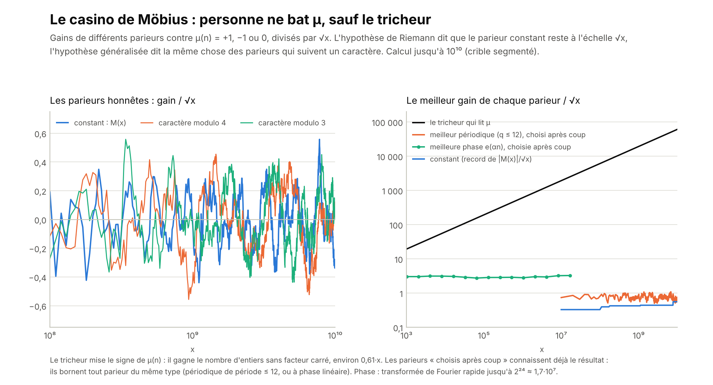

On a fait jouer plusieurs parieurs contre la suite μ(n), jusqu'à 10¹⁰ (crible segmenté, 23 minutes de calcul), et jusqu'à 1,7·10⁷ pour les parieurs à phase.

- **Le parieur constant** gagne M(x). De 10⁸ à 10¹⁰, aux points calculés (tous les 10⁷), |M(x)| reste sous 0,56·√x ; on retrouve M(10¹⁰) = −33 722, la valeur connue.
- **Les parieurs périodiques honnêtes**, qui suivent un caractère de Dirichlet fixé d'avance (modulo 3, 4, 5, 8 ou 12), font de même : au plus 0,63·√x. C'est ce que dit l'hypothèse de Riemann généralisée.
- **Le meilleur parieur périodique choisi après coup**, qui connaît déjà les sommes de chaque classe modulo q ≤ 12 : au plus 1,1·√x. Même en trichant sur le choix de la période, il reste à l'échelle √x.
- **Le parieur à phase linéaire**, qui mise e(αn) et choisit le meilleur α après coup : de 2,7 à 3,3·√x entre 2¹⁰ et 2²⁴. C'est un peu plus que les autres, comme pour une suite tirée au hasard, où choisir α après coup fait gagner un facteur de l'ordre de √(ln x).
- **Le tricheur qui lit μ** gagne le nombre d'entiers sans facteur carré, environ 0,61·x : sa courbe s'envole.

Contre tous les parieurs « simples » essayés, μ se comporte comme une pièce honnête à l'échelle √x. Seul le parieur qui se sert de μ elle-même gagne, comme le laissait prévoir le paradoxe de Russell. Ce n'est pas une preuve : ce sont des parieurs particuliers, sur une plage finie. Programme : [`calculs/casino_mobius.py`](calculs/casino_mobius.py).

### Pairs et impairs : ce qui est vrai pour l'un est-il vrai pour l'autre ?

Bonne intuition, à condition de bien choisir la coupure.

- **Premiers pairs et premiers impairs.** Le seul premier pair est 2. Le « zêta » de {2}, 1/(1 − 2^(−s)), a tous ses pôles sur la droite Re s = 0, espacés de 2π/ln 2 ≈ 9,06 : un cristal parfait, avec une « hypothèse de Riemann » vraie et triviale. Il en va de même pour tout ensemble fini de nombres premiers : un produit fini n'a aucun zéro. Le zêta des premiers impairs, (1 − 2^(−s)) ζ(s), a exactement les mêmes zéros que ζ dans la bande : son hypothèse est l'hypothèse tout entière. Les zéros naissent de l'infinité des nombres premiers, pas d'une partie finie ; comme pour Pólya, « vrai pour chaque partie finie » ne passe pas à la limite.
- **Les premiers ≡ 1 et ≡ 3 modulo 4.** Là, l'intuition est juste. Les deux équipes entendent les mêmes notes, les zéros de ζ et ceux de L(s, χ₄), mais l'équipe 3 entend les notes de χ₄ à l'envers, ce qui crée la course calculée plus haut. Si les premiers ≡ 1 suivent leur loi à √x près, c'est que ni ζ ni L(s, χ₄) n'a de zéro hors de la droite, et les premiers ≡ 3 la suivent aussi. La réciproque est vraie, sauf si ζ et L(s, χ₄) partageaient un zéro hors de la droite, ce que personne ne croit mais que personne n'a exclu. L'équivalence dit seulement que les deux moitiés sont aussi difficiles l'une que l'autre.
- **Les nombres à nombre pair ou impair de facteurs premiers.** C'est la version la plus profonde de l'idée. L'hypothèse revient à dire que ces deux ensembles s'équilibrent à √x près : c'est le L(x) de Pólya. Et Selberg a montré que les méthodes de crible ne voient pas la différence entre les deux : pour elles, ce qui est vrai pour l'un est vrai pour l'autre, et c'est précisément pourquoi elles ne peuvent pas atteindre ce genre d'énoncé (le « problème de la parité »). Friedlander et Iwaniec ont franchi cette barrière en 1998 pour les nombres premiers de la forme a² + b⁴, grâce à une structure supplémentaire. Leçon : pour démontrer l'hypothèse, il faut un outil qui casse cette symétrie.

## Copier les démonstrations

Là où une « hypothèse de Riemann » a été démontrée, on peut suivre la démonstration pas à pas et chercher l'étape où sa copie pour ζ casse.

| Démonstration | Son idée | La copie pour ζ | Où elle casse |
|---|---|---|---|
| Weil, courbes (1948) | Sur la surface C × C, une inégalité de géométrie (Castelnuovo), appliquée à la diagonale et au graphe du Frobenius, donne \|N − q − 1\| ≤ 2g√q | Nos matrices de Weil jouent le rôle de C × C, la formule explicite celui du comptage des points | Le « genre » de ζ est infini : la borne 2g√q ne dit plus rien. Il faudrait la positivité exacte d'une surface « entiers × entiers » |
| Stepanov, Bombieri (1969, 1973) | Un polynôme auxiliaire s'annule très fort en tous les points de la courbe, grâce au Frobenius x ↦ x^q | Une fonction qui s'annulerait très fort en tous les nombres premiers | Les entiers n'ont pas de Frobenius |
| Deligne (1974) | Une borne grossière, valable pour toutes les puissances tensorielles, donne à la limite la borne exacte | Les inégalités de positivité de Mertens, 3 + 4 cos θ + cos 2θ ≥ 0 | Pour ζ, elles n'écartent les zéros que d'une bande collée à Re s = 1, jamais jusqu'à la droite ½ |
| Lee et Yang (1952) | On ajoute les spins un par un sans créer de zéro dans le disque ; la symétrie z ↔ 1/z met les zéros sur le cercle | Avec z_p = p^(−s), le « cercle » \|z_p\| = p^(−½) est exactement la droite critique, et s ↔ 1 − s devient z_p ↦ 1/(p·z_p) | Dans la bande, ζ n'est pas un polynôme en les z_p. Les copies partielles existent : Gonek (2007) construit des approximations par produits d'Euler finis qui vérifient l'hypothèse, sauf peut-être un nombre fini de zéros ; Gonek et Montgomery (2013) montrent que les approximations symétriques Σ_{n≤N} n^(−s) + χ(s) Σ_{n≤N} n^(s−1) ont 100 % de leurs zéros sur la droite. Il manque, là encore, le passage à la limite |
| Polynômes de Jensen (Pólya 1927 ; Griffin, Ono, Rolen, Zagier 2019) | Des polynômes à racines réelles qui approchent ξ | L'hypothèse équivaut à « tous les polynômes de Jensen de ξ ont des racines réelles » | C'est démontré pour chaque degré à partir d'un certain rang ; il faudrait tous les degrés, dès le début |
| de Bruijn, Newman, Polymath15 (1950–2019) | La chaleur rend les zéros réels à partir d'un instant Λ | 0 ≤ Λ ≤ 0,2 | L'hypothèse est Λ = 0 : la marge disparaît |
| Selberg (1956) | Un laplacien autoadjoint : ses fréquences sont forcément réelles | Connes, Consani et Moscovici (2025) : un opérateur autoadjoint fabriqué avec les seuls nombres premiers ≤ x | Deux étapes manquent ; on les a vérifiées par le calcul (ci-dessous) |

### Recopier Selberg : les étapes manquantes, vérifiées

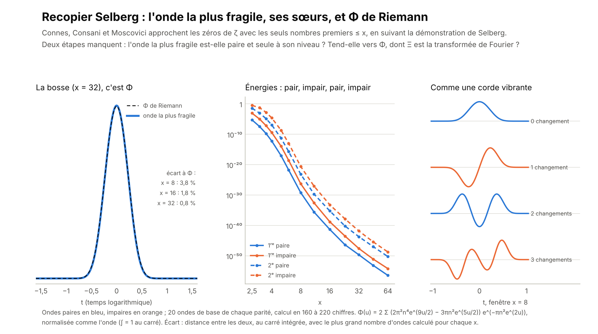

Connes, Consani et Moscovici suivent le plan de Selberg, puis passent à la limite :

1. On restreint l'énergie de Weil aux ondes vivant entre 1/√x et √x ; seuls les nombres premiers ≤ x interviennent (ce sont nos matrices).
2. On prend l'onde d'énergie la plus petite. **Étape manquante** : ils supposent qu'elle est paire et seule à son niveau (énergie simple), et signalent que c'est à vérifier.
3. Sa transformée de Fourier n'a que des zéros réels : ils le démontrent (sous les hypothèses de l'étape 2), ce sont les fréquences d'un opérateur autoadjoint.
4. **Étape manquante** : quand x grandit, cette transformée tend vers Ξ. C'est observé, pas démontré.
5. Théorème de Hurwitz : une limite de fonctions à zéros réels n'a que des zéros réels. D'où l'hypothèse de Riemann. Ils écrivent qu'une preuve rigoureuse de la convergence l'établirait.

Ce que nos calculs ajoutent :

- **L'étape 2 tient dans toutes nos fenêtres.** De x = 2,5 à x = 64, on a calculé à part les ondes paires et les ondes impaires (20 de chaque, en 220 chiffres ; nos ondes s'annulent aux bords de la fenêtre, les leurs sont un peu différentes). La plus petite énergie est toujours celle d'une onde paire, 119 à 1 485 fois plus basse que la meilleure onde impaire, et elle est seule à son niveau : la suivante est 7 100 à 1,5 million fois plus haute. Le résultat est le même avec 28 ondes de chaque parité (x = 8, 16 et 32). Mieux, les énergies alternent pair, impair, pair, impair, et la k-ième onde change k − 1 fois de signe, comme les modes d'une corde vibrante (théorème de Sturm). C'est cette structure qu'il faudrait démontrer pour obtenir l'étape 2.
- **L'étape 3 vaut aussi pour nos ondes**, construites autrement que les leurs. Avec les suites de Sturm (comptage exact des racines réelles d'un polynôme, en 300 chiffres), tous les zéros de la transformée de Fourier de notre onde la plus fragile sont réels, dans 10 cas sur 10.
- **Étape 4 : la bosse devient la fonction Φ de Riemann.** Ξ est la transformée de Fourier d'une fonction connue depuis Riemann et Pólya, Φ(u) = 2 Σ (2π²n⁴e^(9u/2) − 3πn²e^(5u/2)) e^(−πn²e^(2u)), une bosse positive. Dire que l'approximation tend vers Ξ, c'est dire que l'onde la plus fragile tend vers Φ. C'est ce qu'on voit : l'écart vaut 3,8 % à x = 8, 1,8 % à x = 16 et environ 0,8 % à x = 32 (avec 140 ondes en 560 chiffres ; à x = 32, le résultat bouge encore un peu) : il est à peu près divisé par deux quand x double. Et c'est cette bosse positive qui expliquait la cascade : tous les nombres premiers y comptent en négatif.

Rien de tout cela n'est une démonstration : les étapes 2 et 4 restent à démontrer pour toutes les fenêtres, on les a seulement vues à l'œuvre sur des familles finies d'ondes. Mais c'est la copie où il reste le moins à faire : toutes les étapes y sont, et les deux qui manquent se vérifient. Programme : [`calculs/copie_selberg.py`](calculs/copie_selberg.py).

## Ce qu'on peut démontrer, et ce qui reste

L'hypothèse de Riemann n'est pas démontrée ici : personne ne sait le faire. Mais une partie de ce qu'on a observé se démontre vraiment, en quelques lignes. Le reste se ramène à deux conjectures précises.

### Démontré

**Théorème 1 (le jeu de Weil n'a qu'un gagnant).** Si l'hypothèse de Riemann est vraie, on ne peut pas changer les poids d'un nombre fini de puissances de premiers, même d'aussi peu qu'on veut, sans que l'énergie de Weil devienne négative pour une onde bien choisie.

*Démonstration.* Si l'hypothèse est vraie, l'énergie d'une onde φ vaut Σ_γ |φ̂(γ)|², somme sur les zéros. Changer les poids c_n (au lieu de 1) retranche ∫ |φ̂(r)|² F(r) dr, avec F(r) = (1/π) Σ_n (c_n − 1) Λ(n) n^(−½) cos(r ln n). F est une somme finie et non nulle de cosinus de fréquences ln n > 0 : sa moyenne est nulle, donc elle est strictement positive sur un petit intervalle. Les zéros étant isolés, on y choisit une fréquence r₀ à distance δ > 0 de tous les ±γ. On prend l'onde φ_L(t) = L^(−½) χ(t/L) cos(r₀t), où χ est une bosse lisse fixée. Quand L grandit, |φ̂_L|² se concentre autour de ±r₀ : la somme sur les zéros tend vers 0, tandis que ∫ |φ̂_L|² F tend vers π‖χ‖² F(r₀) > 0. L'énergie devient négative. ∎

C'est la version « à l'infini » de notre cascade, qui mesure à quelle vitesse les fenêtres finies verrouillent les poids. Le résultat est simple, et sans doute connu des spécialistes sous une autre forme.

**Lemme 2 (la loi de la marge est une borne).** Dans une fenêtre donnée, soit λ₁ la plus petite énergie, φ₁ l'onde (normalisée) qui la réalise, et s le terme du nombre n dans l'énergie de cette onde. Si s < 0, on ne peut pas augmenter le poids de n de plus de λ₁/|s| sans casser la positivité.

*Démonstration.* Pour l'onde φ₁, l'énergie avec le poids augmenté de t vaut exactement λ₁ + t·s, qui s'annule pour t = λ₁/|s|. ∎

Dans les 430 cas calculés (367 avec 20 ondes, 63 avec 28), la marge mesurée ne dépasse jamais cette borne et la suit à 0,7 % près en médiane. L'écart est petit quand la deuxième énergie est très au-dessus de la première, ce qui est le cas ici (de 7 100 à 1,5 million de fois).

**Lemme 3 (si la bosse est positive, chaque premier compte en négatif).** Si φ₁ ≥ 0, alors ∫ φ₁(t) φ₁(t + ln n) dt ≥ 0 pour tout n, donc le terme de chaque puissance de premier, −(2 ln p/√n) ∫ φ₁(t) φ₁(t + ln n) dt, est négatif ou nul. ∎ C'est pourquoi « trop » casse toujours en premier.

**Lemme 4 (si la bosse est de plus log-concave, les petits premiers sont les plus verrouillés).** Si φ₁ est paire, positive et log-concave, son autocorrélation g(u) = ∫ φ₁(t) φ₁(t + u) dt est paire et log-concave (théorème de Prékopa–Leindler), donc décroissante pour u ≥ 0. Comme 2 ln p/√p décroît le long des nombres premiers à partir de 7, le terme |s| = (2 ln p/√p) g(ln p) décroît, et la borne λ₁/|s| croît avec le nombre premier p ≥ 7. ∎ On a vérifié numériquement que Φ et la bosse sont log-concaves (au moins là où la bosse n'est pas minuscule).

**Lemme 5 (pair et impair se séparent).** L'énergie de Weil ne change pas quand on retourne l'onde (t → −t) : ondes paires et impaires ne se mélangent pas. Le terme des pôles vaut +2 (∫ φ ch(t/2) dt)² pour une onde paire et −2 (∫ φ sh(t/2) dt)² pour une onde impaire. ∎ Les pôles poussent donc dans le mauvais sens (ils relèvent les ondes paires et abaissent les impaires) : si l'onde la plus basse est quand même paire, c'est grâce aux nombres premiers et à la partie archimédienne. C'est ce qu'il faudrait démontrer.

S'y ajoutent les théorèmes des autres, sur lesquels on s'appuie : le sens facile du théorème de Bagchi (si ζ s'imite partout, l'hypothèse est vraie), et le théorème de Connes, Consani et Moscovici (pour leur construction, l'approximation n'a que des zéros réels, si l'étape 2 est vraie).

### Ce qui reste : deux conjectures précises

**Conjecture A (la corde vibrante).** Dans toute fenêtre, les énergies de Weil sont simples, alternent pair, impair, pair…, et la k-ième onde propre change k − 1 fois de signe. Vérifiée ici : l'alternance dans 13 fenêtres de x = 2,5 à 64 (20 ondes de chaque parité, et 28 pour x = 8, 16 et 32), les changements de signe pour x = 3, 4, 8, 16, 32 et 64.

**Conjecture B (la bosse devient Φ).** Quand x grandit, l'onde la plus fragile (normalisée) tend vers la fonction Φ de Riemann, avec un écart de l'ordre de 0,3/x. Observé : 3,8 %, 1,8 % et 0,8 % à x = 8, 16 et 32.

Ce qu'elles donneraient : A donne l'étape 2 de la copie de Selberg ; la bosse est alors positive, et le lemme 3 explique que « trop » casse toujours en premier (si elle est de plus log-concave, le lemme 4 explique l'ordre des verrous). B, sous une forme assez forte (les transformées de Fourier convergent sur tout disque du plan complexe), donne l'étape 4. Formulées pour la construction de Connes, Consani et Moscovici, A et B entraîneraient, avec leur théorème et celui de Hurwitz, l'hypothèse de Riemann. Démontrer l'une ou l'autre serait donc un résultat majeur. Nous ne savons pas le faire, et personne ne le sait aujourd'hui.

## Le grand détour par Fourier

On sort un moment de l'hypothèse de Riemann. On prend ses résultats (la formule explicite, les zéros calculés), on les passe dans une transformée de Fourier, et on remonte vers une autre hypothèse : celle des premiers jumeaux. En route, on emprunte à la physique (un graphe quantique), à la chimie (un gaz de nombres premiers), au paradoxe de Russell et à la théorie des jeux.

> **À lire d'abord.** Rien ici ne démontre l'hypothèse de Riemann, ni la conjecture des premiers jumeaux. La plupart des résultats sont connus (Riemann et von Mangoldt, Montgomery, Bogomolny et Keating, Keating et Smith, Kottos et Smilansky, Kurasov et Sarnak) : nous les refaisons avec nos propres programmes, sur nos propres nombres, un crible jusqu'à 10¹⁰ et 138 069 zéros calculés jusqu'à la hauteur 100 000. Ce qui est à nous : deux mesures (le facteur des jumeaux retrouvé dans les seuls zéros, et le volume de la musique des zéros dans chaque écart entre premiers) et un instrument (la « fleur de Fourier »). Nous ne les avons pas trouvés écrits sous cette forme ; un spécialiste les trouverait sans doute attendus.

### La musique des nombres premiers, par paquets d'ondes

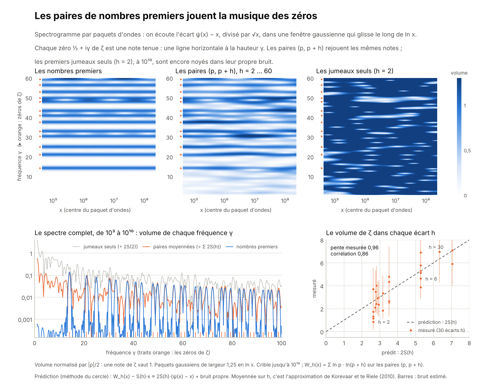

Une transformée de Fourier change une courbe en notes. On la fait par petits paquets : une fenêtre en cloche (une gaussienne) glisse le long de ln x, et pour chaque position on écoute les fréquences présentes, comme dans le spectrogramme d'un morceau de musique. Le morceau, c'est l'écart ψ(x) − x divisé par √x, calculé exactement jusqu'à 10¹⁰.

- **Les zéros sont des notes tenues.** D'après la formule explicite, chaque zéro ½ + iγ ajoute une onde de fréquence γ (en ln x) et de volume 2/|ρ|. Le spectrogramme montre des lignes horizontales exactement aux hauteurs 14,13 ; 21,02 ; 25,01… Les dix premières notes ont le volume prédit à 0,5 % près.
- **Le volume total est donné par une formule.** Si tous les zéros sont sur la droite et simples, la moyenne de (ψ(x) − x)²/x, prise le long de ln x, vaut Σ 1/|ρ|² = 2 + γ − ln 4π, où γ est la constante d'Euler. L'écart-type mesuré de 10³ à 10¹⁰ vaut 0,2145 ; la formule donne 0,2149.
- **Aucun crescendo.** Un zéro β + iγ hors de la droite serait une note qui enfle comme x^(β − ½). Pour chacune des dix premières notes, la pente du volume donne β − ½ entre −0,002 et +0,006. Ce n'est pas un résultat nouveau (on sait que tous les zéros jusqu'à la hauteur 3·10¹² sont sur la droite), mais c'est une façon de lire la partie réelle d'un zéro dans le seul son des nombres premiers.

Programmes : [`calculs/crible_paires.py`](calculs/crible_paires.py) (le crible) et [`calculs/musique_des_paires.py`](calculs/musique_des_paires.py).

### Remonter des zéros jusqu'aux premiers jumeaux

Les zéros se repoussent comme les niveaux d'énergie d'un noyau lourd : c'est la loi GUE de Montgomery et Dyson (1973). Mais cette loi n'est qu'une limite. À hauteur finie, les zéros s'en écartent un peu, et Bogomolny et Keating (1996) ont calculé cet écart : leur formule contient un produit sur tous les nombres premiers, celui de la conjecture de Hardy et Littlewood (1923) sur les paires de premiers. Keating et Smith (2019) ont montré, par un calcul formel (sans démonstration rigoureuse), que ce n'est pas un hasard : la formule des zéros et la conjecture des paires sont équivalentes. Les zéros « savent » donc combien il y a de premiers jumeaux.

On le vérifie dans les deux sens.

- **Des premiers vers les zéros.** On a calculé les 138 069 zéros jusqu'à la hauteur 100 000 (formule de Riemann–Siegel ; le 100 000ᵉ tombe à 74 920,8275, la valeur connue). Entre 10⁴ et 10⁵, leur corrélation de paires s'écarte de la loi GUE par des bosses régulières (figure, en haut à gauche). La formule de Bogomolny et Keating les suit : χ² = 64 sur 60 intervalles, contre 556 pour la loi GUE seule. Sans le produit des premiers, plus rien ne colle : χ² = 4 023.
- **Des zéros vers les premiers : on remonte.** On remplace le produit des premiers A(ε) par A(ε)^κ, et on laisse les zéros choisir κ. Hardy et Littlewood disent κ = 1 ; un monde où les premiers voisins ne se « voient » pas dirait κ = 0. Les zéros répondent κ = 0,95 ± 0,01 : à partir des seuls zéros, on retrouve le facteur des premiers jumeaux à 5 % près. L'écart restant vient sans doute des approximations de la formule et de notre moyenne sur les hauteurs.
- **Et les jumeaux eux-mêmes.** Le crible jusqu'à 10¹⁰ compte 27 412 679 paires de jumeaux (la valeur connue) et, pour chaque écart h = 2, 4, …, 60, les paires (p, p + h). Toutes suivent Hardy–Littlewood à 0,016 % près, avec le facteur S(h), qui double quand 3 divise h. Montgomery et Soundararajan (2004) en déduisent la variance du nombre de premiers dans un petit intervalle de longueur H : H·(ln(x/H) + B), plus petite que celle du hasard pur, H·ln x. Mesurée vers 10⁹, elle colle à 1 % près jusqu'à H = 3 000 ; l'écart grandit ensuite, au-delà de H ≈ √x, où la formule cesse de valoir.

Programmes : [`calculs/zeros_riemann_siegel.py`](calculs/zeros_riemann_siegel.py) (les zéros) et [`calculs/zeros_et_jumeaux.py`](calculs/zeros_et_jumeaux.py).

### Les jumeaux ont-ils leur propre musique ?

Si les zéros connaissent les jumeaux, les jumeaux devraient jouer la musique des zéros. Un raisonnement simple le prédit : là où les premiers sont un peu plus nombreux que prévu, d'un facteur 1 + ε, les paires le sont d'un facteur (1 + ε)², soit environ 1 + 2ε. L'écart des paires (p, p + h) à Hardy–Littlewood devrait donc contenir l'écart des premiers, multiplié par 2S(h) :

W_h(x) − S(h)·x ≈ 2S(h)·(ψ(x) − x) + un bruit propre aux paires,

où W_h(x) = Σ ln p · ln(p + h), sur les paires jusqu'à x. Le même calcul, fait avec la méthode du cercle de Hardy et Littlewood, donne la même prédiction ; c'est une heuristique, pas un théorème. Moyennée sur h, c'est l'approximation proposée par Korevaar et te Riele (2010), qui l'ont testée jusqu'à 10¹².

- **Toutes les paires ensemble : oui.** On moyenne les 30 écarts h = 2 … 60 (figure, au milieu). Les notes de ζ réapparaissent, au bon volume (0,97 en moyenne, pour 1 prédit) et en phase (décalage de moins de 0,25 radian sur les douze premières notes).
- **Écart par écart : le volume suit 2S(h).** Pour chaque h, on mesure le volume de la musique de ζ dans l'écart des paires (figure, en bas à droite). La pente vaut 0,96 et la corrélation 0,86 : les écarts multiples de 6, deux fois plus fréquents, jouent la musique deux fois plus fort. Nous n'avons pas trouvé cette mesure écart par écart dans la littérature.
- **Les jumeaux seuls : pas encore.** Pour h = 2, la musique de ζ est là en principe, mais le bruit propre des jumeaux est vingt fois plus fort (écart-type 10,6 contre 0,57 pour la partie musicale) : à 10¹⁰, on ne l'entend pas. Il faudrait monter beaucoup plus haut, ou mieux filtrer.

Ce que cela ne dit pas : cette musique est une petite oscillation autour de la prédiction de Hardy–Littlewood. Elle ne dit rien de l'essentiel, l'existence d'une infinité de jumeaux. Ce problème bute sur la barrière de la parité (section « Pairs et impairs ») ; le meilleur résultat démontré est qu'il existe une infinité de paires de premiers à distance au plus 246 (Zhang en 2013, puis Maynard, Tao et le projet Polymath).

### La physique : une fleur de nombres premiers

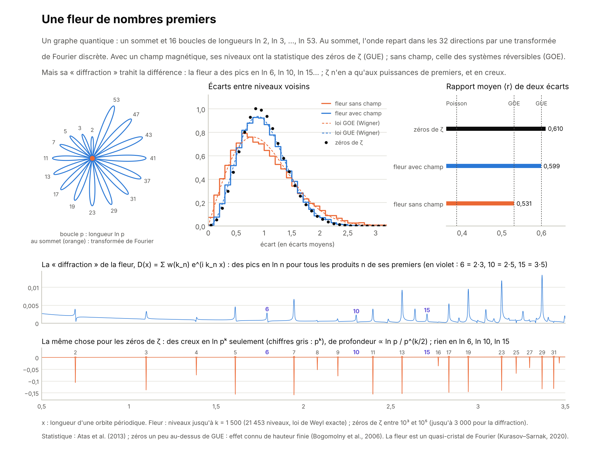

Si les zéros sont les notes d'un instrument (l'idée de Hilbert et Pólya), de quel instrument s'agit-il ? Les physiciens savent fabriquer des instruments quantiques simples, les graphes quantiques (Kottos et Smilansky, 1997) : des fils où une onde circule et se répartit aux carrefours. On en fabrique un avec les nombres premiers : un seul carrefour et 16 boucles de longueurs ln 2, ln 3, ln 5, …, ln 53, comme les pétales d'une fleur. Au carrefour, l'onde repart dans les 32 directions par une transformée de Fourier discrète : chaque direction a la même chance. On calcule ses 21 453 premières notes.

- **Avec un champ magnétique, la fleur joue comme les zéros.** Le rapport moyen de deux écarts successifs vaut 0,599 ; la loi GUE donne 0,600, et les zéros (entre 10³ et 10⁵) 0,610, un peu plus, effet connu de hauteur finie.
- **Sans champ, elle joue autre chose** : 0,531, la loi GOE des systèmes réversibles (ceux dont on peut passer le film à l'envers). C'est la leçon de Michael Berry : puisque les zéros suivent la loi GUE, l'instrument de Riemann, s'il existe, n'est pas réversible ; il contient une sorte de champ magnétique caché. L'opérateur H = xp de Berry et Keating (section « Le photon ») a justement cette propriété.
- **Mais la diffraction trahit la fleur.** La transformée de Fourier des notes révèle les longueurs des trajets fermés (c'est la formule des traces). Pour la fleur, on trouve des pics en ln n pour tous les produits n de ses nombres premiers : faire le tour de la boucle 2, puis celui de la boucle 3, donne un trajet de longueur ln 2 + ln 3 = ln 6. Pour ζ, la formule explicite ne donne que des creux, en ln pᵏ, de profondeur proportionnelle à ln p/p^(k/2), et rien en ln 6, ln 10 ou ln 15.

Deux leçons. D'abord, dans l'instrument de ζ, les trajets ne se combinent pas : seuls comptent les tours répétés d'une même boucle, et c'est le produit d'Euler. Ensuite, le signe est inversé : là où un instrument émet des raies, ζ en absorbe. Alain Connes lit d'ailleurs les zéros comme un spectre d'absorption, des raies noires sur un fond continu. Aucun graphe connu ne fait les deux.

Le spectre de la fleur est un vrai « quasi-cristal de Fourier » : sa diffraction n'a que des pics, parce que ses longueurs ln p sont incommensurables (Kurasov et Sarnak, 2020). C'est le rêve de Dyson (section « Cristal ou quasi-cristal ») réalisé, mais pour la fleur, pas pour ζ. Et Alon, Cohen et Vinzant (2023) ont montré que toute somme d'exponentielles dont les zéros sont tous réels, comme le déterminant de la fleur, vient d'un polynôme de Lee–Yang, ceux des aimants (section « Copier les démonstrations ») : aimants, cristaux et graphes parlent ici de la même chose.

Programme : [`calculs/fleur_de_fourier.py`](calculs/fleur_de_fourier.py).

### La chimie : un gaz de nombres premiers

Imaginons un gaz dont les particules sont les nombres premiers : une particule « p » a l'énergie ln p, et un état du gaz est un entier n = 2^a·3^b·5^c…, qui dit combien il y a de particules de chaque sorte. Sa fonction de partition, la somme qui sert à tout calculer en physique statistique, vaut Σ n^(−β) = ζ(β) : c'est le « gaz de primons » (Julia, Spector, 1990).

- **Le produit d'Euler, c'est un mélange idéal.** Les espèces ne se parlent pas, donc la fonction de partition se factorise, une espèce par nombre premier : ζ(β) = Π 1/(1 − p^(−β)). C'est la définition d'un mélange idéal en chimie.
- **Une température maximale.** Quand β descend vers 1, la somme explose : on ne peut pas chauffer ce gaz au-delà de la température 1, comme le gaz de cordes de la physique (température de Hagedorn).
- **Les fermions et le casino.** Si chaque espèce ne peut être présente qu'une fois (des fermions), il ne reste que les entiers sans facteur carré, et le signe (−1)^(nombre de fermions) est exactement μ(n), la fonction de Möbius. La somme Σ μ(n) n^(−β) = 1/ζ(β) compare les états à nombre pair et à nombre impair de fermions. L'hypothèse de Riemann dit que, jusqu'à l'énergie ln x, les deux s'équilibrent à √x près (au facteur x^ε près) : c'est le casino de Möbius, vu par un physicien (Spector).
- **Les zéros n'existent que pour un gaz infini.** En physique, les zéros de la fonction de partition aux températures complexes (les « zéros de Fisher ») annoncent les transitions de phase. Pour le gaz de primons, ce sont les zéros de ζ (au-delà de la température de Hagedorn, en prolongeant la somme), et l'hypothèse dit qu'ils sont tous sur la droite Re β = ½ : ce serait un « théorème de Lee–Yang » pour le gaz des nombres premiers. Or un mélange fini, avec les premiers jusqu'à P, n'a aucun zéro : un produit fini ne s'annule jamais. Comme les transitions de phase, qui n'apparaissent que pour un système infini (Lee et Yang, 1952), les zéros de ζ naissent seulement quand toutes les espèces sont là. On l'avait vu avec les premiers pairs et impairs : aucune partie finie ne porte l'hypothèse.

### Russell et les ensembles : chaque zéro est-il son propre reflet ?

Au cœur de Riemann, il y a une autoréférence qui ne tourne pas au paradoxe. La cloche de Gauss e^(−πx²) est sa propre transformée de Fourier. Les entiers aussi : la diffraction d'un peigne posé sur les entiers est le même peigne (formule de Poisson). L'ensemble des entiers est son propre dual. De cette autoréférence, Riemann a tiré la symétrie s ↔ 1 − s de ζ, par la fonction thêta : θ(1/t) = √t·θ(t).

Cette symétrie range les zéros par paires de reflets, ρ et 1 − ρ̄, de part et d'autre de la droite critique. L'hypothèse de Riemann dit que chaque zéro est son propre reflet : ρ = 1 − ρ̄, c'est-à-dire Re ρ = ½. C'est la question de Russell, « x ∈ x ? », posée à chaque zéro (deuxième ligne du tableau de la section « Russell, les ensembles et les jeux »). Chez Russell, l'autoréférence sans limite fait tout casser ; chez Riemann, l'autoréférence de Poisson est encadrée, et elle donne une symétrie. Ce qui manque, c'est la raison pour laquelle aucun zéro n'aurait un reflet distinct de lui-même.

### La théorie des jeux : l'attaque par paquets

Le spectrogramme est un jeu. L'Attaquant cherche un zéro hors de la droite : à chaque coup, il choisit un paquet d'ondes, une position x et une fréquence γ, et il gagne s'il entend un crescendo. Le Défenseur, ce sont les nombres premiers. Le critère de Weil (le jeu de Weil, section « Six autres pistes ») dit que l'hypothèse équivaut à : « l'Attaquant ne gagne jamais, quel que soit son paquet ». Jusqu'à 10¹⁰, aucune attaque de la figure ne gagne : pas de note en trop, et les dix premières notes gardent leur volume (|β − ½| ≤ 0,006). C'est bien moins que ce qu'on sait vérifier autrement, mais c'est la même idée, en musique.

Et la « résolution par paquets » marche, mais pour les paires. Un écart h seul, celui des jumeaux, n'entend rien ; la coalition des 30 écarts entend toute la musique. En théorie des jeux, une coalition peut gagner là où chaque joueur seul perd. Ici, c'est un fait de statistique : les bruits des écarts se compensent en partie, la musique s'additionne.

### Ce qu'on retient du détour

1. **Les nombres premiers jouent la musique des zéros** (c'est la formule explicite, connue). On en mesure le volume total (0,2145, pour 0,2149 prédit) et la partie réelle des dix premières notes (½ à 0,006 près).
2. **Des zéros, on remonte au facteur des premiers jumeaux** : κ = 0,95 ± 0,01, pour 1 attendu. C'est l'équivalence de Keating et Smith, vue sur des nombres calculés ici.
3. **En sens inverse, les paires de premiers rejouent la musique des zéros**, au volume 2S(h) (pente mesurée 0,96). Les jumeaux seuls, à 10¹⁰, sont encore trop bruyants pour qu'on l'entende.
4. **Un graphe quantique fait de boucles ln p** reproduit la statistique des zéros avec un champ magnétique, mais pas leur diffraction : ses trajets se combinent, et le signe est inversé. L'instrument de Riemann, s'il existe, est d'un autre genre.
5. **Le gaz de primons et le paradoxe de Russell** disent la même chose autrement : les zéros naissent de l'infinité des espèces, et l'hypothèse demande que chaque zéro soit son propre reflet.

Rien de tout cela ne démontre l'hypothèse de Riemann, ni la conjecture des premiers jumeaux.

## Au final

Ce que toute cette exploration montre, et ce qu'elle ne montre pas.

**L'hypothèse n'est ni démontrée ni contredite.** Tous nos calculs sont compatibles avec elle, et aucun ne la démontre. Quelques petits résultats, eux, sont démontrés (section précédente). La plupart refont, avec nos propres programmes, des calculs connus ; nous l'avons signalé à chaque fois.

**Ce qu'on a appris, en six points.**

1. **Le signe ne compte pas, la taille si.** Pólya demandait que L(x) reste négatif : c'est faux dès 906 150 257. L'hypothèse demande seulement que L(x) reste de l'ordre de √x : c'est ce qu'on observe (au plus 1,36·√x jusqu'au milliard).
2. **Les zéros savent où les courbes repassent.** Leurs ondes retrouvent 906 millions, les régions de la course modulo 4 et le renversement de la course modulo 3 à 608 981 813 029. Deux prédictions restent à vérifier par un calcul exact : vers 2,3·10¹⁹ pour Pólya, vers 6,15·10¹² pour la course modulo 3.
3. **La récurrence de Weil a la bonne forme.** « Vrai pour une fenêtre, donc pour une fenêtre un peu plus grande » : c'est l'énoncé P(x) de Weil. Le premier cas est un théorème (Connes et Consani), et la première marche, quand le nombre 2 entre, s'écrit comme une inégalité précise.
4. **Mais son pas ne peut pas être une estimation.** À chaque nouveau nombre premier, la marge fond (3·10⁻⁸ à x = 3, 3·10⁻⁵⁷ à x = 64 avec 20 ondes, 7·10⁻⁷³ avec 28), et chaque poids se verrouille autour de sa vraie valeur. Un raisonnement par inégalités, qui garderait un peu de jeu d'une marche à la suivante, n'a guère de chance : le jeu tend vers zéro.
5. **Le cas qui parle de lui-même est le seul qui résiste.** ζ ressemble à elle-même à des hauteurs proportionnelles : c'est démontré pour tout rapport irrationnel. S'imiter elle-même sans décalage proportionnel, c'est l'hypothèse (Bagchi). Comme chez Russell, toute la difficulté se concentre dans l'autoréférence.
6. **Les zéros parlent aussi des premiers jumeaux.** Des zéros calculés ici, on retrouve le facteur de Hardy–Littlewood des jumeaux (κ = 0,95 ± 0,01) ; en sens inverse, chaque écart h entre premiers rejoue la musique des zéros au volume 2S(h). Ce sont des fluctuations autour de la conjecture, pas la conjecture : l'infinité des jumeaux reste ouverte.

**Ce que cela dit de la preuve à trouver.** Pour l'onde la plus fragile, la positivité de Weil est une égalité presque parfaite entre la partie archimédienne et les nombres premiers, de plus en plus serrée à mesure que la fenêtre s'élargit. Une démonstration devra donc très probablement venir d'une structure exacte, qui rende la positivité automatique : une géométrie pour les courbes (Weil, Deligne), un opérateur autoadjoint pour les surfaces (Selberg), une récurrence algébrique exacte pour les aimants (Lee et Yang). Nos calculs ne disent pas laquelle ; ils expliquent pourquoi il en faut sans doute une.

**La copie la plus avancée.** Parmi les démonstrations voisines, celle de Selberg, recopiée par Connes, Consani et Moscovici, est celle où il reste le moins à faire : deux étapes, que nos calculs voient à l'œuvre (l'onde la plus fragile est paire et seule à son niveau, et elle tend vers la fonction Φ de Riemann). D'après eux, les démontrer suffirait à démontrer l'hypothèse.

**Ce qui est peut-être nouveau.** Trois constats, que nous n'avons pas trouvés écrits sous cette forme : le scénario « libre, nécessaire, verrouillé » pour chaque puissance de premier ; la loi de la marge ; l'ordre « plus tôt entré, plus verrouillé ». Ils découlent assez directement de ce qu'on sait sur l'onde la plus fragile (Connes, Consani, Moscovici) : quand une seule énergie est presque nulle, la moindre retouche se lit sur elle. Un spécialiste les trouverait sans doute attendus. Ce sont des observations numériques sur des familles finies d'ondes, pas des théorèmes, tout comme les deux prédictions ci-dessus. Le grand détour par Fourier ajoute deux mesures du même genre : le facteur des jumeaux retrouvé dans les seuls zéros (κ = 0,95), et le volume 2S(h) de la musique des zéros dans chaque écart h (pente 0,96) ; la version moyennée de la seconde est due à Korevaar et te Riele (2010).

**Et l'intuition de départ ?** « Si c'est vrai sur une partie, des harmoniques et une symétrie le rendent vrai partout. » Dans sa forme, l'intuition est juste : c'est ainsi qu'on a démontré l'hypothèse pour les courbes, et c'est la forme du critère de Weil. Ce qui manque pour ζ, c'est l'outil qui transporte une égalité exacte d'une fenêtre à la suivante. Personne ne l'a trouvé : c'est là qu'est toute la difficulté de l'hypothèse de Riemann.

## Ce qu'il faudrait ajouter

- **Une géométrie** qui écrive l'énergie comme une somme de carrés, comme la surface « courbe × courbe » le fait pour les courbes modulo p. C'est le rêve du « corps à un élément » et le programme d'Alain Connes.
- **Un instrument** : un opérateur dont les fréquences propres seraient exactement les γ, ce qui les mettrait forcément sur la droite (idée de Hilbert et Pólya). Connes, Consani et Moscovici (2025) en construisent des approximations à partir des seuls nombres premiers ≤ x. Avec les premiers jusqu'à 13, ils retrouvent déjà le premier zéro à 10⁻⁵⁵ près. Ils écrivent qu'une preuve rigoureuse que leur construction converge établirait l'hypothèse.
- **Une idée analytique nouvelle.** 2026 rappelle que les murs tombent parfois : si la « quasi-Riemann » est confirmée, une barrière vieille de plus d'un siècle est tombée.

## La carte des pistes

| Piste | L'idée | Où on en est | Ce qui bloque |
|---|---|---|---|
| Compter les zéros sur la droite | Une part toujours plus grande des notes est « accordée » | Plus des 2/3 (2026) | Une proportion, même 100 %, ne suffit pas |
| Rétrécir la bande | Interdire aux zéros de trop s'éloigner | Bande 1/12–11/12 annoncée (2026) ; Guth et Maynard (2024) : les zéros hors de la droite, s'il y en a, sont plus rares qu'on ne savait le montrer | Réduire la bande à la droite elle-même |
| Vérifier par calcul | Contrôler les notes une à une | Tous les zéros jusqu'à la hauteur 3·10¹² sont sur la droite, soit plus de 10 000 milliards | Il en restera toujours une infinité |
| La « chaleur » (de Bruijn–Newman) | On fait diffuser la fonction comme de la chaleur ; ses zéros deviennent réels à partir d'un instant Λ | 0 ≤ Λ ≤ 0,2 ; l'hypothèse revient à Λ = 0 | Faire descendre 0,2 jusqu'à 0 |
| La positivité (Weil) | Une énergie toujours positive | Équivalent exact ; vérifiée ici jusqu'à x = 64 avec 20 à 28 ondes ; chaque poids premier s'y verrouille | Il faut toutes les ondes, x → ∞ ; sans les nombres premiers, elle casse dès x ≈ 2,28 |
| L'instrument caché (Hilbert–Pólya, Connes) | Les zéros comme fréquences propres | Écarts entre zéros semblables aux niveaux d'énergie des noyaux lourds (Montgomery, Odlyzko) | Personne n'a trouvé l'opérateur |
| Les quasi-cristaux (Dyson) | Des zéros ordonnés sans être périodiques, dont la « diffraction » tombe sur les ln p | Programme proposé en 2009 ; « quasi-cristaux de Fourier » étudiés activement | Classer tous les quasi-cristaux à une dimension |
| Les premiers jumeaux (Hardy–Littlewood) | Les paires de premiers et les corrélations des zéros, deux faces d'une même conjecture (Keating–Smith) | Vérifiée ici à 0,016 % près jusqu'à 10¹⁰ ; démontré : une infinité de paires à distance au plus 246 | La barrière de la parité |
| Les graphes quantiques (Berry, Kottos–Smilansky, Kurasov–Sarnak) | Un instrument fait de boucles de longueur ln p | La statistique GUE des zéros, reproduite avec un champ magnétique | Les trajets se combinent (ln 6 = ln 2 + ln 3) et le signe est inversé |
| Les courbes modulo p (Hasse, Weil, Deligne) | Le même énoncé dans un autre monde | **Démontré** | Aucun équivalent connu pour les entiers |

## Projets pour continuer

1. **Pousser Weil plus loin** avec le carnet : augmenter la précision, le nombre d'ondes et x, essayer d'autres familles d'ondes.
2. **Le contre-essai de Weil** : les zéros hors de la droite de la fonction de Davenport–Heilbronn sont maintenant calculés (section « Peut-on raisonner par récurrence ? ») ; reste à lui faire passer le test de Weil et à regarder son « énergie » devenir négative.
3. **Faire vérifier les prédictions.** La région 2,3·10¹⁹ pour Pólya et la région 6,15·10¹² pour la course modulo 3 demandent un calcul exact, hors de portée ici, mais à la portée de spécialistes.
4. **Comprendre la bosse.** Pourquoi l'onde la plus fragile est-elle toujours une bosse positive ? Si on le démontrait, l'ordre « plus tôt entré, plus verrouillé » et le fait que « trop » casse toujours en premier deviendraient des théorèmes. Et refaire la cascade avec 60 ou 100 ondes, pour des marges stabilisées.
5. **Là où l'hypothèse a failli tomber** : zoomer sur la paire de Lehmer, à la hauteur 7005.
6. **Le jeu de Weil dans toutes les directions** : mesurer l'ensemble des poids gagnants dans toutes les directions, pas seulement un poids à la fois, et vérifier qu'il se resserre partout autour des vrais poids.
7. **Démontrer l'étape 2 de la copie de Selberg** : montrer que les ondes propres de l'énergie de Weil alternent pair, impair, pair… comme celles d'une corde vibrante. Pour un problème voisin, Slepian l'a fait avec un opérateur différentiel qui commute (les fonctions « prolates ») ; Connes, Consani et Moscovici relient justement l'énergie de Weil à ces fonctions.
8. **Entendre les jumeaux seuls.** À 10¹⁰, la musique des zéros est vingt fois plus faible que leur bruit propre. Monter vers 10¹³ ou 10¹⁴ (un crible segmenté en parallèle), ou trouver un meilleur filtre, pour l'entendre dans les seuls jumeaux.
9. **Une fleur sans combinaisons.** Chercher des conditions au carrefour dont la diffraction n'ait que des creux en ln pᵏ, de profondeur ln p/p^(k/2). Ce serait un pas vers l'instrument de Hilbert et Pólya ; personne ne sait le faire, et c'est peut-être impossible avec un graphe.
10. **Lire** : *La Symphonie des nombres premiers* de Marcus du Sautoy, et *Prime Numbers and the Riemann Hypothesis* de Barry Mazur et William Stein (en anglais).

## Sources

- *Quanta Magazine*, 19 octobre 2026 : [l'hypothèse de quasi-Riemann](https://quantamagazine.org/ai-proved-the-quasi-riemann-hypothesis-what-happens-now-20261019)
- L. Alpöge, R. Furman : [arXiv 2608.13637](https://arxiv.org/pdf/2608.13637) ; Y. Lamzouri : [arXiv 2609.02882](https://arxiv.org/pdf/2609.02882)
- A. Connes, C. Consani : [arXiv 2106.01715](https://arxiv.org/abs/2106.01715) ; A. Connes, C. Consani, H. Moscovici : [arXiv 2511.22755](https://arxiv.org/abs/2511.22755)
- A. Groskin : [arXiv 2605.20224](https://arxiv.org/abs/2605.20224)
- D. Platt, T. Trudgian : [arXiv 2004.09765](https://arxiv.org/abs/2004.09765) ; L. Guth, J. Maynard : [Annals of Mathematics](https://annals.math.princeton.edu/2026/203-2/p06)
- F. Dyson, *Birds and Frogs* (2009) : [les zéros comme quasi-cristal](https://empslocal.ex.ac.uk/people/staff/mrwatkin/zeta/dyson-quasicrystal.htm)
- [Paire de Lehmer](https://en.wikipedia.org/wiki/Lehmer_pair) ; [fonction de Davenport–Heilbronn](https://arxiv.org/pdf/1602.06328) ; E. Saias, A. Weingartner, une infinité de zéros hors de la droite : [arXiv 0807.0783](https://arxiv.org/abs/0807.0783)
- R. Schoof, [la preuve de Stepanov et Bombieri pour les courbes](https://www.mat.uniroma2.it/~schoof/RHcurves.pdf)
- [Conjecture de Pólya](https://en.wikipedia.org/wiki/P%C3%B3lya_conjecture) ; S. Kim, P. Q. Nguyen, conjecture de Mertens : [arXiv 2502.21021](https://arxiv.org/pdf/2502.21021) ; P. Borwein, R. Ferguson, M. Mossinghoff, changements de signe de L(n) : [Mathematics of Computation, 2008](https://www.ams.org/mcom/2008-77-263/S0025-5718-08-02036-X/)
- J. Büthe, π(x) < li(x) jusqu'à 10¹⁹ : [Mathematics of Computation, 2018](https://www.ams.org/journals/mcom/2018-87-312/S0025-5718-2017-03264-6) ; D. Platt, T. Trudgian, premier changement de signe : [arXiv 1407.1914](https://arxiv.org/pdf/1407.1914)
- A. Connes, C. Consani, positivité de Weil à la place archimédienne : [arXiv 2006.13771](https://arxiv.org/abs/2006.13771) ; Polymath15, Λ ≤ 0,22 : [arXiv 1904.12438](https://arxiv.org/abs/1904.12438)
- P. Humphries, [sommes pondérées de la fonction de Liouville](https://discovery.ucl.ac.uk/id/eprint/1569441/1/Humphries_the_distribution_of_weighted_sums_of_the_liouville.pdf) ; M(x) ≪ x^(½ + ε) équivaut à l'hypothèse (Littlewood) : [AIM](https://aimath.org/WWN/rh/articles/html/96a/)
- A. Granville, G. Martin, [Prime Number Races](https://arxiv.org/abs/math/0408319) (2006) ; C. Bays, R. Hudson, zéros de L(s, χ₄) et renversements de la course : [Mathematics of Computation, 2000](https://www.ams.org/journals/mcom/2000-69-230/S0025-5718-99-01105-9/S0025-5718-99-01105-9.pdf)
- M. Griffin, K. Ono, L. Rolen, D. Zagier, polynômes de Jensen : [arXiv 1902.07321](https://arxiv.org/abs/1902.07321) ; A. Marcus, D. Spielman, N. Srivastava, graphes de Ramanujan : [arXiv 1304.4132](https://arxiv.org/abs/1304.4132) ; [théorème de Lee–Yang](https://en.wikipedia.org/wiki/Lee%E2%80%93Yang_theorem), et [une preuve par récurrence](https://www.renyi.hu/~gharcos/lee-yang.pdf) (G. Harcos)
- K. Matsumoto, [universalité de ζ, Voronin, Bagchi et récurrence forte](https://arxiv.org/abs/1407.4216) ; A. Yedidia, S. Aaronson, [une machine de Turing indépendante de ZF](https://arxiv.org/abs/1605.04343) ; [BB(5) démontré](https://arxiv.org/abs/2509.12337) ; [l'hypothèse de Riemann comme énoncé Π⁰₁](https://arxiv.org/abs/2311.09464)
- J. Friedlander, H. Iwaniec, [X² + Y⁴ et le problème de la parité](https://arxiv.org/abs/math/9811185) ; [Sylver coinage](https://en.wikipedia.org/wiki/Sylver_coinage) ; J. Kaplan, vidéo *Russell's Paradox – a simple explanation of a profound problem*
- A. Connes, C. Consani, H. Moscovici, [Zeta Spectral Triples](https://arxiv.org/abs/2511.22755) (2025) ; S. Gonek, [Finite Euler products and the Riemann Hypothesis](https://arxiv.org/abs/0704.3448) ; [les approximations symétriques et le résultat de Gonek et Montgomery](https://arxiv.org/abs/2411.08364)
- E. Bogomolny, J. Keating, corrélations des zéros au-delà de la loi GUE : [Physical Review Letters 77 (1996)](https://research-information.bris.ac.uk/en/publications/gutzwillers-trace-formula-and-spectral-statistics-beyond-the-diag/) ; J. Keating, D. Smith, [premiers jumeaux et corrélation de paires des zéros](https://arxiv.org/abs/1903.07057) (2019)
- H. Montgomery, K. Soundararajan, [premiers dans les petits intervalles](https://arxiv.org/abs/math/0409258) (2004) ; J. Korevaar, H. te Riele, [moyenne des paires de premiers](https://arxiv.org/abs/0902.4352) (2010)
- T. Kottos, U. Smilansky, [graphes quantiques](https://link.aps.org/doi/10.1103/PhysRevLett.79.4794) (1997) ; P. Kurasov, P. Sarnak, [polynômes stables et quasi-cristaux](https://arxiv.org/abs/2004.05678) (2020) ; L. Alon, A. Cohen, C. Vinzant, [polynômes de Lee–Yang](https://arxiv.org/abs/2303.03201) (2023)
- Y. Atas et al., [rapport de deux écarts successifs](https://arxiv.org/abs/1212.5611) (2013) ; E. Bogomolny et al., [les zéros à hauteur finie](https://arxiv.org/abs/math/0602270) (2006)
- [Le gaz de primons](https://en.wikipedia.org/wiki/Primon_gas) (B. Julia ; D. Spector, *Communications in Mathematical Physics* 127, 1990)

Réalisé avec l'aide de Claude (Anthropic).
