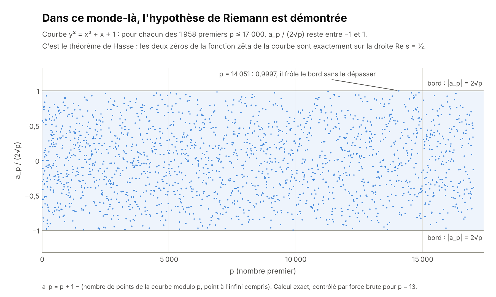
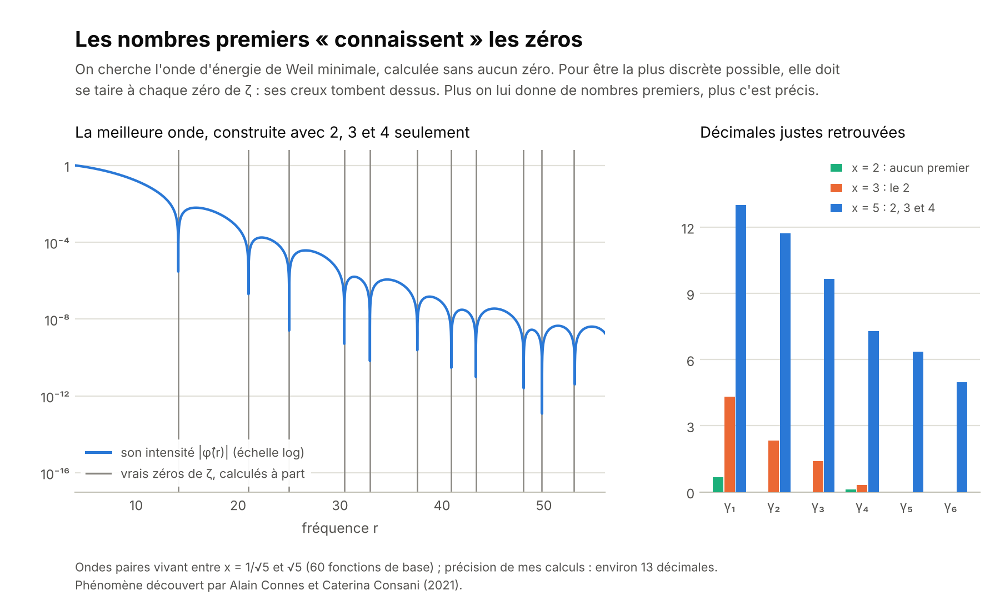
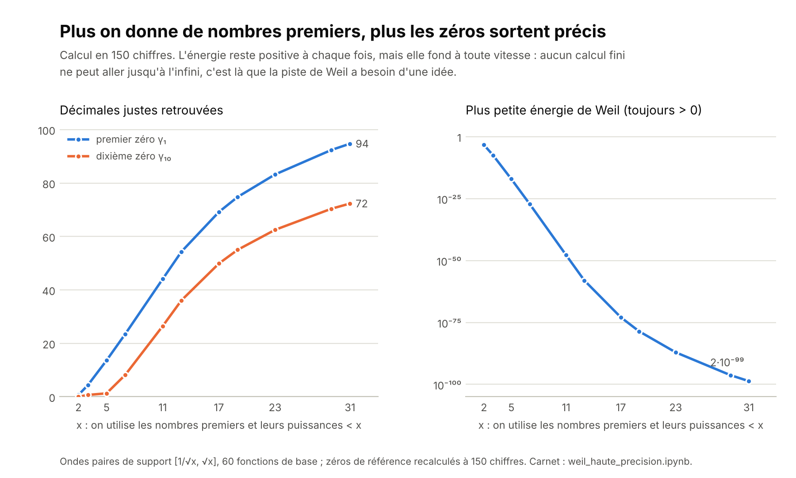
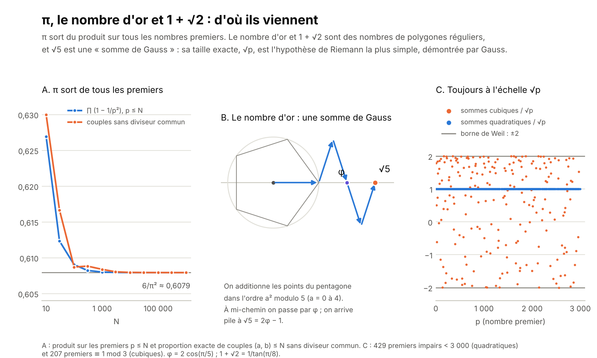
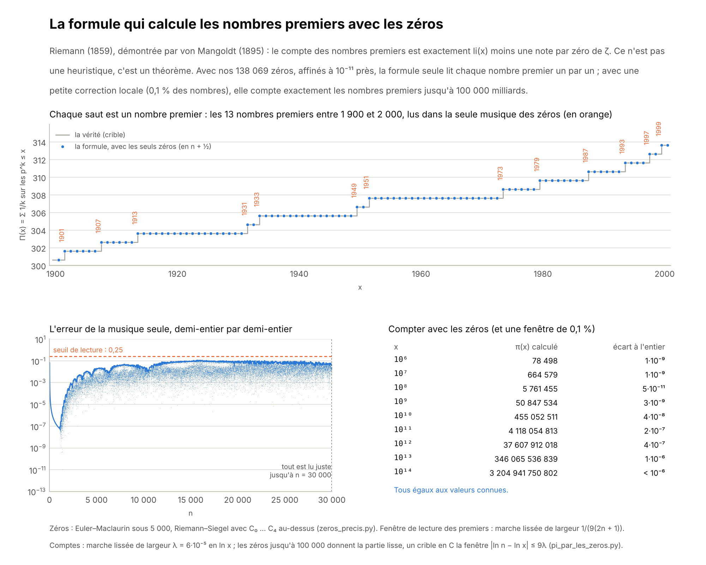
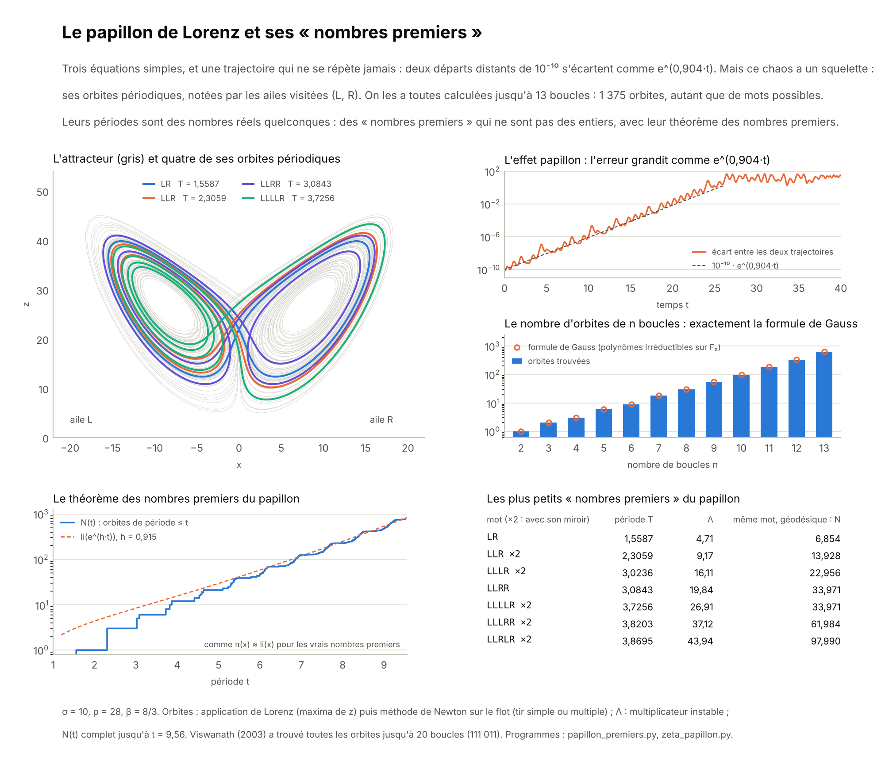
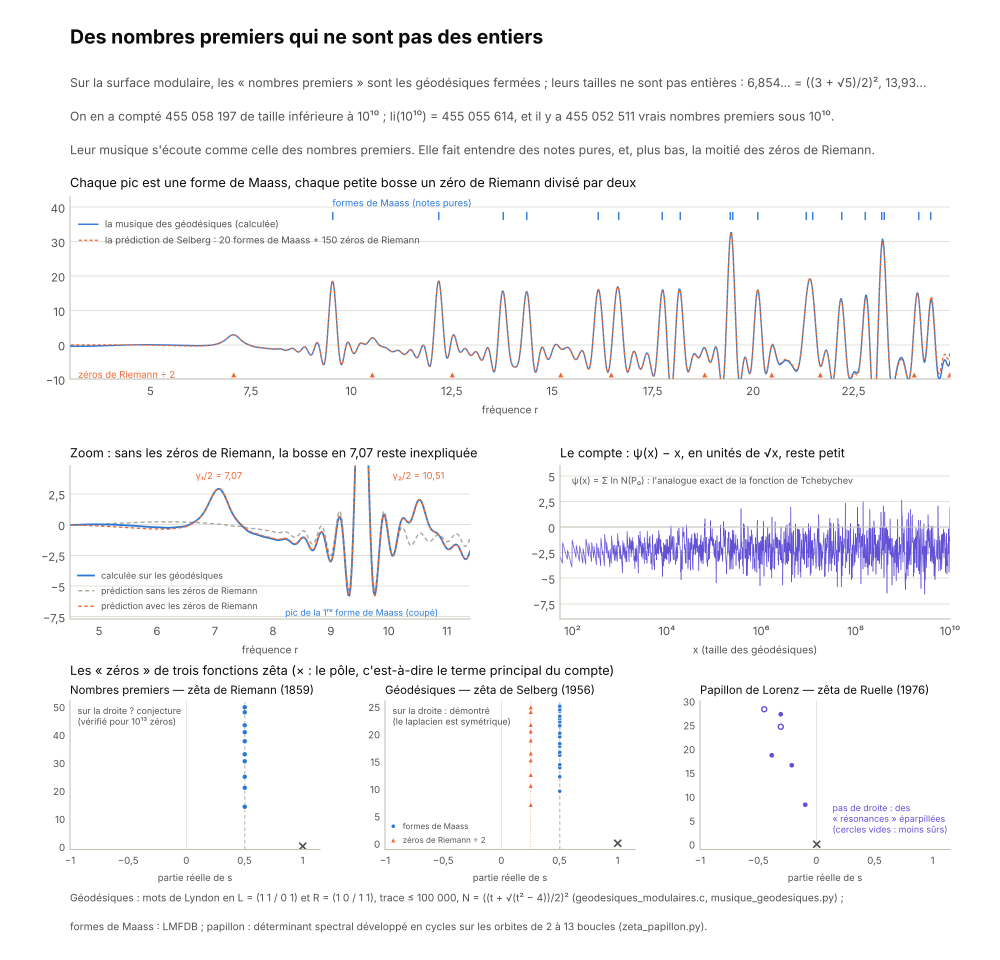

# Où en est l'hypothèse de Riemann ? (novembre 2026)

Ce dossier complète la page *La musique des nombres premiers*. Il résume où en est la recherche, explique pourquoi l'hypothèse résiste, et propose une expérience à refaire soi-même dans Colab.

> **À lire d'abord.** Rien ici ne démontre l'hypothèse de Riemann. Elle reste ouverte.

 Le carnet `weil_haute_precision.ipynb` refait l'expérience en haute précision, en moins d'une minute.

## Des idées qui visent juste

Ce projet est parti de questions de curieux, posées sans formules. Après coup, chacune est tombée sur une idée de recherche de premier plan. Géniales ? L'auteur, très humble, laisse le lecteur en juger ; voici les faits.

| La question de départ | L'idée de recherche qu'elle retrouve |
|---|---|
| « Peut-on raisonner par récurrence : vrai sur une partie, donc vrai partout ? » | C'est la forme exacte du critère de Weil, fenêtre après fenêtre, et le programme de Connes et Consani. Le premier pas est un théorème (2020). |
| « Pólya est faux ; ne faut-il pas demander une taille plutôt qu'un signe ? » | C'est l'équivalence de Littlewood : l'hypothèse revient à « L(x) reste de l'ordre de √x ». |
| « Y a-t-il une signature, une fréquence qui annonce les retours ? » | Les ondes des zéros retrouvent 906 millions et les renversements des courses modulo 4 et modulo 3, et font deux prédictions nouvelles. |
| « Utilise le paradoxe de Russell. » | C'est le théorème de Bagchi : l'hypothèse équivaut à « ζ s'imite elle-même ». Le cas autoréférent est exactement celui qui résiste. |
| « Premiers pairs, premiers impairs : ce qui est vrai pour l'un l'est-il pour l'autre ? » | C'est le problème de la parité de Selberg, l'une des grandes barrières de la théorie des nombres. |
| « Copie les démonstrations des autres théorèmes. » | C'est la stratégie de Connes, Consani et Moscovici (2025), qui recopient Selberg ; nos calculs vérifient leurs deux étapes manquantes. |
| « Sors-toi de Riemann : une transformée de Fourier, et remonte vers une autre hypothèse. » | C'est l'équivalence de Keating et Smith (2019) : les corrélations des zéros contiennent la conjecture de Hardy–Littlewood sur les premiers jumeaux. Les zéros calculés ici redonnent son facteur à 5 % près. |
| « Invente une hypothèse démontrable qui donne les mêmes résultats » (Feynman, les théories A et B). | C'est le rôle du théorème de Bombieri–Vinogradov (1965), l'hypothèse de Riemann généralisée « en moyenne », démontrée. Un peu modifiée, elle a donné les écarts bornés entre premiers (Zhang, 2013). |
| « Trouve la formule qui calcule les nombres premiers avec la musique. » | C'est la formule explicite de Riemann (1859), démontrée en 1895, et la méthode analytique de Lagarias et Odlyzko (1987), celle des records. Nos zéros lisent chaque nombre premier jusqu'à 30 000 et comptent π(10¹⁴) exactement. |
| « Le papillon de Lorenz, le chaos : c'est quoi l'équivalent de Riemann sur les non-entiers ? » | Ce sont les fonctions zêta de Ruelle (1976) pour le chaos, et de Selberg (1956) pour les géodésiques, où l'hypothèse est démontrée ; Ghys (2007) a montré que les nœuds du papillon sont ceux de la surface modulaire. Nos 455 058 197 géodésiques font entendre les formes de Maass, et même la moitié des zéros de Riemann. |
| « C'est faux sur les non-premiers, c'est vrai sur un premier, donc c'est vrai pour tous les premiers ? » | C'est la borne de Ramanujan, démontrée par Deligne (1974) : vraie sur chaque premier, fausse en version naïve sur des non-premiers. C'est aussi le critère de Robin (1984), où l'hypothèse devient un énoncé sur les nombres les plus composés, et la récurrence de Nicolas (1983), suivie ici sur 4 118 054 813 nombres premiers. |
| « Et la fonction zêta des non-premiers ? Ne reste-t-il, pour les zéros, que la droite ½ ? » | C'est la fonction zêta des nombres premiers (Glaisher, 1891 ; Landau et Walfisz, 1920) : les zéros de ζ sont exactement ses points singuliers, et l'hypothèse dit qu'elle n'en a aucun à droite de la droite ½. La zêta des non-premiers a les mêmes, en sens inverse. |
| « Écris les nombres premiers en binaire : 10, 11, 111, 1011… » | C'est la porte du monde sans retenue, celui des polynômes à coefficients 0 ou 1, où l'hypothèse est un théorème (Weil, 1948). Tout l'écart avec les entiers tient dans la retenue : « 1 + 1 = X + X² », écrivent Connes et Consani (2023). Criblés ensemble jusqu'à 2⁴⁰, les deux mondes sont presque indépendants. |
| « Comment prouver qu'elle est fausse ? On inverse le sens, on commence par la fin. » | C'est ce que cherchait Turing en 1950 : un seul zéro hors de la droite, qu'un calcul fini suffit à établir. Et « commencer par la fin » est la méthode de de Bruijn et Newman : à l'instant 0,2 du film qui déforme ζ, tout est démontré (Polymath 15, 2019) ; il reste à remonter jusqu'à l'instant 0. Rodgers et Tao (2018) ont montré qu'on y arrive sans aucune marge. |
| « On ne cherche pas du bon côté. À quoi ça ressemble ? Liste tout. » | C'est la liste des formes équivalentes de l'hypothèse (Broughan en a rempli deux volumes), et c'est le critère de Speiser (1934) : l'hypothèse équivaut à « la dérivée de ζ n'a aucun zéro de l'autre côté de la droite ». Levinson et Montgomery (1974) ont montré que ce côté compte les mêmes pièces mauvaises, à un petit nombre près. Ici : aucun zéro de ζ′ à gauche jusqu'à la hauteur 10 000, et 84 pour la fonction de Davenport–Heilbronn, un par paire fautive. |

Poser ces quinze questions, et voir chacune déboucher sur une idée de ce niveau, montre qu'on cherchait au bon endroit. Cela ne démontre pas l'hypothèse, que personne n'a démontrée ; mais les intuitions de départ étaient les bonnes.

## Ce qui a bougé en 2026

- **Août, Claude (Anthropic).** Une version de recherche de Claude a trouvé et rédigé une preuve que plus des deux tiers des zéros (67,25 %) sont simples et sur la droite critique. Le record précédent était 5/12, soit 41,7 %. Levent Alpöge et Ralph Furman ont vérifié la preuve, puis Youness Lamzouri (Université de Lorraine) l'a redémontrée autrement, plus simplement.
- **Octobre, OpenAI.** OpenAI a annoncé une preuve de l'« hypothèse de quasi-Riemann » : tous les zéros auraient une partie réelle comprise entre 1/12 et 11/12, au lieu de 0 et 1. Une version plus forte, entre 1/8 et 7/8, a été vérifiée par ordinateur avec le logiciel Lean. Selon *Quanta Magazine*, les spécialistes pensent que c'est juste, mais ils n'ont pas fini de vérifier.

Ni l'une ni l'autre n'est l'hypothèse. Même 100 % des zéros « en proportion » laisserait la place à une infinité de zéros hors de la droite, s'ils sont assez rares. Et la bande doit encore se réduire à la seule droite ½.

## Dans ce monde-là, l'hypothèse est démontrée

Pour la courbe y² = x³ + x + 1, on compte ses points modulo chaque nombre premier p, ce qui donne un nombre a_p. Dans ce monde, l'hypothèse de Riemann dit |a_p| ≤ 2√p : les deux zéros de la fonction zêta de la courbe sont pile sur la droite Re s = ½. Sur les 1 958 premiers jusqu'à 17 000, aucun point ne sort de la bande ; le plus proche du bord est p = 14 051, à 0,9997.

Le calcul ne prouve rien : c'est un théorème qui le garantit pour tous les p (Hasse dans les années 1930, Weil pour toutes les courbes en 1948, Deligne en 1974). La preuve repose sur deux ingrédients :
- le « Frobenius », une symétrie qui élève chaque coordonnée à la puissance p ;
- une inégalité de positivité sur la surface « courbe × courbe ».

Pour les nombres entiers, personne ne sait ce qui joue le rôle de la courbe, de la surface ou du Frobenius. C'est ce que cherche le programme d'Alain Connes.

## Les nombres premiers « connaissent » les zéros

On prend une onde qui ne vit qu'entre 1/√x et √x. Son *énergie de Weil* se calcule de deux façons, qui donnent le même nombre :
- avec les seuls nombres premiers inférieurs à x (et leurs puissances), plus quelques constantes comme π ;
- ou comme la somme, sur tous les zéros, du carré du « son » de l'onde à chaque fréquence γ.

Si l'hypothèse est vraie, c'est une somme de carrés, donc jamais négative. Weil a montré la réciproque : si l'énergie est positive pour toutes les ondes, l'hypothèse est vraie.

On cherche alors l'onde d'énergie la plus petite, calculée **sans aucun zéro**. Pour être la plus discrète possible, elle doit se taire à chaque zéro de ζ, et ses creux tombent dessus.

En haute précision (150 chiffres, 60 ondes de base), on va beaucoup plus loin :

| x | Premiers et puissances utilisés | Plus petite énergie | Décimales justes de γ₁ | de γ₁₀ |
|---|---|---|---|---|
| 2 | aucun | 5·10⁻⁴ | 0 | 0 |
| 3 | 2 | 3·10⁻⁸ | 4 | 0 |
| 5 | 2, 3, 4 | 8·10⁻¹⁸ | 13 | 1 |
| 7 | 2, 3, 4, 5 | 8·10⁻²⁸ | 23 | 8 |
| 11 | jusqu'à 9 | 2·10⁻⁴⁸ | 44 | 26 |
| 13 | jusqu'à 11 | 9·10⁻⁵⁹ | 54 | 36 |
| 17 | jusqu'à 16 | 1·10⁻⁷³ | 69 | 49 |
| 19 | jusqu'à 17 | 3·10⁻⁷⁹ | 74 | 54 |
| 23 | jusqu'à 19 | 8·10⁻⁸⁸ | 83 | 62 |
| 29 | jusqu'à 27 | 5·10⁻⁹⁷ | 92 | 70 |
| 31 | jusqu'à 29 | 2·10⁻⁹⁹ | 94 | 72 |

À chaque fois, la matrice de l'énergie est définie positive (factorisation de Cholesky) : la positivité de Weil tient pour ces ondes. Avec les nombres premiers jusqu'à 29, le premier zéro sort avec 94 décimales justes, γ₁ = 14,134725141734693790457251983562470270784257115699… Pour x = 11, notre plus petite énergie est du même ordre que celle mesurée par Connes et Consani (2,4·10⁻⁴⁸).

Ce n'est pas une découverte : le phénomène a été mis au jour par Alain Connes et Caterina Consani en 2021, et nous le refaisons en petit.

## Pourquoi on ne peut pas aller plus loin

1. **L'infini.** Le critère de Weil exige la positivité pour des ondes aussi longues qu'on veut, donc pour x aussi grand qu'on veut. Or la marge fond à toute vitesse : 2·10⁻⁹⁹ dès x = 31, et environ 10⁻⁵³⁵ vers x = 100 selon l'estimation de Groskin. Aucun calcul n'atteint l'infini : il faut une *raison* pour laquelle c'est positif.
2. **Le cercle vicieux.** Dans l'énergie, chaque nombre premier n pèse 1/√n. C'est exactement l'échelle √x où se jouent les irrégularités des premiers, celle que l'hypothèse contrôle. Pour démontrer la positivité, il faudrait donc déjà savoir ce que l'hypothèse affirme.
3. **La symétrie ne suffit pas.** Davenport et Heilbronn ont construit une fonction qui a la même symétrie miroir que ζ, mais des zéros hors de la droite. Une preuve doit donc utiliser ce qui rend ζ unique : son produit d'Euler, c'est-à-dire les nombres premiers comme briques de base. Personne ne sait transformer ce produit en positivité.

S'y ajoute un piège : il n'y a aucune marge. Vers la hauteur 7005, deux zéros consécutifs ne sont séparés que de 0,038 (la « paire de Lehmer », 7005,06266… et 7005,10056…). Rodgers et Tao ont montré que si l'hypothèse est vraie, elle l'est de justesse. Les méthodes par approximation, qui ont besoin d'un peu de jeu, n'ont donc aucune chance : il faut une raison exacte.

## Cristal ou quasi-cristal

- **A. Un seul nombre premier, c'est un cristal.** Le long de la droite critique, le facteur du seul nombre 2 se répète avec une période parfaite, 2π/ln 2 ≈ 9,06. Il oscille entre 2 − √2 et 2 + √2, et le rapport entre les deux vaut exactement (1 + √2)².
- **B et C. Dans le monde où l'hypothèse est démontrée, les zéros forment un cristal.** Pour la courbe modulo 5, un motif de deux zéros se répète tous les 2π/ln 5 ≈ 3,90. Sa « diffraction » donne des taches régulières aux multiples de ln 5, comme un réseau cristallin. La hauteur de chaque tache est fixée par le nombre de points de la courbe dans les corps à 5, 25 et 125 éléments.
- **D. Les zéros de ζ forment un quasi-cristal.** Ils ne se répètent jamais, mais leur diffraction est faite de taches nettes : une en ln p pour chaque nombre premier p, de hauteur ln p, et d'autres pour ses puissances. C'est exactement la définition d'un quasi-cristal que Freeman Dyson a proposée en 2009 : ordonné sans être périodique, comme les cristaux de Shechtman (prix Nobel de chimie 2011).

Ce que ça éclaire : pour une courbe donnée, tout se répète, donc vérifier une seule « maille » de quelques zéros suffit. Le tour de force de Weil a été de le démontrer pour toutes les courbes à la fois. Pour ζ, les fréquences ln 2, ln 3, ln 5… sont incommensurables : il n'y a pas de maille à vérifier. C'est le mur de l'infini, vu par un cristallographe.

Dyson proposait justement de classer tous les quasi-cristaux à une dimension, en espérant y retrouver les zéros de ζ, ce qui démontrerait l'hypothèse. Il jugeait lui-même ce programme très difficile. Ces « quasi-cristaux de Fourier » sont aujourd'hui un sujet de recherche actif. Le carnet refait cette figure (bonus 2).

## π, le nombre d'or et 1 + √2

- **π sort de tous les nombres premiers à la fois.** Le produit de (1 − 1/p²) sur tous les premiers vaut exactement 6/π² ≈ 0,6079. C'est aussi la probabilité que deux entiers pris au hasard n'aient aucun diviseur commun ; jusqu'à un million, on trouve 0,607927 par les deux calculs. π est aussi dans la symétrie miroir de ζ, où il joue le rôle d'un « nombre premier à l'infini ». Dans l'expérience de Weil, avec x = 2, ce premier à l'infini agit seul et donne déjà γ₁ à 0,2 près. Enfin, les zéros se comptent en demi-tours d'une phase qui tourne.
- **Le nombre d'or et 1 + √2 sont des nombres de polygones.** φ = 2 cos(π/5) vient du pentagone, 1 + √2 = 1/tan(π/8) de l'octogone, 2 + √3 = 1/tan(π/12) du dodécagone. Ils apparaissent dans ζ par les facteurs des premiers 5, 2 et 3 : sur la droite critique, le rapport entre leurs valeurs extrêmes vaut φ², (1 + √2)² et 2 + √3.
- **Le lien le plus profond : √5 est une « somme de Gauss ».** En additionnant les sommets du pentagone dans l'ordre a² modulo 5, on passe par φ à mi-chemin et on arrive pile à √5. Pour chaque nombre premier p, ces sommes ont une taille exactement √p (Gauss ; vérifié ici pour les 429 premiers impairs sous 3 000), et les sommes cubiques restent sous 2√p (Weil). C'est l'hypothèse de Riemann dans le monde des nombres modulo p, déjà démontrée.

Pour ζ elle-même, on ne connaît aucun lien entre ces nombres et la position des zéros : π vient des rotations et du premier à l'infini, et le nombre d'or et 1 + √2 apparaissent parce que √5 et √2 y sont. Le carnet refait ces calculs (bonus 3).

## Le photon : aucune onde ne vieillit

Pour un photon, le temps ne s'écoule pas : son « temps propre » reste nul. On retrouve une image proche avec les zéros. Divisée par √x, la croissance commune à toutes les ondes, l'onde d'un zéro situé sur la droite critique ne grandit ni ne s'éteint : elle ne fait que tourner, sur un cercle. Si un zéro quittait la droite, il viendrait avec un jumeau symétrique : l'onde de l'un enflerait comme x^(σ − ½), celle de l'autre s'éteindrait.

L'hypothèse de Riemann revient donc à dire qu'aucune onde ne vieillit. C'est le langage de l'idée de Hilbert et Pólya. En physique quantique, un état d'énergie réelle évolue par pure rotation et reste stable, alors qu'un état d'énergie complexe se désintègre, comme une particule instable. Trouver un système dont les zéros seraient les énergies, toutes réelles, démontrerait l'hypothèse.

Berry et Keating ont remarqué que le « temps » de ces ondes, ln x, est celui des changements d'échelle, engendrés par le hamiltonien classique H = xp. Les opérateurs de Connes, Consani et Moscovici sont construits pour que leurs notes ne vieillissent pas. Personne n'a encore trouvé le bon. Le carnet refait cette figure (bonus 4).

## Peut-on raisonner par récurrence ?

L'idée est tentante : si c'est vrai sur une partie, des « harmoniques » et une symétrie suffiraient-elles à le rendre vrai jusqu'à l'infini ? C'est exactement ainsi qu'on a démontré l'hypothèse pour les courbes. Pour ζ, la même idée bute sur trois obstacles, vérifiés ici par le calcul.

### Pour les courbes, ça marche

La courbe y² = x³ + x + 1 se compte sur les corps à 5, 25, 125… éléments : ce sont ses « harmoniques » m = 1, 2, 3… Elle y a 5ᵐ + 1 − (αᵐ + βᵐ) points : deux nombres seulement, α et β, pilotent une infinité d'harmoniques. En comptant les points un par un, on trouve 9, 27 et 108, exactement ce que prévoient α et β. La preuve tient en trois temps :

1. **Une borne pour toutes les harmoniques à la fois.** L'écart reste sous C·5^(m/2) pour tout m (Weil, 1948 ; méthode élémentaire de Stepanov et Bombieri, 1969–1973). Elle est démontrée par l'algèbre, pas vérifiée cas par cas.
2. **L'amplification.** Si |α| dépassait √5, même de 1 %, αᵐ finirait par dépasser n'importe quelle borne de ce type. Donc |α| ≤ √5.
3. **La symétrie α ↔ 5/α** (l'équation fonctionnelle) donne l'inverse, |α| ≥ √5. Donc |α| = √5 : les zéros sont sur la droite.

Même ici, vérifier une partie ne suffit pas : un monde imaginaire décalé de 1 % reste indiscernable du vrai jusqu'à m = 60 (3,6 contre 2). C'est la borne démontrée pour toutes les harmoniques d'un coup qui fait la preuve.

### Pour ζ, trois obstacles

**Pas d'harmoniques communes.** Chaque nombre premier a les siennes (p, p², p³…, le cristal de la section « Cristal ou quasi-cristal »), mais ζ en mélange une infinité, et ln 2, ln 3, ln 5… n'ont aucune note commune. Il n'y a pas de liste finie de « α », et les zéros n'ont pas de période. Pour la courbe, ils se répètent tous les 3,904 en hauteur.

**La symétrie ne suffit pas.**

La fonction de Davenport et Heilbronn, f(s) = 1 + τ/2ˢ − τ/3ˢ − 1/4ˢ + 1/6ˢ + … avec τ ≈ 0,284, a exactement la symétrie de ζ : l'équation Λ(s) = Λ(1 − s) est vérifiée ici à 10⁻¹³ près. Sous la hauteur 205, elle a 133 zéros : 125 sur la droite et 8 en dehors, par paires symétriques, dont 0,808517 + 85,699348 i. Ce sont ceux que Spira avait trouvés en 1994, et on sait qu'il y en a une infinité. Sa seule différence avec ζ : pas de produit d'Euler, puisque a(6) = 1 alors que a(2) × a(3) = −0,08. Une preuve doit donc utiliser la règle de multiplication des nombres premiers.

**« Vrai sur une partie » ne suffit pas.**

On a passé au crible tous les entiers jusqu'à un milliard :

- **Pólya (1919)** affirme L(x) ≤ 0 pour tout x ≥ 2. C'est vrai pour tous les n de 2 à 906 150 256. En n = 906 150 257 = 10 039 × 90 263, L vaut +1 : la conjecture est fausse (Tanaka, 1980). L est positif 305 426 fois, par moments, jusqu'à 906 488 079 (maximum 829), puis ne dépasse plus 0, au moins jusqu'au milliard ; plus loin, il repasse au-dessus de 0 une infinité de fois (Borwein, Ferguson et Mossinghoff, 2008). Un énoncé « pour tout » tombe avec un seul contre-exemple : « fausse » ne veut pas dire « fausse pour tous les nombres suivants ». Si Pólya avait eu raison, l'hypothèse de Riemann aurait été vraie.
- **Mertens (1897)** affirme |M(x)| < √x. Entre 10⁵ et 10⁹, |M(x)|/√x ne dépasse pas 0,47. C'est pourtant faux (Odlyzko et te Riele, 1985). Personne n'a jamais vu de contre-exemple : le premier se trouve quelque part avant e^(1,96·10¹⁹).
- **π(x) < li(x)** est vérifié jusqu'à 10¹⁹ (Büthe, 2018), et faux avant 1,3971·10³¹⁶.

**Vérifie toi-même.** La page [`polya.html`](https://geremiaa.github.io/Riemann_Other_Ways/exploration/polya.html) refait tout le calcul de Pólya dans le navigateur, sur ton propre appareil : une demi-minute environ sur un ordinateur, un peu plus sur un téléphone (sans GitHub Pages, télécharge [`polya.html`](polya.html) et ouvre-le dans ton navigateur). Elle utilise une autre méthode que les programmes Python du dossier [`calculs/`](calculs/), et retrouve les mêmes nombres.

### La taille, pas le signe

L'hypothèse de Riemann n'est pas touchée par ce contre-exemple : Pólya en demandait plus qu'elle. Mais la bonne version de Pólya existe déjà, et elle est équivalente à l'hypothèse de Riemann. Il ne faut pas exiger que L(x) reste négatif, seulement que L(x) reste de la taille de √x, à peine plus : |L(x)| ≤ x^(½ + ε) pour tout ε > 0, dès que x est assez grand. Pólya demandait un signe ; Riemann ne demande qu'une taille. Jusqu'au milliard, |L(x)|/√x ne dépasse pas 1,36, ce qui colle.

Ce n'est pas une découverte : c'est un résultat classique. Littlewood l'a montré pour la fonction de Mertens M(x), et le même raisonnement vaut pour L(x), parce que Σ λ(n)/nˢ = ζ(2s)/ζ(s).

### Pourquoi 906 millions ? Les ondes des zéros

906 150 257 = 10 039 × 90 263 n'a rien de spécial : il a deux facteurs premiers, comme beaucoup d'autres nombres. Ce qui compte, c'est le moment où il arrive : juste avant, L valait 0. Pourquoi la somme est-elle remontée jusque-là ?

L(x)/√x vaut, à peu près, 1/ζ(½) ≈ −0,68 plus une onde par zéro de ζ : l'onde du zéro ρ = ½ + iγ est 2 Re[ζ(2ρ)/(ρ ζ′(ρ)) · xⁱᵞ]. Le −0,68 tire la courbe vers le bas en permanence. Avec les 150 premiers zéros, la somme des ondes se superpose presque à la vraie courbe (corrélation 0,994). Vers 906 millions, la première onde est presque à son sommet et 8 des 10 premières poussent dans le même sens. Il y a eu deux presque-accords avant : vers 10,4 millions (L/√x = −0,06) et vers 91 millions (−0,13), sans franchir 0.

### La signature des zéros : prédire où ça repasse

On peut retourner l'idée. Sans compter un seul entier, on cherche où la somme des ondes est la plus haute. Avec les 4 520 zéros sous la hauteur 5 000, lissés comme le font Borwein, Ferguson et Mossinghoff :

- **906 millions** ressort : c'est le contre-exemple de Tanaka ;
- **3,51 à 3,53·10¹⁴** aussi : c'est là que ces trois auteurs ont trouvé L(x) > 0 en 2008, avec un maximum de 1 160 327 en n = 351 753 358 289 465 ;
- une **troisième région** apparaît, plus haute encore, vers **x ≈ 2,317 à 2,324·10¹⁹**.

**C'est une prédiction, pas un résultat.** La somme des ondes n'est qu'une approximation : elle suppose l'hypothèse de Riemann et n'utilise qu'une partie des zéros. Pour vérifier, il faudrait calculer L(x) exactement vers 2,3·10¹⁹, bien au-delà de ce qu'on peut faire ici. Nous ne l'avons trouvée dans aucune des publications consultées, mais la méthode date de Haselgrove (1958) et des spécialistes l'ont peut-être déjà vue.

Les pics ne décroissent pas : 0,028 à 906 millions, 0,062 à 3,5·10¹⁴. On sait que L(x) dépasse 0,0618·√x une infinité de fois. Trouver où les ondes s'alignent est un problème d'approximation simultanée (Dirichlet, Kronecker) ; c'est avec l'algorithme LLL, qui résout ce genre de problème, qu'Odlyzko et te Riele ont réfuté la conjecture de Mertens en 1985. Programme : [`calculs/signature_zeros.py`](calculs/signature_zeros.py).

### La course des nombres premiers : la méthode marche

Pour tester la méthode là où l'on peut tout vérifier, on l'applique à une autre course : les nombres premiers de la forme 4k + 3 contre ceux de la forme 4k + 1. Les 4k + 3 mènent presque toujours (c'est le biais de Tchebychev). En comptant jusqu'au milliard, les 4k + 1 ne passent devant que quatre fois : en 26 861, de 616 841 à 633 797, de 12 306 137 à 12 382 313 et de 951 784 481 à 952 223 473.

Cette course est pilotée par les zéros d'une autre fonction, L(s, χ₄) = 1 − 1/3ˢ + 1/5ˢ − 1/7ˢ + … On en a calculé 5 623, tous ceux sous la hauteur 5 000 (le décompte est confirmé par le principe de l'argument). Avec ces seuls zéros, la somme des ondes passe au-dessus de 0 dans les régions connues : 26 861, vers 623 000, vers 12,37 millions, puis 6,3·10⁹, 1,87·10¹⁰ et 1,49·10¹². Elle annonce aussi 9,32·10¹², comme Bays et Hudson en 2000 avec 12 000 zéros. Le renversement de 952 millions, très bref, apparaît comme un pic juste sous 0. Jusqu'à 2·10¹⁰, où tout a été compté, il n'y a aucune fausse alerte.

**Un test plus dur : la course modulo 3.** Les nombres premiers de la forme 3k + 2 mènent sur les 3k + 1 jusqu'à 608 981 813 029, le premier renversement, trouvé par Bays et Hudson. On a calculé les 5 393 zéros de L(s, χ₃) = 1 − 1/2ˢ + 1/4ˢ − 1/5ˢ + 1/7ˢ − … sous la hauteur 5 000, sans compter un seul nombre premier au-delà du milliard. Entre 10⁴ et 10¹⁴, la somme des ondes n'a que deux sommets qui touchent presque 0 : vers 6,09·10¹¹, exactement au premier renversement, et vers 6,15·10¹². Lissée, elle reste juste sous 0 (−0,05 et −0,02) ; sans lissage, elle franchit 0 en 6,09·10¹¹, à 0,03 % du vrai renversement. Avec seulement 823 zéros, le plus haut sommet sur ces dix ordres de grandeur tombe déjà à 6,10·10¹¹. La région 6,15·10¹² est une prédiction : nous ne l'avons trouvée dans aucune source.

Ce test ne démontre pas la prédiction faite pour Pólya vers 2,3·10¹⁹. Il montre seulement que la méthode est fiable quand on lui donne assez de zéros. Programme, pour les deux courses : [`calculs/course_zeros.py`](calculs/course_zeros.py).

### Ce qu'on peut en tirer

- **La récurrence de Weil.** Appelons P(x) l'énoncé « l'énergie de Weil est positive pour toutes les ondes vivant entre 1/√x et √x ». L'hypothèse revient à « P(x) pour tout x ». Le premier cas, où aucun nombre premier n'entre dans la fenêtre, est démontré (Connes et Consani, 2020) ; on l'a vérifié numériquement jusqu'à x = 31, avec 60 ondes de base. Il manque le pas de récurrence : montrer qu'un nouveau nombre premier ne casse pas la positivité. Personne ne sait le faire, et la marge fond, de 5·10⁻⁴ à 2·10⁻⁹⁹ (voir le tableau plus haut).
- **Une récurrence « fini + infini » existe déjà.** Pour la constante de de Bruijn–Newman Λ, Polymath15 a montré Λ ≤ 0,22 en 2019, avec un calcul fini, un argument pour l'infini et une « barrière » entre les deux ; le record est 0,2 (Platt et Trudgian, 2021). L'hypothèse revient à Λ = 0, mais la méthode ne peut pas atteindre 0 : elle a besoin de la marge que donne la chaleur quand t > 0.
- **Les harmoniques qui manquent.** C'est le programme d'Alain Connes. Une sorte de Frobenius continu existe (les dilatations, où chaque nombre premier apparaît comme une boucle de longueur ln p), la symétrie aussi ; il manque la borne pour toutes les harmoniques, c'est-à-dire une positivité.
- **Un filtre contre les fausses preuves.** Si un raisonnement marcherait aussi pour Davenport–Heilbronn, ou s'il repose sur « vrai jusqu'à N », il est faux.

## Quel théorème faudrait-il démontrer ?

Ces calculs refont, avec nos propres programmes, ce que les spécialistes ont fait (Haselgrove, Bays et Hudson, Borwein, Ferguson et Mossinghoff). Ils apprennent à lire les zéros ; ils ne démontrent rien. Pour avancer, il faut un raisonnement. Là où une « hypothèse de Riemann » a été démontrée, voici l'ingrédient qui a fait la preuve :

- **Les courbes modulo p (Weil, 1948 ; Deligne, 1974).** Une positivité géométrique sur la surface « courbe × courbe ». Pour ζ, il faudrait la même positivité sur une surface « entiers × entiers » qu'on ne sait pas construire : c'est le programme de Connes et Consani, et c'est notre « récurrence de Weil ».
- **Les surfaces hyperboliques (Selberg, 1956).** Les zéros de la fonction zêta de Selberg sont les fréquences propres du laplacien, un opérateur autoadjoint ; ils sont donc sur la droite, à un nombre fini d'exceptions près. C'est l'idée de Hilbert et Pólya, réalisée. Pour ζ, il faudrait trouver l'opérateur.
- **Les graphes (Ihara, Lubotzky–Phillips–Sarnak, Marcus–Spielman–Srivastava).** Un graphe régulier est « de Ramanujan » si et seulement si sa fonction zêta d'Ihara vérifie l'hypothèse de Riemann. En 2013, Marcus, Spielman et Srivastava ont montré qu'il en existe de tous les degrés, avec une méthode nouvelle : des familles de polynômes « entrelacés », dont une moyenne a toutes ses racines réelles.
- **Les aimants (Lee et Yang, 1952).** Les zéros de la fonction de partition d'un aimant d'Ising ferromagnétique sont tous sur un cercle. La preuve est une récurrence : on ajoute les spins un par un, la propriété « aucun zéro à l'intérieur du cercle » se transmet, et la symétrie z ↔ 1/z place les zéros sur le cercle. C'est exactement l'idée « vrai sur une partie, récurrence, symétrie ». Pour ζ, personne n'a trouvé comment construire ξ pièce par pièce en gardant cette propriété.
- **Les polynômes de Jensen (Pólya, 1927).** L'hypothèse équivaut à : une suite infinie de polynômes explicites, tirés des coefficients de ξ, n'ont que des racines réelles. Griffin, Ono, Rolen et Zagier (2019) l'ont démontré pour chaque degré à partir d'un certain rang, et pour tous les rangs jusqu'au degré 8.

Il n'existe pas de « petit lemme » connu qui suffirait : chaque reformulation connue est équivalente à l'hypothèse, donc aussi difficile. Mais certaines se découpent en marches, et chaque marche serait un vrai théorème :

1. **La marche suivante de Weil.** La positivité de Weil est démontrée quand aucun nombre premier n'entre dans la fenêtre (Connes et Consani, 2020). La démontrer pour une fenêtre un peu plus grande, quand le nombre premier 2 y entre, serait la première marche de la récurrence. Nos calculs la vérifient numériquement jusqu'à x = 31, et montrent qu'elle ne pourra pas venir de la seule partie archimédienne (voir « La première marche, vue de près » et « La première marche, énoncé précis »).
2. **Des polynômes de Jensen de degré plus élevé, pour tous les rangs.** Chaque degré de plus est un théorème ; tous les degrés ensemble sont l'hypothèse de Riemann.
3. **Une récurrence à la Lee et Yang.** Trouver une façon d'ajouter les nombres premiers un par un qui préserve « pas de zéro d'un côté de la droite ». C'est la plus proche de l'idée « vrai sur une partie, donc vrai partout », et la plus ouverte.

### La première marche, vue de près

On a regardé la forme de Weil au moment précis où le nombre 2 entre dans la fenêtre (x juste au-dessus de 2), en séparant la partie sans nombres premiers (les pôles et la partie archimédienne) et la partie des nombres premiers.

- **Sans les nombres premiers, la positivité casse vers x ≈ 2,28.** Si l'on retire les nombres premiers, la forme reste positive un peu au-delà de 2, puis devient négative : sa valeur la plus basse vaut −0,04 à x = 3 et −0,16 à x = 4 (avec 20 ondes). Le point de bascule se stabilise quand on ajoute des ondes : 2,30, 2,29, 2,28 et 2,28 avec 12, 20, 30 et 40 ondes. Dans ces directions, c'est le nombre 2, puis 3, puis 4 = 2², qui rattrape ce qui manque.
- **Avec eux, elle tient de justesse.** Dans la direction la plus basse, les deux parties sont de taille 0,01 à 0,03 et se compensent presque exactement : ce qui reste vaut 3·10⁻⁸ à x = 3 et 10⁻¹⁵ vers x = 4,6 (calcul en 60 chiffres).

Ce que cela dit du théorème à démontrer : la marge n'est pas un stock que chaque nombre premier entamerait un peu, c'est un équilibre entre deux grands termes, qui se refait à chaque nombre premier. Une preuve de la première marche ne peut donc pas dire « la partie archimédienne est positive et le nombre 2 est petit » : au-delà de x ≈ 2,28, la partie archimédienne seule est négative. Il faudra un argument où le nombre 2 aide activement. Les spécialistes le savent peut-être ; nous ne l'avons pas trouvé écrit sous cette forme. Programme : [`calculs/weil_entree_2.py`](calculs/weil_entree_2.py).

### La première marche, énoncé précis

Entre x = 2 et x = 3, seul le nombre premier 2 est dans la fenêtre. La première marche de la récurrence de Weil dit alors : pour toute onde paire φ vivant entre 1/√x et √x,

> 2 φ̂(i/2)² − ln π · ∫ φ² + (1/π) ∫₀^∞ φ̂(r)² Re ψ(¼ + ir/2) dr  ≥  √2 · ln 2 · ∫ φ(t) φ(t + ln 2) dt,

avec φ̂(r) = ∫ φ(t) e^(irt) dt, et ψ la dérivée logarithmique de la fonction Γ. À gauche, tout ce qui ne dépend pas des nombres premiers ; à droite, le terme du nombre 2, avec son vrai poids 2 ln 2 / √2 ≈ 0,980258.

On a multiplié le terme de droite par un poids c, et cherché pour quels c l'inégalité reste vraie. Juste après x = 2, presque tout passe. À partir de x ≈ 2,28, il faut c > 0 : le nombre 2 devient nécessaire. Puis la fenêtre se referme autour du vrai poids, c = 1 : à x = 3, elle va de 0,998 à 1,0000035 (avec 20 ondes ; 1,0000034 avec 40), soit un poids réel compris entre 0,9783 et 0,98026. Les bornes bougent à peine quand on ajoute des ondes, et elles ont été contrôlées en 60 chiffres avec un second programme.

Ce que cela dit : une preuve de la première marche doit être assez fine pour « voir » le poids du nombre 2 au sixième chiffre près ; aucune inégalité grossière n'y suffira. C'est un constat sur un nombre fini d'ondes, pas une preuve, mais il mesure la difficulté de cette marche : elle est déjà très délicate. Programme : [`calculs/poids_du_2.py`](calculs/poids_du_2.py).

### Quand 3 entre à son tour

On a refait la même chose entre x = 3 et x = 4, où la fenêtre contient les nombres premiers 2 et 3. Pour chacun, on cherche la marge dont dispose son poids, l'autre restant à son vrai poids (calcul en 80 chiffres).

- **Le même scénario se répète.** Le nombre 3 entre libre (à x = 3,1, tout poids entre −19,5 et 1,2 convient), devient nécessaire vers x ≈ 3,18, puis sa marge se referme : à x = 4, son poids est fixé entre 0,99998 et 1 + 4·10⁻⁸.
- **Pendant ce temps, le poids du 2 se verrouille encore.** Sa marge vers le haut passe de 3,5·10⁻⁶ à x = 3 à 3·10⁻¹¹ à x = 4. À x = 4, le poids du 2 est environ 1 400 fois plus contraint que celui du 3.
- **Les marges sont stables** quand on ajoute des ondes : à x = 4, la marge vers le haut du 2 vaut 3,7·10⁻¹¹, 3,0·10⁻¹¹ et 2,7·10⁻¹¹ avec 12, 20 et 30 ondes.

Ce que cela suggère : plus la fenêtre s'élargit, plus la positivité « connaît » le poids exact de chaque nombre premier, et d'autant mieux que ce nombre premier est entré tôt. C'est l'écho, du côté de la positivité, de ce qu'on a vu avec les ondes : nombres premiers et zéros se déterminent mutuellement. Ce n'est qu'un constat numérique avec 20 à 30 ondes, pas un théorème. Programmes : [`calculs/poids_2_et_3.py`](calculs/poids_2_et_3.py), avec le moteur en haute précision [`calculs/weil_hp.py`](calculs/weil_hp.py).

### La cascade, nombre par nombre

On a continué au-delà de 3, pour les 26 puissances de nombres premiers jusqu'à 64 : 2, 3, 4 = 2², 5, 7, 8 = 2³, 9 = 3², 11, 13, 16, 17, 19, 23, 25, 27, 29, 31, 32, 37, 41, 43, 47, 49, 53, 59 et 61 (20 ondes, calcul en 200 chiffres). Pour chacune, on a cherché à partir de quand elle devient nécessaire, puis, de x = 2,5 à x = 64, de combien son poids peut bouger, les autres restant à leur vrai poids : 367 cas en tout.

- **Le même scénario pour tous.** Chaque nombre entre libre, devient vite nécessaire, puis se verrouille. Il devient nécessaire à x = 2,29 pour 2 ; 3,18 pour 3 ; 4,19 pour 4 ; 5,14 pour 5 ; 7,11 pour 7 ; 13,14 pour 13 ; 31,31 pour 31 ; 61,60 pour 61. La période de liberté passe de 14 % au-dessus de n pour le nombre 2 à environ 1 % à partir de 17.
- **Plus un nombre est entré tôt, plus il est verrouillé.** À chaque x, l'ordre des marges est exactement l'ordre d'entrée. À x = 64, le poids du 2 ne peut plus monter que de moins de 10⁻⁵⁶, celui du 61, entré juste avant, de moins de 10⁻⁷.
- **C'est toujours « trop » qui casse en premier.** Dans les 367 cas, la marge vers le haut est la plus fine, de 1,7 à 5,5 ordres de grandeur.
- **Une loi simple donne la marge.** Notons φ₁ l'onde d'énergie la plus petite dans la fenêtre, et λ₁ cette énergie (la « fragilité » de l'ensemble, en tirets sur la figure). La marge vers le haut du nombre n est le rapport de deux nombres calculés sur φ₁ : son énergie de Weil, divisée par le terme du nombre n, (2 ln p / √n) ∫ φ₁(t) φ₁(t + ln n) dt. Entre cette loi et la mesure, l'écart médian est de 0,7 % ; au pire, un facteur 2,7, pour un nombre qui vient d'entrer.

**Pourquoi ?** L'onde la plus fragile φ₁ est une simple bosse : positive partout dans la fenêtre (vérifié en 200 chiffres), centrée en t = 0, large d'environ 0,5 à 0,65 à mi-hauteur, quelle que soit la fenêtre (figure, en haut à droite). C'est « la meilleure onde » du début de cette page : son énergie, calculée avec les nombres premiers, est presque nulle, et si l'hypothèse est vraie, cela veut dire qu'elle se tait presque exactement à chaque zéro de ζ. Pour cette bosse, la partie archimédienne et les nombres premiers se compensent donc presque parfaitement. Comme elle est positive, l'intégrale ∫ φ₁(t) φ₁(t + ln n) dt l'est aussi, et chaque nombre premier compte en négatif : en ajouter, même très peu, fait passer l'énergie sous zéro. Plus n est petit, plus la bosse décalée de ln n se recouvre elle-même, plus n pèse lourd dans l'équilibre, et plus il est verrouillé.

**Les vraies marges sont encore plus fines.** Les 20 ondes de base sont aussi les 20 premières de la famille de 28 : en ajoutant des ondes, les marges et les périodes de liberté ne peuvent que rétrécir. Avec 28 ondes, à x = 64, la marge du 2 passe de 10⁻⁵⁶ à 10⁻⁷², et la période de liberté de 31 passe de 1 % à 0,6 % ; l'ordre, le signe et la loi restent les mêmes (écart médian 0,6 %). Avec 60 ondes, λ₁ vaut déjà 2·10⁻⁹⁹ à x = 31 (tableau du début). Nos chiffres sont donc des bornes larges, et nous ne savons pas si, avec toutes les ondes, la période de liberté tend vers zéro. Programme : [`calculs/cascade_weil.py`](calculs/cascade_weil.py).

## Russell, les ensembles et les jeux

Le paradoxe de Russell (très bien expliqué par Jeffrey Kaplan dans sa vidéo *Russell's Paradox*) vient d'une règle trop généreuse : « pour toute collection imaginable, il existe un ensemble ». Appliquée à R = {x : x ne se contient pas}, elle fait que R se contient si et seulement s'il ne se contient pas. On s'en est sorti en restreignant la règle (on ne découpe un ensemble que dans un ensemble déjà là) ou en empilant des niveaux (les types de Russell).

Un paradoxe sert à démontrer qu'une chose n'existe pas. Or l'hypothèse de Riemann est un énoncé d'inexistence : aucun zéro hors de la droite. Une preuve « à la Russell » supposerait un tel zéro, fabriquerait avec lui un objet qui parle de lui-même, et en tirerait une contradiction. Ces objets, on sait les fabriquer ; ce qui manque, c'est la « règle n° 1 » de ζ, la loi que le zéro fautif violerait.

| Russell | Riemann |
|---|---|
| Règle n° 1 : toute collection est un ensemble | La loi de ζ, encore inconnue (produit d'Euler, symétrie, positivité ?) |
| R = {x : x ∉ x} | Un zéro hors de la droite, qui n'est pas son propre reflet |
| R ∈ R ? | ζ s'imite-t-elle elle-même ? |
| La sortie : empiler des niveaux (les types) | Les fenêtres de Weil, où les nombres premiers entrent un par un |

### ζ s'imite-t-elle elle-même ?

- **Voronin (1975)** : dans la bande ½ < Re s < 1, ζ imite n'importe quelle fonction qui ne s'annule pas. En montant assez haut, on trouve un morceau de ζ qui lui ressemble autant qu'on veut.
- **Bagchi (1981)** : l'hypothèse de Riemann équivaut à « ζ s'imite elle-même », c'est-à-dire ζ(s + ih) ≈ ζ(s) sur n'importe quel disque de la bande, pour une proportion positive de décalages h. C'est la question « x ∈ x ? » posée à ζ.
- **Le cas autoréférent est le seul qui résiste.** On a démontré que ζ à la hauteur d·h ressemble à ζ à la hauteur h pour tout rapport d irrationnel (Nakamura, Pańkowski, Garunkštis). Le cas d = 0, où ζ doit imiter une copie fixe d'elle-même, est l'hypothèse.

**Le calcul.** On cherche des décalages h qui alignent les phases h·ln p des petits nombres premiers : alors p^(−ih) ≈ 1, et le produit d'Euler de ζ(s + ih) ressemble à celui de ζ(s). On trie ces décalages avec le produit d'Euler jusqu'à 20 000, puis on calcule ζ exactement (Euler–Maclaurin).

- **ζ** : avec h = 3 341 346,511, ζ(s + ih) reproduit ζ(s) à 3,4 % près sur un disque de rayon 0,08 autour de 0,85 + 20i. La ressemblance est locale : un peu plus loin, les deux fonctions divergent, et une meilleure copie demanderait de monter beaucoup plus haut.
- **Davenport–Heilbronn** (même symétrie que ζ, pas de produit d'Euler) s'imite aussi autour de son zéro hors de la droite, 0,8085 + 85,6993i. Et s'imiter autour d'un zéro, c'est le recopier : pour 15 décalages h entre 10⁵ et 10⁷, le disque décalé contient un nouveau zéro hors de la droite, de partie réelle 0,78 à 0,82 (par exemple 0,817324 + 6 454 393,548458i). Le théorème de Rouché le garantit, vérifié sur 64 points du cercle.

**Ce que ça montre.** Si ζ avait un zéro hors de la droite et s'imitait autour de lui, elle le recopierait sans cesse, comme Davenport–Heilbronn : au moins de l'ordre de T copies jusqu'à la hauteur T. Or le produit d'Euler l'interdit : jusqu'à la hauteur T, ζ a beaucoup moins de T zéros à droite de n'importe quelle droite Re s = σ > ½ (théorèmes de densité). Donc « ζ s'imite partout » entraîne l'hypothèse : c'est le sens facile du théorème de Bagchi, et il passe par le produit d'Euler, exactement comme le garde-fou de Davenport–Heilbronn l'exige. Le sens difficile, montrer que ζ s'imite partout sans supposer l'hypothèse, reste entier. Programme : [`calculs/auto_imitation.py`](calculs/auto_imitation.py).

### Six autres pistes

- **Le jeu de Weil : les nombres premiers, seule stratégie gagnante.** L'Attaquant choisit une onde, le Défenseur choisit les poids des nombres premiers ; l'Attaquant gagne si l'énergie de Weil devient négative. Notre cascade, c'est ce jeu joué fenêtre par fenêtre, et la bosse est la meilleure attaque. Un petit raisonnement, à faire relire par un spécialiste : si l'hypothèse est vraie, les vrais poids sont la seule stratégie gagnante. Les zéros forment une somme de pics positifs ; changer le poids de quelques puissances de premiers, même de 10⁻¹⁰⁰, y ajoute une oscillation de moyenne nulle, qui devient négative entre deux zéros, et la positivité tombe (théorème de Bochner). Ce qui manque, c'est l'existence d'un gagnant : von Neumann et Nash garantissent un équilibre, pas que sa valeur soit positive.
- **Le casino de Möbius.** Un parieur qui mise 1 sur « μ(n) = +1 » à chaque tour gagne M(x) ; l'hypothèse dit que ce gain ne dépasse √x que de très peu (d'un facteur x^ε). L'hypothèse généralisée dit la même chose pour les parieurs périodiques, et la conjecture de Sarnak (2010), plus faiblement, pour tout parieur « simple ». Le parieur qui lit μ gagne tout : une classe de parieurs sans limite rejoue la règle n° 1. La théorie du hasard a dû la restreindre aux parieurs calculables (Church, 1940 ; Martin-Löf, 1966), comme ZF restreint la règle n° 1. Piste : monter l'échelle des parieurs (constants, périodiques, phases polynomiales, nilsuites, contre lesquelles Green et Tao ont montré que μ ne se laisse pas prendre) et chercher par le calcul où μ cesse de paraître au hasard.
- **Une phrase finie : si elle est indécidable, elle est vraie.** L'hypothèse équivaut à « une inégalité vérifiable est vraie pour tout entier n » (Lagarias, 2002), donc à « une équation diophantienne n'a pas de solution » (Davis, Matiyasevich, Robinson, 1976), donc à « une machine de Turing ne s'arrête jamais » (5 372 états, Yedidia et Aaronson, 2016 ; 744 annoncés sans preuve publiée). Si elle était fausse, un calcul fini le prouverait ; si elle est indécidable, elle est donc vraie. L'axiome du choix ou l'hypothèse du continu peuvent servir gratuitement : une preuve qui s'en sert se transforme en preuve sans eux. Le castor affairé, le jeu de Radó : BB(5) = 47 176 870 est démontré depuis 2024 ; connaître la valeur pour la machine de l'hypothèse la déciderait, mais c'est hors de portée.
- **La diagonale positive.** Cantor, Russell, Gödel et Turing utilisent la même diagonale pour fabriquer une contradiction (Lawvere, 1969). Pour les courbes, Weil utilise aussi une diagonale, celle de la surface C × C, mais elle y fabrique de la positivité, et c'est la preuve. Pour ζ, il faudrait la diagonale d'une surface « entiers × entiers » : c'est le programme de Connes et Consani, la piste la plus profonde.
- **Les types de Russell sont nos fenêtres.** Russell empile des niveaux ; Weil aussi : au niveau x, seuls les nombres premiers inférieurs à x existent. La réflexion vers le bas marche déjà : si la positivité échoue, elle échoue dans une fenêtre finie. Il faudrait une réflexion vers le haut, « vrai jusqu'au niveau x, donc au suivant ». En théorie des ensembles, les principes de ce genre sont des axiomes qu'on ne démontre pas : c'est une analogie, mais elle montre où est le saut.
- **Un jeu où les nombres premiers gagnent sans qu'on sache comment.** Dans le jeu de Conway (*Sylver coinage*), on nomme à tour de rôle des entiers qui ne sont pas des sommes des précédents ; celui qui dit 1 perd. Hutchings a montré que commencer par un nombre premier ≥ 5 gagne, par un argument non constructif : on sait qu'une stratégie gagnante existe sans la connaître. Ouvrir par 16 reste un problème ouvert. Leçon : une preuve d'existence par l'absurde n'a pas besoin de construire.

### Le casino de Möbius, calculé

On a fait jouer plusieurs parieurs contre la suite μ(n), jusqu'à 10¹⁰ (crible segmenté, 23 minutes de calcul), et jusqu'à 1,7·10⁷ pour les parieurs à phase.

- **Le parieur constant** gagne M(x). De 10⁸ à 10¹⁰, aux points calculés (tous les 10⁷), |M(x)| reste sous 0,56·√x ; on retrouve M(10¹⁰) = −33 722, la valeur connue.
- **Les parieurs périodiques honnêtes**, qui suivent un caractère de Dirichlet fixé d'avance (modulo 3, 4, 5, 8 ou 12), font de même : au plus 0,63·√x. C'est ce que dit l'hypothèse de Riemann généralisée.
- **Le meilleur parieur périodique choisi après coup**, qui connaît déjà les sommes de chaque classe modulo q ≤ 12 : au plus 1,1·√x. Même en trichant sur le choix de la période, il reste à l'échelle √x.
- **Le parieur à phase linéaire**, qui mise e(αn) et choisit le meilleur α après coup : de 2,7 à 3,3·√x entre 2¹⁰ et 2²⁴. C'est un peu plus que les autres, comme pour une suite tirée au hasard, où choisir α après coup fait gagner un facteur de l'ordre de √(ln x).
- **Le tricheur qui lit μ** gagne le nombre d'entiers sans facteur carré, environ 0,61·x : sa courbe s'envole.

Contre tous les parieurs « simples » essayés, μ se comporte comme une pièce honnête à l'échelle √x. Seul le parieur qui se sert de μ elle-même gagne, comme le laissait prévoir le paradoxe de Russell. Ce n'est pas une preuve : ce sont des parieurs particuliers, sur une plage finie. Programme : [`calculs/casino_mobius.py`](calculs/casino_mobius.py).

### Pairs et impairs : ce qui est vrai pour l'un est-il vrai pour l'autre ?

Bonne intuition, à condition de bien choisir la coupure.

- **Premiers pairs et premiers impairs.** Le seul premier pair est 2. Le « zêta » de {2}, 1/(1 − 2^(−s)), a tous ses pôles sur la droite Re s = 0, espacés de 2π/ln 2 ≈ 9,06 : un cristal parfait, avec une « hypothèse de Riemann » vraie et triviale. Il en va de même pour tout ensemble fini de nombres premiers : un produit fini n'a aucun zéro. Le zêta des premiers impairs, (1 − 2^(−s)) ζ(s), a exactement les mêmes zéros que ζ dans la bande : son hypothèse est l'hypothèse tout entière. Les zéros naissent de l'infinité des nombres premiers, pas d'une partie finie ; comme pour Pólya, « vrai pour chaque partie finie » ne passe pas à la limite.
- **Les premiers ≡ 1 et ≡ 3 modulo 4.** Là, l'intuition est juste. Les deux équipes entendent les mêmes notes, les zéros de ζ et ceux de L(s, χ₄), mais l'équipe 3 entend les notes de χ₄ à l'envers, ce qui crée la course calculée plus haut. Si les premiers ≡ 1 suivent leur loi à √x près, c'est que ni ζ ni L(s, χ₄) n'a de zéro hors de la droite, et les premiers ≡ 3 la suivent aussi. La réciproque est vraie, sauf si ζ et L(s, χ₄) partageaient un zéro hors de la droite, ce que personne ne croit mais que personne n'a exclu. L'équivalence dit seulement que les deux moitiés sont aussi difficiles l'une que l'autre.
- **Les nombres à nombre pair ou impair de facteurs premiers.** C'est la version la plus profonde de l'idée. L'hypothèse revient à dire que ces deux ensembles s'équilibrent à √x près : c'est le L(x) de Pólya. Et Selberg a montré que les méthodes de crible ne voient pas la différence entre les deux : pour elles, ce qui est vrai pour l'un est vrai pour l'autre, et c'est précisément pourquoi elles ne peuvent pas atteindre ce genre d'énoncé (le « problème de la parité »). Friedlander et Iwaniec ont franchi cette barrière en 1998 pour les nombres premiers de la forme a² + b⁴, grâce à une structure supplémentaire. Leçon : pour démontrer l'hypothèse, il faut un outil qui casse cette symétrie.

## Copier les démonstrations

Là où une « hypothèse de Riemann » a été démontrée, on peut suivre la démonstration pas à pas et chercher l'étape où sa copie pour ζ casse.

| Démonstration | Son idée | La copie pour ζ | Où elle casse |
|---|---|---|---|
| Weil, courbes (1948) | Sur la surface C × C, une inégalité de géométrie (Castelnuovo), appliquée à la diagonale et au graphe du Frobenius, donne \|N − q − 1\| ≤ 2g√q | Nos matrices de Weil jouent le rôle de C × C, la formule explicite celui du comptage des points (section suivante, refaite sur de vraies courbes) | Le « genre » de ζ est infini : la borne 2g√q ne dit plus rien. Il faudrait la positivité exacte d'une surface « entiers × entiers » |
| Stepanov, Bombieri (1969, 1973) | Un polynôme auxiliaire s'annule très fort en tous les points de la courbe, grâce au Frobenius x ↦ x^q | Une fonction qui s'annulerait très fort en tous les nombres premiers | Les entiers n'ont pas de Frobenius |
| Deligne (1974) | Une borne grossière, valable pour toutes les puissances tensorielles, donne à la limite la borne exacte | Les inégalités de positivité de Mertens, 3 + 4 cos θ + cos 2θ ≥ 0 | Pour ζ, elles n'écartent les zéros que d'une bande collée à Re s = 1, jamais jusqu'à la droite ½ |
| Lee et Yang (1952) | On ajoute les spins un par un sans créer de zéro dans le disque ; la symétrie z ↔ 1/z met les zéros sur le cercle | Avec z_p = p^(−s), le « cercle » \|z_p\| = p^(−½) est exactement la droite critique, et s ↔ 1 − s devient z_p ↦ 1/(p·z_p) | Dans la bande, ζ n'est pas un polynôme en les z_p. Les copies partielles existent : Gonek (2007) construit des approximations par produits d'Euler finis qui vérifient l'hypothèse, sauf peut-être un nombre fini de zéros ; Gonek et Montgomery (2013) montrent que les approximations symétriques Σ_{n≤N} n^(−s) + χ(s) Σ_{n≤N} n^(s−1) ont 100 % de leurs zéros sur la droite. Il manque, là encore, le passage à la limite |
| Polynômes de Jensen (Pólya 1927 ; Griffin, Ono, Rolen, Zagier 2019) | Des polynômes à racines réelles qui approchent ξ | L'hypothèse équivaut à « tous les polynômes de Jensen de ξ ont des racines réelles » | C'est démontré pour chaque degré à partir d'un certain rang ; il faudrait tous les degrés, dès le début |
| de Bruijn, Newman, Polymath15 (1950–2019) | La chaleur rend les zéros réels à partir d'un instant Λ | 0 ≤ Λ ≤ 0,2 | L'hypothèse est Λ = 0 : la marge disparaît |
| Selberg (1956) | Un laplacien autoadjoint : ses fréquences sont forcément réelles | Connes, Consani et Moscovici (2025) : un opérateur autoadjoint fabriqué avec les seuls nombres premiers ≤ x | Deux étapes manquent ; on les a vérifiées par le calcul (ci-dessous) |

### Recopier Weil : la surface C × C, en vrai

Pour les courbes, l'hypothèse de Riemann est un théorème (Weil, 1948). On a refait sa démonstration sur quatre vraies courbes : y² = x³ + x + 1 sur le corps à 5 éléments (genre 1), une courbe de genre 2 sur le corps à 7 éléments, une de genre 6 et une de genre 10 sur le corps à 3 éléments. Un programme en C compte leurs points sur les corps à qⁿ éléments, jusqu'à 14 millions d'éléments.

**La surface.** On multiplie la courbe par elle-même : C × C. On y trace quatre courbes (figure, en haut à gauche) : deux « fibres » f₁ et f₂, la diagonale Δ (les points (x, x)) et le graphe Γₙ du Frobenius puissance n (les points (x, x^(qⁿ))). Tous leurs nombres d'intersection se lisent dans les comptages de points. En particulier, Δ et Γₙ se croisent exactement aux Nₙ points de la courbe sur le corps à qⁿ éléments.

**La géométrie interdit les zéros hors de la droite.** Le théorème de l'indice de Hodge dit qu'une surface n'a qu'une seule direction « positive » ; on l'a vérifié : pour chaque courbe, la matrice 4 × 4 des intersections de f₁, f₂, Δ et Γ₁ a exactement une valeur propre positive. Une fois les fibres mises de côté, la diagonale et les graphes vivent donc dans un monde où l'on peut mesurer des angles. L'inégalité de Cauchy–Schwarz, |cos θ| ≤ 1, appliquée à l'angle entre Δ et Γₙ, s'écrit |Nₙ − qⁿ − 1| ≤ 2g·q^(n/2) : c'est exactement l'hypothèse de Riemann de la courbe. Le paradoxe de Russell avait sa diagonale destructrice ; celle de Weil fabrique de la positivité.

**Ce que donne le calcul.**
- La fonction zêta, tirée des comptages jusqu'à n = g, prédit exactement tous les comptages suivants (jusqu'à n = 9, 8, 15 et 14 selon la courbe), et ses 2g zéros sont sur la droite à 10⁻¹² près.
- L'angle entre la diagonale et chaque graphe est bien réel : |cos θₙ| reste sous 1 pour tout n ≤ 60 (au plus 0,66 pour la courbe de genre 10, figure en haut à droite).
- La matrice des angles entre tous les graphes (la « matrice de Gram », l'énergie de la surface) est positive, et elle n'a que 2g directions. Avec les seuls comptages de points, son rang vaut exactement 2, 4 et 12 pour les courbes de genre 1, 2 et 6. Pour la courbe de genre 10, il vaut 20 avec 61 graphes : chaque graphe ajouté au-delà de 20 n'apporte plus rien (figure, en bas à gauche). C'est la musique de la courbe : 2g notes, toutes de la même force.
- **Un monde imaginaire.** Sur la courbe de genre 10, on fait fusionner deux zéros voisins, puis on les sort de la droite critique, en Re s = 0,53 et 0,47 (puis 0,56 et 0,44). Aucune surface ne peut porter ces nombres : la matrice de Gram prend deux directions négatives dès 16 graphes (15 dans le second cas). L'angle seul, lui, ne devient imaginaire qu'à n = 39 dans le second cas, et pas avant n = 60 dans le premier. Pour voir vite un zéro hors de la droite, il faut toute la surface.

**Et pour ζ ?** On a construit la même matrice avec les nombres premiers. C'est notre matrice de Weil, calculée sans aucun zéro, avec des ondes vivant entre 1/32 et 32. Elle est positive : sa plus petite valeur propre vaut au pire −1,5·10⁻¹¹, ce qui n'est que du bruit de calcul en double précision. Et elle compte les zéros de ζ un par un. Avec des ondes de fréquence au plus 54, elle a 11 grandes directions, et il y a 11 zéros sous 54. Jusqu'à 108, elle a 33 directions pour 33 zéros. Jusqu'à 163, elle en a 60 pour 59 zéros : le soixantième zéro est juste au bord, à 163,03. Pour la courbe de genre 10, le compte s'arrête à 20. Pour ζ, il ne s'arrête jamais (figure, en bas à droite). Cette correspondance découle de la formule explicite : elle était attendue, mais c'est autre chose de la voir sortir des seuls nombres premiers.

**Où ça casse.** La surface de ζ aurait une infinité de directions : un « genre infini ». Pour les courbes, la positivité est un théorème de géométrie, démontré sur de vraies surfaces où tout est de dimension finie. Pour ζ, on l'observe, sans pouvoir la forcer : il faudrait construire la surface « entiers × entiers » et y démontrer un théorème de Hodge. C'est le cœur du programme d'Alain Connes et Caterina Consani.

Rien de tout cela ne démontre l'hypothèse de Riemann : on a refait une preuve qui existe, pour les courbes, et observé pour ζ la positivité qu'il faudrait démontrer.

Programmes : [`calculs/courbes_rapide.c`](calculs/courbes_rapide.c) (le comptage des points sur les corps finis, par tables de logarithmes) et [`calculs/surface_CxC.py`](calculs/surface_CxC.py) ; la matrice de ζ vient de [`calculs/weil_entree_2.py`](calculs/weil_entree_2.py).

### Recopier Selberg : les étapes manquantes, vérifiées

Connes, Consani et Moscovici suivent le plan de Selberg, puis passent à la limite :

1. On restreint l'énergie de Weil aux ondes vivant entre 1/√x et √x ; seuls les nombres premiers ≤ x interviennent (ce sont nos matrices).
2. On prend l'onde d'énergie la plus petite. **Étape manquante** : ils supposent qu'elle est paire et seule à son niveau (énergie simple), et signalent que c'est à vérifier.
3. Sa transformée de Fourier n'a que des zéros réels : ils le démontrent (sous les hypothèses de l'étape 2), ce sont les fréquences d'un opérateur autoadjoint.
4. **Étape manquante** : quand x grandit, cette transformée tend vers Ξ. C'est observé, pas démontré.
5. Théorème de Hurwitz : une limite de fonctions à zéros réels n'a que des zéros réels. D'où l'hypothèse de Riemann. Ils écrivent qu'une preuve rigoureuse de la convergence l'établirait.

Ce que nos calculs ajoutent :

- **L'étape 2 tient dans toutes nos fenêtres.** De x = 2,5 à x = 64, on a calculé à part les ondes paires et les ondes impaires (20 de chaque, en 220 chiffres ; nos ondes s'annulent aux bords de la fenêtre, les leurs sont un peu différentes). La plus petite énergie est toujours celle d'une onde paire, 119 à 1 485 fois plus basse que la meilleure onde impaire, et elle est seule à son niveau : la suivante est 7 100 à 1,5 million fois plus haute. Le résultat est le même avec 28 ondes de chaque parité (x = 8, 16 et 32). Mieux, les énergies alternent pair, impair, pair, impair, et la k-ième onde change k − 1 fois de signe, comme les modes d'une corde vibrante (théorème de Sturm). C'est cette structure qu'il faudrait démontrer pour obtenir l'étape 2.
- **L'étape 3 vaut aussi pour nos ondes**, construites autrement que les leurs. Avec les suites de Sturm (comptage exact des racines réelles d'un polynôme, en 300 chiffres), tous les zéros de la transformée de Fourier de notre onde la plus fragile sont réels, dans 10 cas sur 10.
- **Étape 4 : la bosse devient la fonction Φ de Riemann.** Ξ est la transformée de Fourier d'une fonction connue depuis Riemann et Pólya, Φ(u) = 2 Σ (2π²n⁴e^(9u/2) − 3πn²e^(5u/2)) e^(−πn²e^(2u)), une bosse positive. Dire que l'approximation tend vers Ξ, c'est dire que l'onde la plus fragile tend vers Φ. C'est ce qu'on voit : l'écart vaut 3,8 % à x = 8, 1,8 % à x = 16 et environ 0,8 % à x = 32 (avec 140 ondes en 560 chiffres ; à x = 32, le résultat bouge encore un peu) : il est à peu près divisé par deux quand x double. Et c'est cette bosse positive qui expliquait la cascade : tous les nombres premiers y comptent en négatif.

Rien de tout cela n'est une démonstration : les étapes 2 et 4 restent à démontrer pour toutes les fenêtres, on les a seulement vues à l'œuvre sur des familles finies d'ondes. Mais c'est la copie où il reste le moins à faire : toutes les étapes y sont, et les deux qui manquent se vérifient. Programme : [`calculs/copie_selberg.py`](calculs/copie_selberg.py).

## Ce qu'on peut démontrer, et ce qui reste

L'hypothèse de Riemann n'est pas démontrée ici : personne ne sait le faire. Mais une partie de ce qu'on a observé se démontre vraiment, en quelques lignes. Le reste se ramène à deux conjectures précises.

### Démontré

**Théorème 1 (le jeu de Weil n'a qu'un gagnant).** Si l'hypothèse de Riemann est vraie, on ne peut pas changer les poids d'un nombre fini de puissances de premiers, même d'aussi peu qu'on veut, sans que l'énergie de Weil devienne négative pour une onde bien choisie.

*Démonstration.* Si l'hypothèse est vraie, l'énergie d'une onde φ vaut Σ_γ |φ̂(γ)|², somme sur les zéros. Changer les poids c_n (au lieu de 1) retranche ∫ |φ̂(r)|² F(r) dr, avec F(r) = (1/π) Σ_n (c_n − 1) Λ(n) n^(−½) cos(r ln n). F est une somme finie et non nulle de cosinus de fréquences ln n > 0 : sa moyenne est nulle, donc elle est strictement positive sur un petit intervalle. Les zéros étant isolés, on y choisit une fréquence r₀ à distance δ > 0 de tous les ±γ. On prend l'onde φ_L(t) = L^(−½) χ(t/L) cos(r₀t), où χ est une bosse lisse fixée. Quand L grandit, |φ̂_L|² se concentre autour de ±r₀ : la somme sur les zéros tend vers 0, tandis que ∫ |φ̂_L|² F tend vers π‖χ‖² F(r₀) > 0. L'énergie devient négative. ∎

C'est la version « à l'infini » de notre cascade, qui mesure à quelle vitesse les fenêtres finies verrouillent les poids. Le résultat est simple, et sans doute connu des spécialistes sous une autre forme.

**Lemme 2 (la loi de la marge est une borne).** Dans une fenêtre donnée, soit λ₁ la plus petite énergie, φ₁ l'onde (normalisée) qui la réalise, et s le terme du nombre n dans l'énergie de cette onde. Si s < 0, on ne peut pas augmenter le poids de n de plus de λ₁/|s| sans casser la positivité.

*Démonstration.* Pour l'onde φ₁, l'énergie avec le poids augmenté de t vaut exactement λ₁ + t·s, qui s'annule pour t = λ₁/|s|. ∎

Dans les 430 cas calculés (367 avec 20 ondes, 63 avec 28), la marge mesurée ne dépasse jamais cette borne et la suit à 0,7 % près en médiane. L'écart est petit quand la deuxième énergie est très au-dessus de la première, ce qui est le cas ici (de 7 100 à 1,5 million de fois).

**Lemme 3 (si la bosse est positive, chaque premier compte en négatif).** Si φ₁ ≥ 0, alors ∫ φ₁(t) φ₁(t + ln n) dt ≥ 0 pour tout n, donc le terme de chaque puissance de premier, −(2 ln p/√n) ∫ φ₁(t) φ₁(t + ln n) dt, est négatif ou nul. ∎ C'est pourquoi « trop » casse toujours en premier.

**Lemme 4 (si la bosse est de plus log-concave, les petits premiers sont les plus verrouillés).** Si φ₁ est paire, positive et log-concave, son autocorrélation g(u) = ∫ φ₁(t) φ₁(t + u) dt est paire et log-concave (théorème de Prékopa–Leindler), donc décroissante pour u ≥ 0. Comme 2 ln p/√p décroît le long des nombres premiers à partir de 7, le terme |s| = (2 ln p/√p) g(ln p) décroît, et la borne λ₁/|s| croît avec le nombre premier p ≥ 7. ∎ On a vérifié numériquement que Φ et la bosse sont log-concaves (au moins là où la bosse n'est pas minuscule).

**Lemme 5 (pair et impair se séparent).** L'énergie de Weil ne change pas quand on retourne l'onde (t → −t) : ondes paires et impaires ne se mélangent pas. Le terme des pôles vaut +2 (∫ φ ch(t/2) dt)² pour une onde paire et −2 (∫ φ sh(t/2) dt)² pour une onde impaire. ∎ Les pôles poussent donc dans le mauvais sens (ils relèvent les ondes paires et abaissent les impaires) : si l'onde la plus basse est quand même paire, c'est grâce aux nombres premiers et à la partie archimédienne. C'est ce qu'il faudrait démontrer.

Trois énoncés de plus (Perron–Frobenius sans les pôles, l'entrelacement et les règles de somme, et « la plus basse est paire » si l'hypothèse est vraie) sont dans la section « Et la démonstration ? », avec toutes les démonstrations dans la note [`demontre.pdf`](demontre.pdf).

S'y ajoutent les théorèmes des autres, sur lesquels on s'appuie : le sens facile du théorème de Bagchi (si ζ s'imite partout, l'hypothèse est vraie), et le théorème de Connes, Consani et Moscovici (pour leur construction, l'approximation n'a que des zéros réels, si l'étape 2 est vraie).

### Ce qui reste : deux conjectures précises

**Conjecture A (la corde vibrante).** Dans toute fenêtre, les énergies de Weil sont simples, alternent pair, impair, pair…, et la k-ième onde propre change k − 1 fois de signe. Vérifiée ici : l'alternance dans 13 fenêtres de x = 2,5 à 64 (20 ondes de chaque parité, et 28 pour x = 8, 16 et 32), les changements de signe pour x = 3, 4, 8, 16, 32 et 64.

**Conjecture B (la bosse devient Φ).** Quand x grandit, l'onde la plus fragile (normalisée) tend vers la fonction Φ de Riemann, avec un écart de l'ordre de 0,3/x. Observé : 3,8 %, 1,8 % et 0,8 % à x = 8, 16 et 32.

Ce qu'elles donneraient : A donne l'étape 2 de la copie de Selberg ; la bosse est alors positive, et le lemme 3 explique que « trop » casse toujours en premier (si elle est de plus log-concave, le lemme 4 explique l'ordre des verrous). B, sous une forme assez forte (les transformées de Fourier convergent sur tout disque du plan complexe), donne l'étape 4. Formulées pour la construction de Connes, Consani et Moscovici, A et B entraîneraient, avec leur théorème et celui de Hurwitz, l'hypothèse de Riemann. Démontrer l'une ou l'autre serait donc un résultat majeur. Nous ne savons pas le faire, et personne ne le sait aujourd'hui.

## Le grand détour par Fourier

On sort un moment de l'hypothèse de Riemann. On prend ses résultats (la formule explicite, les zéros calculés), on les passe dans une transformée de Fourier, et on remonte vers une autre hypothèse : celle des premiers jumeaux. En route, on emprunte à la physique (un graphe quantique), à la chimie (un gaz de nombres premiers), au paradoxe de Russell et à la théorie des jeux.

> **À lire d'abord.** Rien ici ne démontre l'hypothèse de Riemann, ni la conjecture des premiers jumeaux. La plupart des résultats sont connus (Riemann et von Mangoldt, Montgomery, Bogomolny et Keating, Keating et Smith, Kottos et Smilansky, Kurasov et Sarnak) : nous les refaisons avec nos propres programmes, sur nos propres nombres, un crible jusqu'à 10¹⁰ et 138 069 zéros calculés jusqu'à la hauteur 100 000. Ce qui est à nous : trois mesures (le facteur des jumeaux retrouvé dans les seuls zéros, le volume de la musique des zéros dans chaque écart entre premiers, et celui des notes des fonctions L, dans les paires puis dans les triplets) et un instrument (la « fleur de Fourier »). Nous ne les avons pas trouvés écrits sous cette forme ; un spécialiste les trouverait sans doute attendus.

### La musique des nombres premiers, par paquets d'ondes

Une transformée de Fourier change une courbe en notes. On la fait par petits paquets : une fenêtre en cloche (une gaussienne) glisse le long de ln x, et pour chaque position on écoute les fréquences présentes, comme dans le spectrogramme d'un morceau de musique. Le morceau, c'est l'écart ψ(x) − x divisé par √x, calculé exactement jusqu'à 10¹⁰.

- **Les zéros sont des notes tenues.** D'après la formule explicite, chaque zéro ½ + iγ ajoute une onde de fréquence γ (en ln x) et de volume 2/|ρ|. Le spectrogramme montre des lignes horizontales exactement aux hauteurs 14,13 ; 21,02 ; 25,01… Les dix premières notes ont le volume prédit à 0,5 % près.
- **Le volume total est donné par une formule.** Si tous les zéros sont sur la droite et simples, la moyenne de (ψ(x) − x)²/x, prise le long de ln x, vaut Σ 1/|ρ|² = 2 + γ − ln 4π, où γ est la constante d'Euler. L'écart-type mesuré de 10³ à 10¹⁰ vaut 0,2145 ; la formule donne 0,2149.
- **Aucun crescendo.** Un zéro β + iγ hors de la droite serait une note qui enfle comme x^(β − ½). Pour chacune des dix premières notes, la pente du volume donne β − ½ entre −0,002 et +0,006. Ce n'est pas un résultat nouveau (on sait que tous les zéros jusqu'à la hauteur 3·10¹² sont sur la droite), mais c'est une façon de lire la partie réelle d'un zéro dans le seul son des nombres premiers.

Programmes : [`calculs/crible_paires.py`](calculs/crible_paires.py) (le crible) et [`calculs/musique_des_paires.py`](calculs/musique_des_paires.py).

### Remonter des zéros jusqu'aux premiers jumeaux

Les zéros se repoussent comme les niveaux d'énergie d'un noyau lourd : c'est la loi GUE de Montgomery et Dyson (1973). Mais cette loi n'est qu'une limite. À hauteur finie, les zéros s'en écartent un peu, et Bogomolny et Keating (1996) ont calculé cet écart : leur formule contient un produit sur tous les nombres premiers, celui de la conjecture de Hardy et Littlewood (1923) sur les paires de premiers. Keating et Smith (2019) ont montré, par un calcul formel (sans démonstration rigoureuse), que ce n'est pas un hasard : la formule des zéros et la conjecture des paires sont équivalentes. Les zéros « savent » donc combien il y a de premiers jumeaux.

On le vérifie dans les deux sens.

- **Des premiers vers les zéros.** On a calculé les 138 069 zéros jusqu'à la hauteur 100 000 (formule de Riemann–Siegel ; le 100 000ᵉ tombe à 74 920,8275, la valeur connue). Entre 10⁴ et 10⁵, leur corrélation de paires s'écarte de la loi GUE par des bosses régulières (figure, en haut à gauche). La formule de Bogomolny et Keating les suit : χ² = 64 sur 60 intervalles, contre 556 pour la loi GUE seule. Sans le produit des premiers, plus rien ne colle : χ² = 4 023.
- **Des zéros vers les premiers : on remonte.** On remplace le produit des premiers A(ε) par A(ε)^κ, et on laisse les zéros choisir κ. Hardy et Littlewood disent κ = 1 ; un monde où les premiers voisins ne se « voient » pas dirait κ = 0. Les zéros répondent κ = 0,95 ± 0,01 : à partir des seuls zéros, on retrouve le facteur des premiers jumeaux à 5 % près. L'écart restant vient sans doute des approximations de la formule et de notre moyenne sur les hauteurs.
- **Et les jumeaux eux-mêmes.** Le crible jusqu'à 10¹⁰ compte 27 412 679 paires de jumeaux (la valeur connue) et, pour chaque écart h = 2, 4, …, 60, les paires (p, p + h). Toutes suivent Hardy–Littlewood à 0,016 % près, avec le facteur S(h), qui double quand 3 divise h. Montgomery et Soundararajan (2004) en déduisent la variance du nombre de premiers dans un petit intervalle de longueur H : H·(ln(x/H) + B), plus petite que celle du hasard pur, H·ln x. Mesurée vers 10⁹, elle colle à 1 % près jusqu'à H = 3 000 ; l'écart grandit ensuite, au-delà de H ≈ √x, où la formule cesse de valoir.

Programmes : [`calculs/zeros_riemann_siegel.py`](calculs/zeros_riemann_siegel.py) (les zéros) et [`calculs/zeros_et_jumeaux.py`](calculs/zeros_et_jumeaux.py).

### Les jumeaux ont-ils leur propre musique ?

Si les zéros connaissent les jumeaux, les jumeaux devraient jouer la musique des zéros. Un raisonnement simple le prédit : là où les premiers sont un peu plus nombreux que prévu, d'un facteur 1 + ε, les paires le sont d'un facteur (1 + ε)², soit environ 1 + 2ε. L'écart des paires (p, p + h) à Hardy–Littlewood devrait donc contenir l'écart des premiers, multiplié par 2S(h) :

W_h(x) − S(h)·x ≈ 2S(h)·(ψ(x) − x) + un bruit propre aux paires,

où W_h(x) = Σ ln p · ln(p + h), sur les paires jusqu'à x. Le même calcul, fait avec la méthode du cercle de Hardy et Littlewood, donne la même prédiction ; c'est une heuristique, pas un théorème. Moyennée sur h, c'est l'approximation proposée par Korevaar et te Riele (2010), qui l'ont testée jusqu'à 10¹².

- **Toutes les paires ensemble : oui.** On moyenne les 30 écarts h = 2 … 60 (figure, au milieu). Les notes de ζ réapparaissent, au bon volume (0,97 en moyenne, pour 1 prédit) et en phase (décalage de moins de 0,25 radian sur les douze premières notes).
- **Écart par écart : le volume suit 2S(h).** Pour chaque h, on mesure le volume de la musique de ζ dans l'écart des paires (figure, en bas à droite). La pente vaut 0,96 et la corrélation 0,86 : les écarts multiples de 6, deux fois plus fréquents, jouent la musique deux fois plus fort. Nous n'avons pas trouvé cette mesure écart par écart dans la littérature.
- **Les jumeaux seuls : pas à l'oreille.** Pour h = 2, le spectrogramme ne l'entend pas : le bruit propre des jumeaux est vingt fois plus fort que la partie musicale (écart-type 10,6 contre 0,57). Il faut un meilleur filtre : c'est la section suivante.

Ce que cela ne dit pas : cette musique est une petite oscillation autour de la prédiction de Hardy–Littlewood. Elle ne dit rien de l'essentiel, l'existence d'une infinité de jumeaux. Ce problème bute sur la barrière de la parité (section « Pairs et impairs ») ; le meilleur résultat démontré est qu'il existe une infinité de paires de premiers à distance au plus 246 (Zhang en 2013, puis Maynard, Tao et le projet Polymath).

### Les jumeaux seuls, enfin entendus

Le spectrogramme écoute note par note, dans une petite fenêtre : c'est trop peu pour les jumeaux. Les physiciens de LIGO, qui cherchent des ondes gravitationnelles noyées dans le bruit de leurs détecteurs, font autrement : ils connaissent la forme exacte du signal attendu, et ils la cherchent d'un coup dans tout l'enregistrement. C'est un « filtre adapté ». Ici, la forme attendue est la musique des nombres premiers elle-même, (ψ(x) − x)/√x, avec toutes ses notes de 50 à 6 000 (5 588 zéros) ; en dessous de 50, le bruit propre des jumeaux couvre tout. Pour mesurer le bruit, on fait aussi comme LIGO : on fait glisser le gabarit le long de ln x, ce qui détruit l'accord avec les vraies notes, et on regarde de combien la mesure bouge (50 glissements).

- **Les jumeaux seuls jouent la musique des zéros, au bon volume** : 1,09 ± 0,15 fois le volume prédit 2S(2), soit un signal à 7 écarts-types (σ). Aucun des 50 glissements ne dépasse 0,37.
- **Chacun des 30 écarts aussi.** De h = 2 à h = 60, le rapport mesuré/prédit vaut en moyenne 0,98 ± 0,04 (22 σ), et chaque écart pris seul vaut 1 à son bruit près. Une version précédente de cette page annonçait ± 0,02 (47 σ) : c'était une erreur « naïve », qui traitait les 30 écarts comme 30 expériences indépendantes, alors qu'ils partagent leurs nombres premiers. En refaisant toute la synthèse pour chaque glissement, on compte cette corrélation, et l'erreur double. Toutes les erreurs combinées de cette page sont désormais calculées ainsi.
- **L'épreuve à l'aveugle.** La prédiction étant fixée, on a compté les paires nouvelles entre 10¹⁰ et 10¹² avec un crible en C (jumeaux_rapide.c, qui retrouve les 1 870 585 220 paires de jumeaux connues jusqu'à 10¹²), et on les a écoutées seules. Comme ψ(x) n'est pas calculé si loin, le gabarit vient des zéros eux-mêmes (entre 10³ et 10¹⁰, sa corrélation avec le gabarit du crible vaut 0,991). Résultat sur ces données nouvelles : 0,61 ± 0,31 pour les jumeaux, 1,07 ± 0,31 pour h = 4 et 1,05 ± 0,29 pour h = 6, pour 1 prédit ; ensemble, 0,91 ± 0,17 (5 σ). C'est moins net qu'avant 10¹⁰, parce que la plage est courte en ln x (4,6 contre 14) et le bruit plus fort ; mais la prédiction passe l'épreuve.
- **Pourquoi monter plus haut n'aurait presque rien changé.** Le bruit propre des jumeaux est un bruit de comptage : divisé par √x, il grandit comme ln x (de 0,77 à 1,35 entre 10⁵ et 10⁸), tandis que la musique garde le même volume. Les grands x apportent donc peu : en écoutant les jumeaux seuls de 10³ jusqu'à x, le signal monte à 8,2 σ vers x = 5·10⁸, puis redescend un peu (6,9 σ jusqu'à 10¹⁰, 6,2 σ jusqu'à 5·10¹¹) : les données lointaines, plus bruitées, diluent la musique. Le gain est venu du filtre, pas de la hauteur ; monter à 10¹³ (des heures de calcul) n'aurait guère changé.

Programmes : [`calculs/musique_des_jumeaux.py`](calculs/musique_des_jumeaux.py) et, pour les paires jusqu'à 10¹², [`calculs/jumeaux_rapide.c`](calculs/jumeaux_rapide.c), un crible en C 28 fois plus rapide que celui en Python, qui retrouve exactement les mêmes nombres jusqu'à 10¹⁰.

### Les paires entendent aussi les fonctions L

La densité des nombres premiers ne fluctue pas seulement en bloc : elle fluctue aussi d'une classe à l'autre modulo q, au rythme des zéros des fonctions L(s, χ) de Dirichlet (c'est la course des premiers modulo 4 et modulo 3, plus haut). Une paire (p, p + h) combine la fluctuation de la classe de p et celle de la classe de p + h. En faisant la moyenne sur les classes possibles, on obtient une prédiction précise : l'écart des paires doit contenir ψ(x, χ) = Σ χ(n) Λ(n), avec le volume S(h)·c_χ(h), où c_χ(h) est la moyenne de χ̄(a) + χ̄(a + h) sur les classes a autorisées (celles où ni p ni p + h n'a de facteur commun avec q). Pour un module premier q qui ne divise pas h, cela donne c_χ(h) = −2χ̄(h)/(q − 2) si χ est pair (χ(−1) = 1), et 0 si χ est impair ; si q divise h, c_χ(h) = 0. Cette prédiction pouvait se tromper de bien des façons ; elle ne se trompe pas.

- **χ₅ : le signe suit h modulo 5.** Pour le caractère réel modulo 5, la prédiction vaut +2/3 si h ≡ 2 ou 3 (mod 5), −2/3 si h ≡ 1 ou 4, et 0 si 5 divise h. Mesuré, en ajustant tous les gabarits ensemble : 1,01 ± 0,07 fois la prédiction, un signal à 14 σ, avec le bon signe pour chacun des 24 écarts non multiples de 5, et rien pour les 6 multiples de 5 (figure, en haut à droite).
- **Les autres caractères pairs** : le caractère cubique modulo 7 (complexe), 1,08 ± 0,08 fois la prédiction (14 σ) ; le caractère réel modulo 13, plus faible (c = ±2/11), 0,93 ± 0,17 (5 σ).
- **Les témoins se taisent.** Les caractères impairs (modulo 3, modulo 4, et le caractère complexe modulo 5) et deux caractères pairs pour lesquels la prédiction est nulle (modulo 8 et modulo 12) ne donnent que du bruit : χ² de 26 à 37 pour 30 écarts, quand les glissements, qui ne contiennent que du bruit, donnent 31 ± 9.

Ce que cela veut dire : les fluctuations de la conjecture de Hardy–Littlewood sont faites des mêmes notes que les nombres premiers, celles de ζ et celles des fonctions L, avec des volumes qu'un raisonnement simple prédit, sans aucun paramètre ajusté. Korevaar et te Riele (2010) avaient vu la part de ζ en moyenne sur h ; les fonctions L disparaissent dans cette moyenne, puisque leur signe change avec h. C'est une heuristique : rien de tout cela n'est démontré, et nous ne l'avons pas trouvée écrite sous cette forme. Un spécialiste la trouverait sans doute naturelle ; la confirmation numérique, elle, est nette.

### Et les triplets ?

Une paire additionne deux fluctuations ; un triplet de nombres premiers (p, p + a, p + b) en additionne trois. Le même raisonnement donne une prédiction, toujours sans paramètre ajusté : là où les premiers sont plus nombreux d'un facteur 1 + ε, les triplets le sont d'un facteur (1 + ε)³, soit environ 1 + 3ε. L'écart des triplets à la conjecture de Hardy et Littlewood (celle des k-uplets, en 1923) doit donc contenir 3·S(H) fois la musique de ζ, où S(H) est la « série singulière » du motif H = (0, a, b) : le nombre qui joue pour les triplets le rôle de S(h) pour les paires, S(H) = Π (1 − ν/p)(1 − 1/p)⁻³, où ν est le nombre de classes modulo p que touche H. Et chaque fonction L doit s'y entendre avec le volume S(H)·c_χ(H), où c_χ(H) est la moyenne de χ̄(r) + χ̄(r + a) + χ̄(r + b) sur les classes r autorisées modulo q.

Cette fois, la prédiction contient une surprise. Dans les paires, les caractères impairs se taisent toujours, parce qu'une paire est son propre reflet : retournée dans un miroir, (p, p + h) reste une paire d'écart h, et un caractère impair change de signe dans le miroir (χ(−n) = −χ(n)), si bien que les deux contributions s'annulent. Un triplet, lui, n'est pas toujours son propre reflet. Le triplet (p, p + 2, p + 6) impose p ≡ 2 (mod 3), sans quoi l'un des trois serait divisible par 3 : ses membres tombent dans les classes 2, 1 et 2, d'où c = −1 pour le caractère impair χ₃. Son reflet, le triplet (p, p + 4, p + 6), impose p ≡ 1 : classes 1, 2 et 1, d'où c = +1. Deux triplets reflets l'un de l'autre devraient donc entendre la musique de L(s, χ₃) avec des signes opposés : une note qu'aucune paire ne joue (pour les paires, χ² = 28 pour 30 écarts, du bruit). À l'inverse, χ₄, χ₈ et χ₁₂ doivent se taire pour tous les triplets : modulo 4 ou 8, un motif de nombres pairs n'impose rien à p, et ses classes possibles se compensent.

Un crible en C compte, jusqu'à 10¹⁰, les 50 sortes de triplets (0, a, b) avec b ≤ 24 que les petits nombres premiers n'interdisent pas, et un quadruplet, (p, p + 2, p + 6, p + 8) : 190 millions de triplets en tout. On les écoute avec le même filtre adapté que les paires.

- **Hardy–Littlewood tient pour les 50 triplets**, à 0,11 % près au plus. Par exemple, 2 713 122 triplets (p, p + 2, p + 6) avec p ≤ 9 999 043 536 (le dernier point de notre grille, juste sous 10¹⁰), pour 2 715 062 prédits (S = 2,858).
- **La musique de ζ, au volume 3·S(H)** : 0,98 ± 0,07 fois la prédiction, un signal à 14 σ (figure, en haut à droite).
- **χ₃, le caractère impair que les paires n'entendent pas** : 0,91 ± 0,13 fois la prédiction, un signal à 7 σ. Le signe suit le motif : prédit −1 pour 22 motifs, dont (0, 2, 6), +1 pour 22 autres, dont (0, 4, 6), et 0 pour les 6 motifs faits de multiples de 6, comme (0, 6, 12) (figure, en bas à gauche). Motif par motif, le bruit reste fort : (0, 2, 6) donne −0,7 ± 0,9 et (0, 4, 6) +2,2 ± 1,1 ; c'est l'ensemble des 50 qui tranche.
- **Les autres caractères** : χ₅, 1,01 ± 0,10 (10 σ) ; le caractère cubique modulo 7, 0,92 ± 0,13 (7 σ) ; le caractère complexe modulo 5, impair lui aussi, que les triplets entendent pour 20 motifs sur 50, 0,92 ± 0,29 (3 σ) ; χ₁₃, trop faible pour conclure (0,64 ± 0,39).
- **Les témoins se taisent encore** : χ₄, χ₈ et χ₁₂, prédits nuls pour tous les triplets, donnent χ² = 45, 51 et 54 pour 50 motifs, quand les glissements, qui ne contiennent que du bruit, donnent 52 ± 11, 52 ± 10 et 52 ± 13.
- **Le quadruplet (p, p + 2, p + 6, p + 8)** : 180 517 jusqu'à la même borne, 0,3 % de moins que Hardy–Littlewood ; sa musique de ζ, 1,9 ± 0,8 fois la prédiction 4·S, est trop bruitée pour conclure.

Un mot sur les erreurs. Les 50 motifs partagent leurs nombres premiers (un même p peut ouvrir plusieurs sortes de triplets), et leurs bruits sont corrélés. Une erreur « naïve », qui traiterait les 50 motifs comme 50 expériences indépendantes, serait deux fois trop petite pour ζ (± 0,03, soit 29 σ au lieu de 14 σ). Toutes les erreurs ci-dessus viennent donc des glissements eux-mêmes : pour chaque glissement, on refait la synthèse entière, ce qui compte cette corrélation. La même correction vaut pour les paires (section précédente) : elle ramène leur signal de 47 à 22 σ pour ζ, et de 17 à 14 σ pour χ₅.

Ce que cela veut dire : la règle « chaque membre apporte sa fluctuation » marche aussi avec trois membres, et elle prédit, sans rien ajuster, une note que les paires ne jouent jamais. C'est toujours une heuristique, pas un théorème. Et l'essentiel reste hors d'atteinte : on ne sait même pas démontrer qu'il existe une infinité de triplets de nombres premiers, ni d'ailleurs une infinité de jumeaux.

Programmes : [`calculs/triplets_rapide.c`](calculs/triplets_rapide.c) (le crible, quelques minutes jusqu'à 10¹⁰ ; la liste des motifs est dans [`calculs/motifs_triplets.txt`](calculs/motifs_triplets.txt)) et [`calculs/musique_des_triplets.py`](calculs/musique_des_triplets.py).

### La physique : une fleur de nombres premiers

Si les zéros sont les notes d'un instrument (l'idée de Hilbert et Pólya), de quel instrument s'agit-il ? Les physiciens savent fabriquer des instruments quantiques simples, les graphes quantiques (Kottos et Smilansky, 1997) : des fils où une onde circule et se répartit aux carrefours. On en fabrique un avec les nombres premiers : un seul carrefour et 16 boucles de longueurs ln 2, ln 3, ln 5, …, ln 53, comme les pétales d'une fleur. Au carrefour, l'onde repart dans les 32 directions par une transformée de Fourier discrète : chaque direction a la même chance. On calcule ses 21 453 premières notes.

- **Avec un champ magnétique, la fleur joue comme les zéros.** Le rapport moyen de deux écarts successifs vaut 0,599 ; la loi GUE donne 0,600, et les zéros (entre 10³ et 10⁵) 0,610, un peu plus, effet connu de hauteur finie.
- **Sans champ, elle joue autre chose** : 0,531, la loi GOE des systèmes réversibles (ceux dont on peut passer le film à l'envers). C'est la leçon de Michael Berry : puisque les zéros suivent la loi GUE, l'instrument de Riemann, s'il existe, n'est pas réversible ; il contient une sorte de champ magnétique caché. L'opérateur H = xp de Berry et Keating (section « Le photon ») a justement cette propriété.
- **Mais la diffraction trahit la fleur.** La transformée de Fourier des notes révèle les longueurs des trajets fermés (c'est la formule des traces). Pour la fleur, on trouve des pics en ln n pour tous les produits n de ses nombres premiers : faire le tour de la boucle 2, puis celui de la boucle 3, donne un trajet de longueur ln 2 + ln 3 = ln 6. Pour ζ, la formule explicite ne donne que des creux, en ln pᵏ, de profondeur proportionnelle à ln p/p^(k/2), et rien en ln 6, ln 10 ou ln 15.

Deux leçons. D'abord, dans l'instrument de ζ, les trajets ne se combinent pas : seuls comptent les tours répétés d'une même boucle, et c'est le produit d'Euler. Ensuite, le signe est inversé : là où un instrument émet des raies, ζ en absorbe. Alain Connes lit d'ailleurs les zéros comme un spectre d'absorption, des raies noires sur un fond continu. Aucun graphe connu ne fait les deux.

Le spectre de la fleur est un vrai « quasi-cristal de Fourier » : sa diffraction n'a que des pics, parce que ses longueurs ln p sont incommensurables (Kurasov et Sarnak, 2020). C'est le rêve de Dyson (section « Cristal ou quasi-cristal ») réalisé, mais pour la fleur, pas pour ζ. Et Alon, Cohen et Vinzant (2023) ont montré que toute somme d'exponentielles dont les zéros sont tous réels, comme le déterminant de la fleur, vient d'un polynôme de Lee–Yang, ceux des aimants (section « Copier les démonstrations ») : aimants, cristaux et graphes parlent ici de la même chose.

Programme : [`calculs/fleur_de_fourier.py`](calculs/fleur_de_fourier.py).

### La chimie : un gaz de nombres premiers

Imaginons un gaz dont les particules sont les nombres premiers : une particule « p » a l'énergie ln p, et un état du gaz est un entier n = 2^a·3^b·5^c…, qui dit combien il y a de particules de chaque sorte. Sa fonction de partition, la somme qui sert à tout calculer en physique statistique, vaut Σ n^(−β) = ζ(β) : c'est le « gaz de primons » (Julia, Spector, 1990).

- **Le produit d'Euler, c'est un mélange idéal.** Les espèces ne se parlent pas, donc la fonction de partition se factorise, une espèce par nombre premier : ζ(β) = Π 1/(1 − p^(−β)). C'est la définition d'un mélange idéal en chimie.
- **Une température maximale.** Quand β descend vers 1, la somme explose : on ne peut pas chauffer ce gaz au-delà de la température 1, comme le gaz de cordes de la physique (température de Hagedorn).
- **Les fermions et le casino.** Si chaque espèce ne peut être présente qu'une fois (des fermions), il ne reste que les entiers sans facteur carré, et le signe (−1)^(nombre de fermions) est exactement μ(n), la fonction de Möbius. La somme Σ μ(n) n^(−β) = 1/ζ(β) compare les états à nombre pair et à nombre impair de fermions. L'hypothèse de Riemann dit que, jusqu'à l'énergie ln x, les deux s'équilibrent à √x près (au facteur x^ε près) : c'est le casino de Möbius, vu par un physicien (Spector).
- **Les zéros n'existent que pour un gaz infini.** En physique, les zéros de la fonction de partition aux températures complexes (les « zéros de Fisher ») annoncent les transitions de phase. Pour le gaz de primons, ce sont les zéros de ζ (au-delà de la température de Hagedorn, en prolongeant la somme), et l'hypothèse dit qu'ils sont tous sur la droite Re β = ½ : ce serait un « théorème de Lee–Yang » pour le gaz des nombres premiers. Or un mélange fini, avec les premiers jusqu'à P, n'a aucun zéro : un produit fini ne s'annule jamais. Comme les transitions de phase, qui n'apparaissent que pour un système infini (Lee et Yang, 1952), les zéros de ζ naissent seulement quand toutes les espèces sont là. On l'avait vu avec les premiers pairs et impairs : aucune partie finie ne porte l'hypothèse.

### Russell et les ensembles : chaque zéro est-il son propre reflet ?

Au cœur de Riemann, il y a une autoréférence qui ne tourne pas au paradoxe. La cloche de Gauss e^(−πx²) est sa propre transformée de Fourier. Les entiers aussi : la diffraction d'un peigne posé sur les entiers est le même peigne (formule de Poisson). L'ensemble des entiers est son propre dual. De cette autoréférence, Riemann a tiré la symétrie s ↔ 1 − s de ζ, par la fonction thêta : θ(1/t) = √t·θ(t).

Cette symétrie range les zéros par paires de reflets, ρ et 1 − ρ̄, de part et d'autre de la droite critique. L'hypothèse de Riemann dit que chaque zéro est son propre reflet : ρ = 1 − ρ̄, c'est-à-dire Re ρ = ½. C'est la question de Russell, « x ∈ x ? », posée à chaque zéro (deuxième ligne du tableau de la section « Russell, les ensembles et les jeux »). Chez Russell, l'autoréférence sans limite fait tout casser ; chez Riemann, l'autoréférence de Poisson est encadrée, et elle donne une symétrie. Ce qui manque, c'est la raison pour laquelle aucun zéro n'aurait un reflet distinct de lui-même.

### La théorie des jeux : l'attaque par paquets

Le spectrogramme est un jeu. L'Attaquant cherche un zéro hors de la droite : à chaque coup, il choisit un paquet d'ondes, une position x et une fréquence γ, et il gagne s'il entend un crescendo. Le Défenseur, ce sont les nombres premiers. Le critère de Weil (le jeu de Weil, section « Six autres pistes ») dit que l'hypothèse équivaut à : « l'Attaquant ne gagne jamais, quel que soit son paquet ». Jusqu'à 10¹⁰, aucune attaque de la figure ne gagne : pas de note en trop, et les dix premières notes gardent leur volume (|β − ½| ≤ 0,006). C'est bien moins que ce qu'on sait vérifier autrement, mais c'est la même idée, en musique.

Et la « résolution par paquets » marche, mais pour les paires. Un écart h seul, celui des jumeaux, n'entend rien ; la coalition des 30 écarts entend toute la musique. En théorie des jeux, une coalition peut gagner là où chaque joueur seul perd. Ici, c'est un fait de statistique : les bruits des écarts se compensent en partie, la musique s'additionne.

### Ce qu'on retient du détour

1. **Les nombres premiers jouent la musique des zéros** (c'est la formule explicite, connue). On en mesure le volume total (0,2145, pour 0,2149 prédit) et la partie réelle des dix premières notes (½ à 0,006 près).
2. **Des zéros, on remonte au facteur des premiers jumeaux** : κ = 0,95 ± 0,01, pour 1 attendu. C'est l'équivalence de Keating et Smith, vue sur des nombres calculés ici.
3. **En sens inverse, les paires de premiers rejouent la musique des zéros**, au volume 2S(h) (0,98 ± 0,04 fois la prédiction avec un filtre adapté), les jumeaux seuls compris (1,09 ± 0,15). Et elles rejouent aussi les notes des fonctions L de Dirichlet, avec le signe prédit (14 σ pour χ₅). Les triplets aussi, au volume 3·S(H), avec en plus une note que les paires ne jouent jamais, celle d'un caractère impair (χ₃, 7 σ).
4. **Un graphe quantique fait de boucles ln p** reproduit la statistique des zéros avec un champ magnétique, mais pas leur diffraction : ses trajets se combinent, et le signe est inversé. L'instrument de Riemann, s'il existe, est d'un autre genre.
5. **Le gaz de primons et le paradoxe de Russell** disent la même chose autrement : les zéros naissent de l'infinité des espèces, et l'hypothèse demande que chaque zéro soit son propre reflet.

Rien de tout cela ne démontre l'hypothèse de Riemann, ni la conjecture des premiers jumeaux.

## Savoir et comprendre : l'hypothèse B de Feynman

Dans *Seeking New Laws*, sa dernière conférence Messenger à l'université Cornell (1964), Richard Feynman raconte deux choses.

**Deux théories A et B qui donnent exactement les mêmes résultats.** Elles sont mathématiquement équivalentes, et pourtant elles ne se valent pas. Pour deviner une loi nouvelle, on modifie un peu la théorie ; or une petite modification de A et une petite modification de B mènent à des endroits très différents. Un bon physicien garde donc plusieurs formulations en tête.

**L'astronome maya.** Les Mayas prédisaient Vénus et les éclipses avec des règles d'arithmétique d'une grande précision. Un jeune homme vient dire au savant : et si c'étaient des boules de roche, là-haut, qui tournent ? Le savant lui demande si son idée prédit les éclipses aussi bien que les tables. Pas encore. Alors on l'oublie. C'est la différence entre savoir (calculer juste) et comprendre (avoir une image qui pourra aller plus loin).

L'idée de départ de ce projet était exactement celle-là : inventer une hypothèse B, démontrable, qui donne les mêmes résultats que l'hypothèse de Riemann. Il faut d'abord être honnête sur un point. Si B est exactement équivalente à l'hypothèse, démontrer B, c'est démontrer l'hypothèse : il n'y a pas de raccourci. Mais Feynman a raison, la forme compte : pour les courbes, c'est une reformulation (une positivité sur la surface C × C, section « Dans ce monde-là ») qui a rendu la preuve possible. Et si B est plus faible, on peut parfois la démontrer, et elle donne alors les mêmes résultats pour bien des questions. Le test de Feynman dit où A et B se séparent : on tourne un bouton.

### Chaque forme de l'hypothèse a son bouton

| Forme de l'hypothèse | Le bouton | Faux | L'hypothèse | Démontré |
|---|---|---|---|---|
| Möbius (Littlewood, 1912) | l'exposant θ dans \|M(x)\| ≤ x^θ | θ < ½ ; même \|M(x)\| < √x (Mertens) est faux (Odlyzko et te Riele, 1985) | θ = ½ + ε | θ = 1 : le théorème des nombres premiers (1896) |
| Robin (1984) | la constante c dans σ(n) < c·n·ln ln n, pour n > 5 040 | c < e^γ | c = e^γ ≈ 1,781 | c > e^γ, pour n assez grand |
| de Bruijn–Newman | le temps t de « chaleur » (carte des pistes) | t < 0 (Rodgers et Tao, 2018) | t = 0 | t ≥ 0,2 (Platt et Trudgian, 2021) |
| Weil (1952) | les poids des nombres premiers | tout autre poids, si l'hypothèse est vraie (Théorème 1, plus haut) | les vrais poids | — |
| Liouville et Selberg–Delange (calcul ci-dessous) | z dans Σ z^Ω(n) | — | z = −1 | tout z ≠ −1 du cercle \|z\| = 1 : le terme principal est un théorème |
| Le hasard (Wintner ; Aymone et Sidoravicius) | le biais des signes ±1 vers −1 | — | biais total : c'est μ | aucun biais : un théorème (Wintner, 1944) |
| Les premiers en progression (Bombieri–Vinogradov) | le niveau ϑ : jusqu'où vont les modules, x^ϑ | ϑ = 1 sous sa forme la plus forte (Friedlander et Granville, 1989) | ϑ = ½ pour chaque module : l'hypothèse généralisée | ϑ = ½ en moyenne (1965) ; un peu plus de ½ pour des modules sans grand facteur premier (Zhang, 2013) |

La lecture du tableau est frappante : dans toutes ses formes, l'hypothèse est au bord. Un cran du mauvais côté, elle devient fausse (le √x de Mertens, la constante de Robin, le temps négatif de de Bruijn–Newman) ; un cran de l'autre côté, elle devient plus faible, et souvent démontrée. Rodgers et Tao l'ont prouvé pour de Bruijn–Newman : si l'hypothèse est vraie, elle l'est de justesse. Notre cascade de Weil disait la même chose (la marge fond vers zéro) : aucune inégalité « avec de la marge » ne la démontrera.

**La meilleure hypothèse B connue : Bombieri–Vinogradov.** Démontrée en 1965, elle dit que les nombres premiers se répartissent dans les progressions arithmétiques aussi bien que le prédit l'hypothèse de Riemann généralisée, non pas pour chaque module, mais en moyenne sur les modules jusqu'à √x. Pour beaucoup d'applications, c'est aussi bon : le théorème de Chen (1973), selon lequel tout nombre pair assez grand est la somme d'un premier et d'un nombre ayant au plus deux facteurs premiers, repose dessus. Et voici la remarque de Feynman, presque mot pour mot : en la modifiant un tout petit peu, au niveau ½ + 1/584 pour des modules sans grand facteur premier, Zhang (2013) a obtenu une infinité de paires de premiers à distance bornée, ce que l'hypothèse généralisée elle-même ne donne pas. A et B donnaient les mêmes résultats ; leurs petites modifications, non.

### L'aiguille de Liouville

La fonction de Liouville vaut λ(n) = (−1)^Ω(n), où Ω(n) compte les facteurs premiers de n avec leur multiplicité (Ω(12) = 3, car 12 = 2·2·3). L'hypothèse de Riemann revient à dire que L(x) = Σ λ(n) reste de l'ordre de √x (section « La taille, pas le signe »). Voici le bouton : remplacer −1 par un nombre z quelconque, et regarder Σ z^Ω(n).

- **Pour tout z ≠ −1, c'est un théorème.** La méthode de Selberg (1954) et Delange donne Σ_{n ≤ x} z^Ω(n) ≈ x (ln x)^(z − 1)·G(z)/Γ(z), où G(z) est un produit sur les nombres premiers et Γ la fonction gamma. On a tout calculé exactement jusqu'à 10⁹ : sur tout le cercle |z| = 1, calcul et théorème se superposent (2 233 contre 2 281 fois √x en z = i, avec deux termes de la formule).
- **En z = −1, tout s'annule.** La fonction Γ a un pôle en −1 : 1/Γ(−1) = 0, et le terme principal disparaît exactement, avec tous ses termes correctifs. Il ne reste que la musique des zéros, de l'ordre de √x (0,80·√x à 10⁹). C'est la pointe de l'aiguille, et l'hypothèse de Riemann dit que rien de plus grand ne s'y cache.
- **Un tout petit tour de bouton change tout.** En z = −0,99, le théorème prédit un terme principal d'environ −0,016·x/(ln x)², minuscule à côté de x, mais qui dépasse √x vers 5·10⁸ ; à 10⁹, la somme vaut déjà −2,52·√x, et elle s'éloigne pour toujours. En z = −1,01, elle part de l'autre côté. C'est exactement la remarque de Feynman : une modification infime de B, un résultat extrêmement différent.
- **Au passage, le biais de Pólya.** La moyenne de L(x)/√x, prise le long de ln x, vaut −0,679 ; la formule explicite prédit 1/ζ(½) = −0,685. C'est ce biais qui faisait croire que L(x) restait toujours négatif.

Ce que cela dit : une théorie B démontrable (Selberg–Delange) donne la bonne réponse partout sur le cercle sauf en un point, et ce point est l'hypothèse. Pour la démontrer par ce chemin, il faudrait savoir que ce qui reste en z = −1 est de l'ordre de √x ; aujourd'hui, on ne sait le borner que par une quantité à peine plus petite que x.

### Une hypothèse B démontrable : le hasard

Aurel Wintner (1944) a eu l'idée la plus simple : remplacer les signes de la fonction de Möbius par des pile ou face. On garde les entiers sans facteur carré, mais chaque nombre premier reçoit un signe ±1 au hasard, et f(n) est le produit des signes de ses facteurs. Pour ces « Möbius au hasard », l'analogue de l'hypothèse de Riemann est un théorème : presque sûrement, leur somme reste de l'ordre de x^(½ + ε). Voilà une hypothèse B démontrable qui donne, pour la taille, le même résultat que l'hypothèse de Riemann.

- **Même échelle, pas le même volume.** Entre 10⁶ et 10⁹, le maximum de nos six tirages au hasard va de 0,9 à 1,6 fois √x ; le vrai M(x) reste sous 0,45·√x. Le vrai μ est plus sage que le hasard, parce que sa musique n'a que quelques notes fortes. Il finira pourtant par dépasser √x, très loin (Odlyzko et te Riele, 1985). En moyenne, le hasard fait même un peu mieux que √x, d'un facteur (ln ln x)^(1/4) : c'est un théorème de Harper (2020).
- **Pas la même musique.** Le spectre en ln x du vrai M(x) n'a que des raies, aux zéros de ζ, et leurs volumes sont exactement ceux de la formule explicite, 2/|ρ ζ′(ρ)| (0,178 ; 0,084 ; 0,058…, mesurés comme prédits). Le hasard n'a pas de raies : c'est un bruit.
- **Le bouton du hasard.** Aymone et Sidoravicius ont truqué la pièce, très légèrement, vers −1, comme μ : pour une famille de ces fonctions, « rester à l'échelle √x » redevient équivalent à l'hypothèse de Riemann. Sans biais, c'est un théorème ; avec le biais total, c'est μ ; et dès qu'on penche vers μ, on retombe sur le problème.

Programmes : [`calculs/liouville_hasard.py`](calculs/liouville_hasard.py) (le crible) et [`calculs/bouton_de_feynman.py`](calculs/bouton_de_feynman.py).

### Le jeune Maya

La leçon des Mayas vaut pour tout ce projet. Nos calculs sont des tables de prêtres : tous les nombres premiers jusqu'à 10¹⁰, les jumeaux jusqu'à 10¹², 138 069 zéros, κ = 0,95, les volumes 2S(h) et S(h)·c_χ(h), justes à quelques pour cent. Ils prédisent très bien, et ils ne démontrent rien. Pour les courbes, les « boules de roche » existaient : les points de la courbe, et la surface C × C où la positivité devient de la géométrie (Weil) ; elles ont tout expliqué d'un coup. Pour ζ, personne ne les a trouvées. Notre fleur de nombres premiers était une tentative de boule de roche : un vrai objet physique, avec la bonne statistique. Elle a échoué exactement là où Feynman conseille de regarder, à une petite modification près : ses trajets se combinent, ceux de ζ non. Le programme d'Alain Connes cherche ces boules de roche : un espace où les nombres premiers seraient des orbites qui ne se combinent pas.

### Ce qu'on retient

1. **L'idée de départ existe, et elle a déjà servi.** Des hypothèses B démontrables qui donnent les mêmes résultats que l'hypothèse de Riemann, il y en a : Bombieri–Vinogradov (en moyenne), Selberg–Delange (partout sauf en z = −1), le hasard (Wintner). La plus célèbre, un peu modifiée, a donné les écarts bornés entre premiers.
2. **Mais l'hypothèse est au bord, dans toutes ses formes.** Un cran d'un côté, elle devient fausse ; un cran de l'autre, plus faible et souvent démontrée. Elle tient sur une aiguille : aucune estimation « avec de la marge » ne la démontrera.
3. **Ce qui a marché ailleurs avait des boules de roche derrière.** Pour les courbes, une géométrie. Pour ζ, il manque l'objet ; nos tables, aussi précises soient-elles, ne le remplacent pas.

Rien de tout cela ne démontre l'hypothèse de Riemann.

## La formule qui calcule les nombres premiers

Cette formule existe. Riemann l'a écrite en 1859, von Mangoldt l'a démontrée en 1895 : c'est la formule explicite. Notons Π(x) le nombre de puissances de nombres premiers p^k ≤ x, chacune comptée avec le poids 1/k. Alors, exactement,

Π(x) = li(x) − Σ_ρ li(x^ρ) − ln 2 + ∫_x^∞ dt / (t(t² − 1) ln t),

où ρ parcourt les zéros non triviaux de ζ. Le nombre de nombres premiers s'en déduit : π(x) = Π(x) − π(√x)/2 − π(∛x)/3 − … La formule est vraie, que l'hypothèse de Riemann le soit ou non. Ce n'est pas une heuristique, c'est un théorème. La page interactive en montre le principe avec 150 zéros ; on l'a poussée jusqu'au bout.

**Des zéros très précis.** Nos 138 069 zéros jusqu'à la hauteur 100 000 n'étaient justes qu'à 10⁻³ ou 10⁻⁵ près : assez pour écouter, pas pour compter. On les a affinés à environ 10⁻¹¹ près, avec la formule d'Euler–Maclaurin sous la hauteur 5 000 et la formule de Riemann–Siegel, avec ses cinq premiers termes correctifs, au-dessus. Les premiers zéros coïncident avec les valeurs connues à 10⁻¹⁴ près, et le 100 000ᵉ vaut 74 920,827498994.

**Les zéros seuls lisent chaque nombre premier.** Pour chaque demi-entier n + ½, on nourrit la formule des seuls zéros : aucun crible, aucun nombre premier en entrée. On adoucit un tout petit peu la marche, assez peu pour ne toucher aucun entier (largeur 1/(9(2n + 1)) en échelle logarithmique). La formule donne alors Π(n + ½) à 0,11 près au pire, et le saut entre n − ½ et n + ½ vaut 1 exactement quand n est premier (½ pour un carré de nombre premier, ⅓ pour un cube…). On lit ainsi, un par un, les 3 245 nombres premiers jusqu'à 30 000, sans en manquer ni en inventer un seul (figure, en haut). Pour aller plus loin, il faudrait des zéros plus hauts : séparer n de n + 1 demande des notes de plus en plus aiguës.

**Compter jusqu'à cent mille milliards.** Pour aller beaucoup plus loin, on adoucit davantage la marche : c'est la méthode analytique de Lagarias et Odlyzko (1987). La formule, nourrie des zéros, donne alors tout le compte, sauf une petite correction autour de x, qu'on obtient en criblant une fenêtre qui ne fait que 0,1 % de x (un programme en C). Chaque compte tombe sur un entier, à 10⁻⁶ près au pire, et cet entier est chaque fois la valeur connue :

| x | π(x), calculé avec les zéros | écart à l'entier | nombres criblés autour de x |
|---|---|---|---|
| 10⁶ | 78 498 | 1·10⁻⁹ | 1 082 |
| 10⁷ | 664 579 | 1·10⁻⁹ | 10 802 |
| 10⁸ | 5 761 455 | 5·10⁻¹¹ | 108 002 |
| 10⁹ | 50 847 534 | 3·10⁻⁹ | 1 080 002 |
| 10¹⁰ | 455 052 511 | 4·10⁻⁸ | 10 800 003 |
| 10¹¹ | 4 118 054 813 | 2·10⁻⁷ | 108 000 007 |
| 10¹² | 37 607 912 018 | 4·10⁻⁷ | 1 080 000 055 |
| 10¹³ | 346 065 536 839 | 1·10⁻⁶ | 10 800 000 527 |
| 10¹⁴ | 3 204 941 750 802 | < 10⁻⁶ | 108 000 005 251 |

Jusqu'à 10¹⁴, le crible ne regarde donc qu'un nombre sur mille ; tout le reste vient de la musique. C'est ainsi que se calculent les records : π(10²⁴), par Platt (2015), sans aucune hypothèse et avec 70 milliards de zéros, puis π(10²⁵), par Büthe (2017).

**Les « formules » qui trichent.** On sait écrire des formules exactes pour les nombres premiers. Celle de Willans (1964) utilise des factorielles (le théorème de Wilson). Avec la constante de Mills (1947), les parties entières de A^(3ⁿ) sont toutes des nombres premiers. Un polynôme à 26 variables a pour valeurs positives exactement les nombres premiers (Jones, Sato, Wada et Wiens, 1976). Avec la constante 2,920050977316… (Fridman et ses coauteurs, 2019), on itère f ↦ ⌊f⌋·(f − ⌊f⌋ + 1), et les parties entières successives valent 2, 3, 5, 7, 11… On l'a vérifiée : ses décimales redonnent les 60 premiers nombres premiers. Mais pour écrire ces décimales, il faut déjà connaître les nombres premiers. Ces formules sont exactes et n'apprennent rien : chacune cache un crible.

**Ce que la formule explicite ne fait pas.** Elle ne raccourcit pas le chemin. Il faut tous les zéros, et les zéros contiennent exactement la même information que les nombres premiers : c'est la même partition, jouée par deux orchestres. La méthode analytique demande environ √x opérations pour compter jusqu'à x. Personne ne sait faire beaucoup mieux, ni même trouver vite, sans hasard, un nombre premier d'une taille donnée : c'est un problème ouvert. Le projet collaboratif Polymath4 (2010) a seulement montré qu'on peut obtenir la parité de π(x) un peu plus vite que π(x) lui-même. Enfin, l'hypothèse de Riemann ne demande pas une formule, elle dit que celle-ci n'a pas de mauvaise surprise : toutes ses notes ont la même force, si bien que li(x) ne se trompe que d'environ √x·ln x.

**« Les nombres sont une création de l'homme. »** C'est vrai : on a choisi 1, l'addition et la multiplication. Mais on n'a pas choisi leurs conséquences, pas plus que les inventeurs des échecs n'ont choisi si les blancs gagnent en jouant parfaitement. Gödel a montré en 1931 que tout système de règles assez riche contient des énoncés vrais qu'il ne peut pas démontrer. L'hypothèse de Riemann est d'une espèce particulière : elle équivaut à dire qu'une certaine équation en nombres entiers n'a pas de solution (Davis, Matiyasevich et Robinson, 1976). Si elle était fausse, un calcul fini le montrerait. Donc, si elle était indémontrable, elle serait vraie. Le chaos des nombres premiers n'en est pas un : il est entièrement déterminé, et la formule explicite le décrit exactement. Ce qui manque n'est pas une formule, c'est une raison pour laquelle toutes ses notes ont la même force.

Programmes : [`calculs/zeros_precis.py`](calculs/zeros_precis.py) (les zéros affinés), [`calculs/premiers_par_la_musique.py`](calculs/premiers_par_la_musique.py) (les nombres premiers lus dans les seuls zéros), [`calculs/pi_par_les_zeros.py`](calculs/pi_par_les_zeros.py) et [`calculs/crible_fenetre.c`](calculs/crible_fenetre.c) (les comptes exacts).

## Le papillon de Lorenz, et Riemann hors des entiers

**L'attracteur de Lorenz.** En 1963, le météorologue Edward Lorenz réduit un modèle de convection (de l'air chauffé par le bas) à trois équations :

dx/dt = 10 (y − x),   dy/dt = x (28 − z) − y,   dz/dt = x y − (8/3) z.

Rien n'y est laissé au hasard : le présent fixe tout l'avenir. Pourtant la trajectoire ne se répète jamais. Elle tourne autour de deux « ailes », passe de l'une à l'autre sans régularité, et dessine le papillon. Elle est imprévisible à long terme : deux départs distants de 10⁻¹⁰ s'écartent comme e^(0,904·t) (figure, en haut à droite). Une erreur est donc multipliée par e toutes les 1,1 unités de temps, et par dix milliards en 25 unités environ. C'est l'effet papillon : la conférence de Lorenz, en 1972, demandait si le battement d'ailes d'un papillon au Brésil peut déclencher une tornade au Texas. Mais la forme, elle, ne change pas : toutes les trajectoires finissent sur le même objet, l'attracteur, un feuilleté infini de dimension 2,06 environ. Qu'il existe vraiment, et ne soit pas un artefact des ordinateurs, n'a été démontré qu'en 2002, par Warwick Tucker, avec une preuve assistée par ordinateur : c'était le 14ᵉ problème de Smale.

**Un chaos qui a un squelette.** Dans ce chaos se cache une infinité de trajectoires périodiques, toutes instables. On les note par les ailes visitées à chaque tour : LR fait un tour à gauche, un tour à droite, et recommence ; LLR, deux tours à gauche et un à droite ; et ainsi de suite. Chaque mot de 20 lettres au plus qui n'est pas la répétition d'un mot plus court donne exactement une orbite. Au-delà, quelques mots manquent : aucune trajectoire ne fait plus de 25 tours de suite du même côté (c'est ce que fait celle qui sort de l'origine), et un mot qui contient une série plus longue n'a pas d'orbite. Et toute trajectoire du papillon suit tour à tour, de très près, des morceaux de ces orbites : comme les entiers se fabriquent avec les nombres premiers, le chaos se fabrique avec elles. Les physiciens les appellent d'ailleurs « cycles premiers » (Cvitanović). On les a toutes calculées jusqu'à 13 tours : 1 375 orbites, aucune ne manque (l'application de Lorenz donne un point de départ, puis la méthode de Newton sur les équations elles-mêmes les fixe à 10⁻¹¹ près). Viswanath (2003) est allé jusqu'à 20 tours : 111 011 orbites, toutes là aussi.

**Compter les cycles comme Gauss comptait les polynômes.** Jusqu'à 20 tours au moins, le nombre d'orbites de n tours (1, 2, 3, 6, 9, 18, 30, 56…) est exactement (1/n)·Σ μ(d)·2^(n/d), la somme portant sur les diviseurs d de n (figure, au milieu à droite). C'est la formule de Gauss pour les polynômes irréductibles de degré n à coefficients 0 et 1, les « nombres premiers » des polynômes modulo 2 : le monde où, on l'a vu avec la surface C × C, l'hypothèse de Riemann est démontrée. Seule différence : les deux polynômes de degré 1, X et X + 1, correspondent aux centres des deux ailes, qui ne sont pas des orbites. Mesurer chaque orbite par son nombre de tours, un entier, c'est donc retomber dans le monde des polynômes, où tout est démontré.

**Des nombres premiers qui ne sont pas des entiers.** Mesurons plutôt chaque orbite par sa durée, sa période T. LR dure 1,5587 unités de temps, LLR 2,3059, LLLR 3,0236, LLRR 3,0843… (figure, tableau) : des nombres réels quelconques. Ce sont des « nombres premiers » qui ne sont pas des entiers. Ils ont leur théorème des nombres premiers : il y a environ li(e^(h·t)) orbites de période au plus t, où h ≈ 0,915 est l'entropie topologique du papillon (figure, en bas à gauche). C'est exactement π(x) ≈ li(x), avec x = e^(h·t). Pour les flots « uniformément chaotiques », c'est un théorème (Margulis, 1969 ; Parry et Pollicott, 1983) ; pour le papillon, on l'observe.

**La fonction zêta du papillon.** Comme Euler, on fait un produit sur les nombres premiers : 1/ζ(s) = Π_p (1 − e^(−s·T_p)/|Λ_p|), où Λ_p est le facteur dont une petite erreur grossit en un tour de l'orbite p (4,71 pour LR). C'est la fonction zêta de Ruelle (1976). On la développe « en cycles », à la manière de Cvitanović, avec nos 1 375 orbites : les orbites longues suivent les courtes, leurs contributions se compensent, et la série converge. Trois vérifications. D'abord, s = 0 est bien un zéro (à 2·10⁻³ près avec les orbites jusqu'à 13 tours) : rien ne s'échappe de l'attracteur. Ensuite, l'exposant de Lyapunov tiré des seules orbites vaut 0,908 avec les orbites jusqu'à 13 tours, et 0,905 en extrapolant, pour 0,904 mesuré directement (la valeur connue est 0,906). Enfin, l'entropie vaut h ≈ 0,915 : un peu plus que l'exposant de Lyapunov, comme le veut la théorie (formule de Pesin).

**Ses zéros ne sont pas alignés.** Les autres zéros de cette zêta sont complexes. Ce sont les « résonances de Ruelle–Pollicott » : ils disent à quelle vitesse le papillon oublie son passé. Les plus nets sont s = −0,10 ± 8,30 i, puis −0,21 ± 16,49 i, puis −0,38 ± 18,61 i (deuxième figure, en bas à droite). Le premier dit que le papillon tourne à 8,30 radians par unité de temps (un tour en 0,76) et oublie sa phase en une dizaine d'unités de temps. Ces zéros ne sont pas sur une droite, et personne ne s'attend à ce qu'ils le soient : le papillon n'a pas d'hypothèse de Riemann. Ce qui est démontré (Araújo et Melbourne, 2016), c'est qu'il oublie à vitesse exponentielle : c'est l'analogue d'une bande sans zéro, comme la région sans zéro de de la Vallée Poussin pour ζ (1899), pas d'une droite.

**Trois mondes de nombres premiers non entiers.**

1. **Beurling (1937).** On choisit n'importe quels nombres réels plus grands que 1 comme « nombres premiers », et leurs produits comme « entiers ». L'hypothèse de Riemann n'y est pas automatique. Diamond, Montgomery et Vorhauer (2006) construisent des systèmes dont les « entiers » sont aussi réguliers qu'on veut, et dont la zêta a pourtant des zéros loin de la droite ; Broucke, Debruyne et Vindas (2020) construisent l'inverse. Des nombres premiers et une multiplication ne suffisent donc pas.
2. **Les géodésiques de la surface modulaire (Selberg, 1956).** Cette surface est le demi-plan de Poincaré, replié par les matrices entières de déterminant 1. Ses « nombres premiers » sont ses géodésiques fermées, les boucles où un fil tendu ne glisse pas, et leur taille est N = e^(longueur) : 6,854… pour la plus courte, ((3 + √5)/2)². Leur zêta a ses zéros « spectraux » sur la droite Re s = ½. C'est démontré, parce qu'ils viennent des fréquences de vibration de la surface, et qu'un opérateur symétrique (le laplacien) n'a que des fréquences réelles.
3. **Le papillon (Ruelle, 1976).** Pas de droite : ses zéros s'éparpillent.

**Le même squelette, deux horloges.** Étienne Ghys (2007) a démontré un fait étonnant : les orbites périodiques du modèle géométrique du papillon, vues comme des nœuds dans l'espace, sont exactement les mêmes nœuds que les géodésiques fermées de la surface modulaire (suivies dans l'espace à trois dimensions des positions et des directions), et avec le même mot (on remplace L et R par les matrices (1 1 / 0 1) et (1 0 / 1 1)). Pour les équations de Lorenz elles-mêmes, chaque orbite périodique est l'un de ces nœuds ; seuls les mots à trop longues séries n'ont pas d'orbite. LR correspond à la géodésique de taille 6,854, LLR à celle de taille 13,93, et ainsi de suite (figure du papillon, tableau). Les deux horloges ne s'accordent pas : LLRR et LLLLR ont la même taille sur la surface modulaire, 33,97, mais pas la même période dans le papillon, 3,08 et 3,73. Ce sont donc les mêmes « nombres premiers », mesurés avec deux horloges : la période du papillon donne une zêta sans hypothèse de Riemann, la longueur sur la surface modulaire en donne une où l'hypothèse est démontrée. L'hypothèse ne tient pas aux nombres premiers eux-mêmes, mais à la façon de les mesurer, c'est-à-dire à l'existence d'un instrument symétrique caché.

**On a écouté les géodésiques.** Un programme en C énumère toutes les géodésiques fermées primitives de trace au plus 100 000, donc de taille au plus 10¹⁰ : il y en a 455 058 197, trouvées en deux minutes. Sous 10¹⁰, il y a 455 052 511 vrais nombres premiers, et li(10¹⁰) = 455 055 614 : même loi. On écoute ensuite leur musique, exactement comme celle des nombres premiers (deuxième figure, en haut). Chaque pic tombe sur une fréquence propre de la surface, une « forme de Maass » : 9,535 pour 9,5337 (valeur de la base de données LMFDB), 12,175 pour 12,1730, 13,770 pour 13,7798, 14,365 pour 14,3585… Les vingt premières y sont ; deux très proches, 19,423 et 19,485, donnent un pic double.

**Et la moitié des zéros de Riemann.** Entre les pics, de petites bosses : en 7,065, 10,53 et 12,545. Ce sont γ₁/2 = 7,067, γ₂/2 = 10,511 et γ₃/2 = 12,505 : les zéros de Riemann divisés par deux. La surface modulaire a une pointe qui file à l'infini ; les ondes qui s'y perdent sont réglées par la fonction φ(s) = Λ(2s − 1)/Λ(2s), où Λ est la fonction ζ complétée, et chaque zéro de ζ y laisse sa trace. La prédiction de Selberg, calculée sans aucune géodésique, avec les vingt formes de Maass et nos 150 premiers zéros de Riemann, se superpose à la musique : écart maximal 0,07 autour de 7,07 (contre 2,87 sans les zéros de Riemann), et 0,22 en moyenne quadratique de 3 à 24, pour des pics de hauteur 16 à 19. Les géodésiques de la surface modulaire « connaissent » donc les zéros de Riemann. Cela ne démontre rien sur eux : la droite démontrée est celle des formes de Maass, et les zéros de Riemann sont là à part, en s = ρ/2, sur la droite Re s = ¼ si et seulement si l'hypothèse de Riemann est vraie.

**Le compte des géodésiques** (deuxième figure, au milieu à droite). ψ(x) − x reste de l'ordre de quelques √x : entre −6,6·√x et +2,6·√x aux points mesurés, jusqu'à 10¹⁰. Les théorèmes ne garantissent guère mieux que x^(25/36) (Soundararajan et Young, 2013) : même là où l'hypothèse de Riemann est démontrée, l'erreur du compte n'est pas démontrée de l'ordre de √x, car la zêta de Selberg a beaucoup plus de zéros que celle de Riemann.

**Les nombres premiers sont-ils un chaos ?** Dans un sens précis, oui, mais pas celui du papillon. La formule explicite de Riemann a exactement la forme de la formule des traces de Gutzwiller, qui relie les orbites périodiques d'un système chaotique à ses fréquences : les nombres premiers y jouent les orbites, de longueur ln p, et les zéros les fréquences. Mais le papillon perd de l'information, il oublie : ses fréquences sont amorties et ses zéros s'éparpillent. Pour des zéros sur une droite, il faudrait un chaos qui n'oublie rien, un système quantique dont les niveaux d'énergie seraient les γ. Les écarts entre zéros ont la statistique de tels niveaux (Montgomery, 1973 ; Odlyzko, 1987). Berry et Keating (1999) ont proposé un candidat, l'énergie H = xp ; personne n'a su le rendre rigoureux. C'est le programme de Hilbert et Pólya (voir « Ce qu'il faudrait ajouter »).

**Ce qu'on en retient.**

1. **L'équivalent de Riemann hors des entiers existe, dans plusieurs mondes.** Il est démontré là où se cache un instrument symétrique (le Frobenius des courbes, le laplacien de la surface modulaire), faux ou sans objet là où la dynamique oublie (le papillon), et au choix dans le monde de Beurling.
2. **Le papillon a son théorème des nombres premiers, et même sa formule de Gauss, mais pas d'hypothèse de Riemann.** Ses nœuds sont pourtant ceux de la surface modulaire, où l'hypothèse est vraie : tout dépend de l'horloge.
3. **Pour les vrais nombres premiers, on ne connaît pas l'instrument.** Rien de tout cela ne démontre l'hypothèse de Riemann.

Programmes : [`calculs/papillon_premiers.py`](calculs/papillon_premiers.py) (les orbites périodiques), [`calculs/zeta_papillon.py`](calculs/zeta_papillon.py) (la zêta du papillon et ses zéros), [`calculs/geodesiques_modulaires.c`](calculs/geodesiques_modulaires.c) (les 455 millions de géodésiques) et [`calculs/musique_geodesiques.py`](calculs/musique_geodesiques.py) (leur musique, et la prédiction de Selberg).

## Vrai sur un premier, donc vrai pour tous ?

La question : existe-t-il un équivalent de l'hypothèse de Riemann sur les non-premiers, et peut-on raisonner ainsi : « c'est faux sur les non-premiers, c'est vrai sur un premier, donc c'est vrai pour tous les premiers » ? L'idée a trois formes précises, et chacune existe vraiment en mathématiques. On les a calculées toutes les trois.

1. **Sur les non-premiers.** L'hypothèse de Riemann est, mot pour mot, un énoncé sur les nombres composés (Robin).
2. **Sur chaque premier, séparément.** Dans un monde voisin, « vrai sur chaque nombre premier » est un théorème (Ramanujan, Deligne). Mais c'est une hypothèse « locale », pas la vraie.
3. **Un premier de plus à chaque marche.** C'est une récurrence (Nicolas), ou un passage à la limite (les produits d'Euler finis). Dans les deux cas, c'est le dernier pas, vers l'infini, qui manque.

**L'hypothèse de Riemann sur les non-premiers (Robin, 1984).** Notons σ(n) la somme des diviseurs de n : σ(12) = 1 + 2 + 3 + 4 + 6 + 12 = 28. Guy Robin a démontré que l'hypothèse de Riemann équivaut à

σ(n) < e^γ · n · ln ln n   pour tout n > 5 040,

où e^γ = 1,781… Pour un nombre premier p, σ(p) = p + 1, et l'inégalité est vraie de très loin dès p = 7 (figure, courbe violette). Ce sont les nombres les plus composés, ceux qui ont le plus de diviseurs, qui s'approchent de la limite : les nombres « colossalement abondants », comme 5 040 = 2⁴ · 3² · 5 · 7. Jusqu'à 5 040, il y a exactement 27 exceptions : 2, 3, 4, 5, 6, 8, 9, 10, 12, 16, 18, 20, 24, 30, 36, 48, 60, 72, 84, 120, 180, 240, 360, 720, 840, 2 520 et 5 040 (seuls 2, 3 et 5 sont premiers, parce que ln ln n y est minuscule). L'hypothèse dit : plus aucune après 5 040. Il suffit pour cela de regarder les nombres colossalement abondants (Robin ; voir Broughan, 2017). On en a calculé 901, dont le plus grand facteur premier va de 31 à 10¹¹, jusqu'à 10^(4,3·10¹⁰) : tous sous la limite, avec une marge qui fond comme 1/√(ln n) (figure, en bas à gauche). Morrill et Platt ont vérifié l'inégalité jusqu'à 10^(10^13,1). Si l'hypothèse était fausse, il y aurait une infinité d'exceptions (Robin).

Le schéma de départ s'y retrouve, mais retourné : c'est vrai sur les premiers, trivialement, et ce sont les non-premiers qui pourraient tout faire tomber. L'hypothèse de Riemann est une affirmation sur les nombres les plus composés : aucun n'a « trop » de diviseurs.

**Vrai sur chaque premier : Ramanujan et Deligne.** Il existe un monde où « c'est vrai sur chaque nombre premier » est un théorème. En 1916, Ramanujan étudie la suite τ(n) : τ(2) = −24, τ(3) = 252, τ(5) = 4 830… Il conjecture |τ(p)| ≤ 2·p^(11/2) pour tout premier p, et Deligne le démontre en 1974, comme conséquence de l'hypothèse de Riemann pour les variétés sur les corps finis : c'est une hypothèse de Riemann « locale », nombre premier par nombre premier. On a calculé τ(p) exactement (formule de Niebur, en entiers de 128 bits) pour les 9 592 premiers jusqu'à 100 000 : tous respectent la borne, et ils se répartissent selon la loi en demi-cercle de Sato et Tate, démontrée en 2011 (figure, à droite). Et c'est faux sur des non-premiers : la même borne, |τ(n)| ≤ 2·n^(11/2), est fausse pour 439 non-premiers sous 100 000, le premier étant 799 = 17 × 47. Un non-premier a plusieurs « voix », ses facteurs, qui peuvent s'ajouter. La bonne borne est d(n)·n^(11/2), où d(n) est le nombre de diviseurs ; elle découle des premiers par simple multiplication, et elle tient pour tous les n ≤ 100 000.

C'est exactement le schéma de départ : vrai sur chaque premier, faux sous sa forme naïve sur des non-premiers, et la vérité sur les premiers donne tout le reste. Mais ce que cela démontre, c'est l'hypothèse locale. L'hypothèse de Riemann « globale » pour la fonction L de Ramanujan, Σ τ(n)/n^s, selon laquelle tous ses zéros sont sur la droite Re s = 6, reste ouverte. Pour ζ, c'est encore plus net : chaque facteur 1/(1 − p^(−s)) du produit d'Euler a ses notes parfaitement alignées, et pourtant les zéros de ζ ne viennent d'aucun premier en particulier, ils viennent de tous à la fois. Être vrai sur chaque premier séparément ne dit rien de ce que font tous les premiers ensemble. Dans le monde des courbes, c'est différent : chaque nombre premier p y est un monde à lui seul, le corps à p éléments, et l'hypothèse s'y démontre p par p (Weil). Pour ζ, il faudrait un monde qui contienne tous les premiers à la fois : c'est le rêve du « corps à un élément » (voir « Ce qu'il faudrait ajouter »).

**Un premier de plus à chaque marche : la récurrence de Nicolas.** Jean-Louis Nicolas a démontré en 1983 que l'hypothèse de Riemann équivaut à une inégalité sur les produits 2, 2·3, 2·3·5, 2·3·5·7… des premiers nombres premiers. Écrite en logarithmes, elle dit que la marge F(p) reste positive à chaque nombre premier p, avec F(p) = Σ_{q ≤ p} −ln(1 − 1/q) − γ − ln ln θ(p), où θ(p) est la somme des ln q pour q ≤ p. Chaque nouveau nombre premier est une marche : c'est littéralement une récurrence. On l'a suivie, premier après premier, jusqu'à 10¹¹ : 4 118 054 813 nombres premiers, criblés en C en une dizaine de minutes. Trois constats.

1. **La marge baisse à chaque marche, sans aucune exception** (figure, A) : 4 118 054 811 marches, aucune remontée. Ce n'est pas un hasard, c'est un théorème (démontré dans la note [`demontre.pdf`](demontre.pdf), et sans doute connu des spécialistes). La marge baisse à la marche qui mène au nombre premier p exactement quand θ, juste avant p, est sous un seuil θ*(p), et ce seuil est compris entre p − ½·ln p − ¾ et p. Or Büthe a démontré en 2018 que x − θ(x) > 0,05·√x pour tout x ≤ 10¹⁹ : dès que p dépasse 11 835, c'est plus que ½·ln p + ¾, et en dessous on vérifie les 1 436 marches une à une. La marge baisse donc à chaque nombre premier jusqu'à 10¹⁹. Mais pas pour toujours : Littlewood a démontré en 1914 que θ(x) dépasse x une infinité de fois, et la marge remonte alors. La première remontée a lieu avant 1,4·10³¹⁶ (Platt et Trudgian, 2016). Notre constat le plus net, vérifié quatre milliards de fois, n'est donc vrai que « sur une partie ». Et « vrai au rang k, donc vrai au rang k + 1 » ne peut pas venir de la marche elle-même : jusqu'à 10¹⁹, chaque marche fait perdre. La marge tend vers 0, et pourtant ne s'annule pas : elle vaut encore 2,4·10⁻⁷ en p = 10¹¹.
2. **La marge en p est faite de tout ce qui viendra après p.** Comme elle tend vers 0, la marge en p est exactement la somme de toutes les pertes à venir. La formule explicite de von Mangoldt la coupe en deux : une partie fixée par les premiers jusqu'à p, et une partie qui ne dépend que des premiers au-delà de p. Cette seconde partie, les zéros de ζ la prédisent : nos 138 069 zéros la redonnent à moins de 10⁻⁶ près au-delà de p = 10⁹ (figure, C). « Vrai au rang k » est donc un énoncé sur l'infini, pas sur les k premiers nombres premiers.
3. **Un bonus contre des vagues.** Multipliée par √p · ln p, la marge tend, si l'hypothèse est vraie, vers 2 plus des vagues. Le 2 vient des carrés de nombres premiers (c'est le biais de Tchebychev) ; les vagues viennent des zéros, et elles valent au plus ± 0,046 au total (la somme des 1/(ρ(1 − ρ)) sur les zéros ρ). Le bonus gagne, et de loin (figure, B ; à nos tailles, une correction d'environ −2/ln p tire encore la courbe un peu sous la bande, elle s'efface à l'infini). Si un seul zéro sortait de la droite, en β + iγ avec β > ½, sa vague grandirait comme p^(β − ½) et finirait par dépasser le bonus : la marge deviendrait négative une infinité de fois.

Une récurrence aurait donc besoin d'un pas chiffré : « si la marge vaut au moins c/(√p · ln p) au rang k, elle le vaut encore au rang k + 1 ». Ce pas revient à contrôler θ(x) − x à l'échelle de √x, c'est-à-dire à l'hypothèse de Riemann elle-même. C'est le même cercle que pour Weil (voir « Pourquoi on ne peut pas aller plus loin »).

**Tous les premiers d'un coup : le passage à la limite.** Autre version du schéma : démontrer « vrai avec les premiers jusqu'à X » pour chaque X, puis faire grandir X. Avec les seuls premiers p ≤ X, on fabrique un produit d'Euler fini P_X, que l'on symétrise comme ζ : sur la droite critique, ζ_X = P_X + χ·P̄_X, où P̄_X est le conjugué de P_X et χ le facteur de l'équation fonctionnelle. C'est l'idée de Gonek (2007), en plus simple (lui lisse le produit). Gonek démontre, sans aucune hypothèse, que tous les zéros de son modèle au-dessus d'une petite hauteur sont sur la droite : c'est « vrai avec les premiers jusqu'à X », mais presque par construction, parce que χ n'est de module 1 que sur la droite. Ces zéros convergent-ils vers ceux de ζ ? On a suivi les zéros entre les hauteurs 10 et 60, pour X allant de 2 à un million (figure, D et E). Au début, chaque premier ajouté les rapproche : l'écart moyen aux 13 zéros de ζ passe de 0,26 (avec le seul nombre 2) à 0,01 (avec les premiers jusqu'à 113). Puis il stagne, remonte lentement, et à partir de X ≈ 28 000 des zéros parasites apparaissent, bientôt par dizaines : 347 entre 10 et 60 pour X = 10⁶, au lieu de 13. La raison : sur la droite critique, le produit d'Euler ne converge pas, et les premiers au-delà de X de l'ordre de t² (t, la hauteur) le font exploser. Il faut donc couper à un X qui dépend de la hauteur, et l'erreur commise est alors réglée… par les zéros de ζ eux-mêmes. C'est la version la plus avancée du schéma, celle de Connes, Consani et Moscovici (voir « Recopier Selberg ») : un objet fabriqué avec les premiers ≤ x, dont les zéros sont démontrés réels. Il leur manque, précisément, la convergence.

**Faux sans les premiers.** Le schéma a aussi un versant démontré : sans produit d'Euler, c'est faux. La fonction de Davenport et Heilbronn (voir « Peut-on raisonner par récurrence ? ») a la même symétrie que ζ et des zéros hors de la droite ; les fonctions d'Epstein, qui comptent les points d'un réseau au lieu de multiplier des nombres premiers, aussi (Davenport et Heilbronn, 1936). On pense donc que ce sont les nombres premiers, avec leur multiplication, qui rendent l'hypothèse vraie : c'est la conjecture de Selberg pour toute sa « classe » de fonctions. Personne ne sait transformer le produit d'Euler en démonstration.

**Tout ce qu'on s'est dit, relu sous cet angle.**

| Ce qu'on a exploré | La forme de « vrai sur une partie, donc partout » | Ce qui marche | Ce qui manque |
|---|---|---|---|
| La récurrence de Weil (fenêtres, cascade) | Un premier de plus dans la fenêtre | Le premier pas est un théorème (Connes et Consani) | La marge fond (7·10⁻⁷³) : le pas ne peut pas être une estimation |
| Pólya, Mertens, π < li | Vrai sur un très long début | Vérifié des milliards de fois | Faux plus loin : vrai sur une partie ne suffit pas |
| Les courbes, la surface C × C | Vrai pour chaque premier p, chaque corps à p éléments | **Démontré** (Weil, Deligne) | Pas de « corps à un élément » connu pour les entiers |
| Ramanujan (ici) | Vrai sur chaque premier, puis on multiplie | **Démontré** (Deligne) ; 439 non-premiers sous 100 000 dépassent la borne naïve | C'est l'hypothèse locale ; la globale reste ouverte |
| Robin (ici) | L'hypothèse sur les non-premiers | Vraie sur les premiers, trivialement ; 901 nombres colossalement abondants vérifiés ici | Les plus composés frôlent la limite, avec une marge qui fond |
| Nicolas (ici) | Un premier de plus à chaque marche | 4 118 054 811 marches suivies | Chaque marche fait perdre ; la vérité au rang k se décide à l'infini |
| Produits d'Euler finis (ici) | Vrai avec les premiers ≤ X, puis X → ∞ | Les zéros sont sur la droite pour chaque X | Pas de convergence : au-delà de X ≈ t², ça s'emballe |
| La copie de Selberg (Connes, Consani, Moscovici) | Vrai avec les premiers ≤ x, puis la limite (Hurwitz) | Les deux étapes manquantes, vues par le calcul | La convergence, non démontrée |
| Davenport–Heilbronn, Epstein | Faux sans les premiers | **Démontré** | « Vrai grâce aux premiers » reste à démontrer |
| Les jumeaux, les triplets, la formule explicite | Les premiers rejouent les zéros, les zéros redonnent les premiers | Mesuré, et c'est un théorème (formule explicite) | Même information des deux côtés : aucun raccourci |
| Feynman : l'hypothèse B | Une forme plus faible, démontrable | Bombieri–Vinogradov, Selberg–Delange | Elles se séparent de l'hypothèse exactement sur l'aiguille |
| Le papillon et les géodésiques | Les mêmes « premiers », une autre horloge | **Démontré** pour les géodésiques (Selberg) | Pas d'instrument symétrique connu pour les entiers |

**Ce qu'on en retient.**

1. **Le schéma a la bonne forme, et il a déjà servi.** « Vrai sur chaque premier, séparément » est exactement ce qui a été démontré pour les courbes (Weil) et pour Ramanujan (Deligne). « Vrai avec les premiers jusqu'à x, puis à la limite » est exactement le programme de Connes, Consani et Moscovici.
2. **Pour ζ, le dernier pas est toute l'hypothèse.** Chaque marche fait perdre de la marge (4 118 054 811 fois sur 4 118 054 811, et c'est démontré jusqu'à 10¹⁹), la marge au rang k dépend de tous les premiers suivants, et les approximations finies ne convergent pas d'elles-mêmes. Une vérification finie, si grande soit-elle, plus un pas local, ne peut pas conclure.
3. **L'hypothèse est aussi une affirmation sur les non-premiers.** Pour Robin, les nombres les plus composés ne doivent jamais avoir trop de diviseurs. Cette forme est équivalente aux autres, et pas plus facile.
4. **Attention aux « preuves » qui circulent.** On trouve en ligne de nombreuses « démonstrations » de l'hypothèse par les critères de Robin ou de Nicolas. Aucune n'a été acceptée : chacune cache, quelque part, un pas qui suppose ce qu'il faut démontrer.

Rien de tout cela ne démontre l'hypothèse de Riemann.

Programmes : [`calculs/nicolas_premier_apres_premier.c`](calculs/nicolas_premier_apres_premier.c) (les 4 milliards de marches), [`calculs/nicolas_robin.py`](calculs/nicolas_robin.py) (la prédiction par les zéros, et les nombres colossalement abondants), [`calculs/ramanujan_tau.c`](calculs/ramanujan_tau.c) (τ(p) exact) et [`calculs/produits_euler_finis.py`](calculs/produits_euler_finis.py) (les zéros des produits d'Euler finis). Données : [`calculs/nicolas_1e11.txt`](calculs/nicolas_1e11.txt) et [`calculs/tau_premiers.txt`](calculs/tau_premiers.txt).

## Et la démonstration ? La tentative, et le mur

La question a fini par être posée telle quelle : « démontre-moi cette hypothèse ». Il n'y a pas de démonstration ici, et il n'y en a nulle part. Voici une tentative menée honnêtement jusqu'au bout : ce qu'elle démontre vraiment, et l'endroit exact où elle s'arrête. Les énoncés et leurs démonstrations complètes sont rédigés à part, dans une note de sept pages : [`demontre.pdf`](demontre.pdf).

**Où en est la recherche (novembre 2026).**

- **Par le calcul** : tous les zéros jusqu'à la hauteur 3·10¹² sont sur la droite (Platt et Trudgian, 2021).
- **En proportion** : plus des deux tiers des zéros sont sur la droite (août 2026).
- **Par la bande** : aucun zéro n'a une partie réelle supérieure à 7/8 (octobre 2026, formalisé avec le logiciel Lean, encore en cours de relecture). La méthode qui donne 11/12 ne peut pas descendre plus bas, d'après l'exposé qui en a été fait.

Entre 7/8 et ½, entre « deux tiers » et « tous », il ne manque pas un effort de plus : il manque une idée.

**La piste suivie.** La plus avancée est la copie de Selberg, de Connes, Consani et Moscovici (voir « Recopier Selberg »). Il lui manque deux étapes : montrer que l'onde la plus fragile d'une fenêtre est paire et seule à son niveau (étape 2), et montrer qu'elle converge quand la fenêtre grandit (étape 4). On a attaqué l'étape 2.

**Ce qu'on démontre.** On sépare l'énergie de Weil d'une fenêtre en deux : W = B + pôles. B contient la partie archimédienne et les nombres premiers ; le terme des pôles ne voit qu'une seule direction, c(t) = ch(t/2) pour les ondes paires et s(t) = sh(t/2) pour les impaires (lemme 5).

1. **Sans les pôles, l'onde la plus basse est une bosse positive, paire, seule à son niveau** (figure, A). C'est un théorème de Perron–Frobenius. La partie archimédienne est l'énergie d'un mouvement au hasard par sauts (formule de Lévy–Khintchine), et chaque nombre premier compte en négatif : remplacer une onde par sa valeur absolue ne peut que baisser l'énergie B.
2. **Les énergies de W et de B s'entrelacent** (figure, B). Ajouter une seule direction ne peut pas faire monter un niveau plus haut que le suivant : la plus petite énergie paire de W est coincée entre les deux premières de B. Quand elle est strictement sous la deuxième, elle est seule à son niveau. C'est le cas dans nos onze fenêtres (x de 2,5 à 64, avec 20 ondes de chaque parité), d'un facteur 4 900 à 1,4 million.
3. **« Presque nulle » devient une égalité.** Dès que B n'a qu'une seule direction négative (c'est le cas dans toutes nos fenêtres), la positivité de Weil équivaut à deux « règles de somme » : ⟨c, B⁻¹c⟩ ≤ −½ pour les ondes paires, ⟨s, B⁻¹s⟩ ≤ ½ pour les impaires. On mesure −½ − 2·10⁻³⁰ à x = 8 et −½ − 4·10⁻⁵⁸ à x = 64. Sans les pôles, B a une seule direction négative, la bosse du point 1 ; le terme des pôles la compense exactement. L'hypothèse de Riemann dit que cette compensation ne déborde jamais, dans aucune fenêtre.
4. **Si l'hypothèse est vraie, l'onde la plus basse est paire** (figure, C). La primitive d'une onde impaire est une onde paire, et elle est γ₁² ≈ 200 fois plus silencieuse en chaque zéro (γ₁ = 14,13…, le premier zéro). La plus petite énergie paire est donc au moins γ₁²/R fois plus basse que la plus petite énergie impaire, où R mesure la raideur de l'onde impaire (6,7 à 16,3 ici). On mesure un rapport de 119 à 1 485, pour une garantie de 12 à 30.

**Où cela s'arrête.**

- **Le point 4 suppose l'hypothèse.** Sans elle, « la plus basse est paire » reste à démontrer. Aucune comparaison grossière ne peut y arriver : les deux énergies à comparer valent 6·10⁻³⁰ et 5·10⁻²⁷ à x = 8, 2·10⁻⁵⁷ et 3·10⁻⁵⁵ à x = 64, alors que B a des énergies de l'ordre de 1 à 10. Il faut une identité exacte, pas une estimation.
- **Le point 3 est équivalent à l'hypothèse.** Il dit où est la difficulté ; il ne la lève pas.
- **L'étape 4, la convergence, n'est pas entamée.** Elle contient à elle seule l'essentiel de l'hypothèse.

La structure de « corde vibrante » de la conjecture A (les énergies alternent, la k-ième onde change k − 1 fois de signe) est celle que donnent les noyaux « totalement positifs » (Gantmacher et Krein). Or l'hypothèse de Riemann équivaut justement à la positivité totale d'une fonction tirée de ξ (Schoenberg ; Gröchenig, 2020) : c'est un indice que la conjecture A, pour toutes les fenêtres, est sans doute aussi profonde que l'hypothèse elle-même.

**La récurrence de Nicolas : un théorème, et une leçon** (figure, D). La marge de Nicolas baisse à chaque nombre premier jusqu'à 10¹⁹ ; elle remonte une infinité de fois plus loin, la première fois avant 1,4·10³¹⁶ (voir la section précédente). « Vrai pour les 234 millions de milliards de premiers nombres premiers » et « faux une infinité de fois » peuvent donc aller ensemble.

**Pourquoi plus de calcul n'y changerait rien.**

- L'hypothèse parle d'une infinité de zéros, et un calcul n'en traite qu'un nombre fini. Un calcul pourrait la réfuter, puisqu'un seul zéro hors de la droite suffirait ; il ne peut pas la démontrer.
- Toutes les marges tendent vers zéro : 2·10⁻⁵⁷ ici, 2·10⁻⁹⁹ avec 60 ondes. Aucun argument « avec du jeu » ne passe.
- Les progrès de 2026 ne sont pas venus d'un calcul plus long, mais d'idées nouvelles, vérifiées ensuite ligne à ligne par des spécialistes ou par un logiciel de preuve. Une « preuve » sans cette vérification ne vaudrait rien.

**Ce qu'il faudrait.** La note énonce trois conjectures précises : la simplicité (la plus petite énergie paire reste strictement sous la deuxième énergie de B), la parité (la plus basse est paire, sans supposer l'hypothèse) et la convergence. Les deux premières donneraient l'étape 2 ; la troisième est l'étape 4. Nous ne savons démontrer aucune des trois.

Rien de tout cela ne démontre l'hypothèse de Riemann.

Note et programmes : [`demontre.pdf`](demontre.pdf) (source : [`demontre.tex`](demontre.tex)) ; [`calculs/structure_de_weil.py`](calculs/structure_de_weil.py) (les deux secteurs, l'entrelacement et les règles de somme ; résultats dans [`calculs/structure_de_weil.txt`](calculs/structure_de_weil.txt)) ; [`calculs/nicolas_petits_premiers.py`](calculs/nicolas_petits_premiers.py) (la partie « calcul fini » du théorème sur la marge de Nicolas) ; [`calculs/controles_de_la_note.py`](calculs/controles_de_la_note.py) (contrôle numérique des formules de la note) ; [`calculs/papillon_serie_maximale.py`](calculs/papillon_serie_maximale.py) (les 25 tours de suite du même côté, pour la section du papillon).

## Et les non-premiers ? Leur fonction zêta

La question : un nombre premier se définit par ses diviseurs, 1 et lui-même. Peut-on définir les non-premiers de la même façon ? Que donne la fonction zêta pour eux ? Et ne reste-t-il alors, pour les zéros, que la droite ½ ?

**Définir un non-premier comme on définit un premier.** Un nombre premier a exactement deux diviseurs. Un non-premier (on dit « composé ») en a au moins trois : il s'écrit a × b, avec a et b plus grands que 1. On range alors tous les entiers par leur nombre de facteurs premiers, comptés avec répétition : un seul pour les nombres premiers, deux pour 4, 6, 9, 10…, trois pour 8, 12, 18, 20…, et ainsi de suite. Les non-premiers sont toutes les familles à partir de deux. On les a comptées jusqu'à un milliard, avec un crible en C :

| Nombre de facteurs premiers | Exemples | Combien jusqu'à 10⁹ | Poids Σ 1/n² de la famille |
|---|---|---|---|
| 0 | 1 | 1 | 1 |
| 1 (les nombres premiers) | 2, 3, 5, 7… | 50 847 534 | 0,4522 |
| 2 | 4, 6, 9, 10… | 160 788 536 | 0,1408 |
| 3 | 8, 12, 18, 20… | 229 924 367 | 0,0385 |
| 4 | 16, 24, 36, 40… | 212 385 942 | 0,0100 |
| 5 | 32, 48, 72, 80… | 150 982 388 | 0,0025 |
| 6 et plus | 64, 96, 144, 160… | 195 071 232 | 0,0009 |

Jusqu'à un milliard, 95 % des entiers sont des non-premiers. Les poids s'additionnent pour donner ζ(2) = π²/6 = 1,6449… : chaque famille a sa propre fonction zêta, et ζ est leur somme.

**Leur fonction zêta.** On coupe la somme ζ(s) = Σ 1/nˢ en trois : le nombre 1, les nombres premiers, les non-premiers.

ζ(s) = 1 + P(s) + C(s),   avec P(s) = Σ 1/pˢ sur les nombres premiers, et C(s) = Σ 1/nˢ sur les non-premiers.

P est la « fonction zêta des nombres premiers » (Glaisher, 1891). Le produit d'Euler la relie à ζ : le logarithme de ζ est la zêta des premiers, à de petites corrections près, ln ζ(s) = P(s) + P(2s)/2 + P(3s)/3 + … En inversant, P(s) = Σ μ(k)/k · ln ζ(ks). Cette formule calcule P, donc C = ζ − 1 − P, dans toute la bande où vivent les zéros.

**Ce que deviennent les zéros.** Là où ζ s'annule, son logarithme vaut −∞. Chaque zéro de ζ est donc un puits sans fond de P. Et comme ζ = 1 + P + C reste finie, C y monte à l'infini : chaque zéro est un pic de C (figure, A et B). Tout près du premier zéro, sur la droite ½, on mesure −8,7 pour P et +7,7 pour C : leur somme vaut −1,000, c'est-à-dire ζ = 0. Un zéro de ζ n'est donc un zéro ni pour les premiers ni pour les non-premiers : c'est l'endroit où les deux s'emballent en sens opposés et se compensent exactement.

**« Ne reste-t-il que la droite ½ ? » C'est exactement l'hypothèse de Riemann.** À droite de la droite ½, les seuls accidents possibles de P sont le point s = 1 et les zéros de ζ. L'hypothèse équivaut donc à ceci : la zêta des nombres premiers (ou celle des non-premiers) n'a aucun accident à droite de la droite ½, sauf en s = 1. Ce qu'on sait de cette zone :

- **à partir de 1** : rien, sauf le point 1 lui-même. C'est le théorème des nombres premiers (Hadamard, de la Vallée Poussin, 1896) ;
- **entre 7/8 et 1** : rien (annoncé en 2026, en cours de relecture) ;
- **sur la droite ½** : une infinité de zéros (Hardy, 1914), et plus des deux tiers de tous les zéros (2026) ;
- **entre ½ et 7/8** : on ne sait pas. C'est cette bande qu'il reste à vider.

**À gauche de la droite, c'est tout le contraire.** Chaque zéro connu de ζ réapparaît divisé par 2, sur la droite ¼, où il fait un pic ; divisé par 3, sur la droite ⅙ ; divisé par 5, par 6, par 7… Les accidents se serrent de plus en plus contre l'axe σ = 0, qui devient un mur : P ne peut pas être prolongée au-delà (Landau et Walfisz, 1920). ζ, elle, se prolonge à tout le plan. Les nombres premiers pris seuls sont beaucoup plus accidentés que tous les entiers ensemble.

**Pourquoi les non-premiers ne sont pas un raccourci.**

- **Ils portent la même information, en miroir.** Les entiers 1, 2, 3… sont parfaitement réguliers, et ζ n'a qu'un seul accident, en s = 1. Comme C = ζ − 1 − P, les accidents de C sont exactement ceux de P, en sens inverse. Pour les comptes, c'est encore plus simple : il y a x − 1 − π(x) non-premiers jusqu'à x. Jusqu'à 10¹⁴, la formule li(x) surestime le nombre de premiers de 314 890 ; elle sous-estime donc le nombre de non-premiers de 314 890. Savoir où sont les uns, c'est savoir où sont les autres.
- **Chaque famille a les mêmes accidents.** La zêta des produits de deux premiers vaut (P(s)² + P(2s))/2, celle des produits de trois premiers est un polynôme du même genre, et ainsi de suite : toutes s'emballent aux zéros de ζ. C'est leur somme qui s'annule (figure, C). Près du premier zéro, « 1 + les premiers » vaut 1,83 en module ; avec les produits de deux premiers, 2,46 ; il faut une vingtaine de familles pour approcher la vraie valeur, 0,076. Un zéro est un accord entre toutes les familles de non-premiers, pas la propriété d'une seule.
- **La coupe la plus fine est connue : pair ou impair.** Si l'on sépare les entiers selon que leur nombre de facteurs premiers est pair ou impair, la différence des deux zêtas vaut ζ(2s)/ζ(s), dont les pôles sont exactement les zéros de ζ. L'hypothèse revient à dire que les deux moitiés s'équilibrent à √x près, ou à peine plus : c'est la somme L(x) de Pólya (voir « Peut-on raisonner par récurrence ? »). Notre crible trouve L(10⁹) = −25 216, la valeur connue.

**Ce qu'on en retient.**

1. **Les non-premiers se définissent aussi par leurs diviseurs**, et se rangent en familles selon leur nombre de facteurs premiers. Chaque famille a sa fonction zêta, et ζ est leur somme.
2. **Les zéros de ζ sont les puits de la zêta des premiers et les pics de celle des non-premiers.** « Il ne reste de place que sur la droite ½ » est une autre façon, exacte, d'énoncer l'hypothèse de Riemann.
3. **Ce n'est pas un raccourci** : les non-premiers contiennent la même information que les premiers, en miroir. On trouve en ligne des « preuves » de l'hypothèse par la zêta des nombres premiers ; aucune n'a été acceptée.

Rien de tout cela ne démontre l'hypothèse de Riemann.

Programmes : [`calculs/familles_de_non_premiers.c`](calculs/familles_de_non_premiers.c) (le crible des familles jusqu'à 10⁹) et [`calculs/zeta_des_non_premiers.py`](calculs/zeta_des_non_premiers.py) (les fonctions zêta des premiers, des non-premiers et de chaque famille).

## Combien font 1 + 1 ? Le monde sans retenue

![En haut à gauche, les nombres de 2 à 63 avec leur écriture binaire, coloriés selon qu'ils sont premiers avec retenue, sans retenue, ou dans les deux mondes ; à droite, la part des nombres premiers multipliée par n : 1 sans retenue, 1,44 à la limite avec retenue ; en bas à gauche, l'écart du compte : nul sans retenue, une onde pure pour une courbe, irrégulier avec retenue ; à droite, le rapport entre les doubles premiers comptés et attendus, en dents de scie, qui tend vers 1 et suit le calcul des fuites](sans_retenue.png)

L'idée de départ : écrire les nombres premiers en binaire, avec des 0 et des 1. 2 s'écrit 10, 3 s'écrit 11, 7 s'écrit 111, 11 s'écrit 1011… Que devient l'hypothèse de Riemann, vue de là ?

**Deux façons de multiplier les mêmes écritures.** En binaire, une multiplication se pose comme à l'école : 11 × 11, c'est 11 plus 110. Avec la retenue, on trouve 1001 : 3 × 3 = 9. Sans la retenue (1 + 1 = 0, et rien ne passe à la colonne voisine), on trouve 101, c'est-à-dire 5. Notons ⊗ ce produit sans retenue : 3 ⊗ 3 = 5, 3 ⊗ 7 = 9, 7 ⊗ 7 = 21.

Ce monde sans retenue a ses propres nombres premiers, ceux qui ne sont le produit ⊗ de rien de plus petit : 10, 11, 111, 1011, 1101, 10011, 11001, 11111…, soit 2, 3, 7, 11, 13, 19, 25, 31… Les deux listes se ressemblent sans se confondre (figure, A) : 5 et 17 ne sont plus premiers (5 = 3 ⊗ 3), 25 et 55 le deviennent. Comme chez nous, tout nombre s'y décompose d'une seule façon en facteurs premiers. Ce monde est bien connu : ce sont les polynômes à coefficients 0 ou 1 (1101 se lit x³ + x² + 1). C'est la version la plus simple, modulo 2 et sans courbe, des mondes de la section « Dans ce monde-là, l'hypothèse est démontrée » ; le rapprochement avec les entiers a un siècle (Artin, 1924 ; Weil). Il sert tous les jours : la somme de contrôle de chaque fichier zip, le CRC-32, est le reste d'une division sans retenue, et les processeurs ont une instruction réservée à ce produit.

On a criblé les deux mondes ensemble, nombre par nombre, jusqu'à 2⁴⁰ = 1 099 511 627 776 : le crible d'Ératosthène ordinaire, et le même crible sans retenue, où l'on raye les multiples ⊗ de chaque premier.

| Jusqu'à 2⁴⁰ | Combien |
|---|---|
| Nombres premiers (avec retenue) | 41 203 088 796 |
| Premiers sans retenue | 28 978 383 317 |
| Premiers dans les deux mondes | 2 187 712 867 |

La première ligne est la valeur connue de π(2⁴⁰) : c'est un contrôle du crible.

**1. Sans retenue, le compte est exact.** Parmi les nombres de n + 1 chiffres binaires, le nombre de premiers sans retenue est donné par une formule de Gauss : (1/n) Σ μ(d) 2^(n/d), où d parcourt les diviseurs de n. Le crible la retrouve pour les 39 tailles, sans un seul nombre d'écart. Pour les nombres de 40 chiffres, elle donne (2³⁹ − 2¹³ − 2³ + 2)/39 = 14 096 302 710, soit un nombre sur 39,0000006. La loi est « une fois sur n », presque exactement (figure, B). Avec retenue, la loi de Gauss habituelle donne une fois sur n·ln 2 : à nombre de chiffres égal, la retenue fabrique, à la limite, 1/ln 2 = 1,4427 fois plus de nombres premiers. On mesure 1,4224 pour les nombres de 40 chiffres, et le rapport monte encore.

**2. Pas de retenue, pas de musique.** Chez nous, l'erreur du compte se mesure avec ψ, la somme des ln p sur les puissances de nombres premiers, et l'hypothèse de Riemann dit que cette erreur garde la taille d'un tirage au sort : √N, à un facteur logarithmique près. Sans retenue, la somme correspondante tombe juste : Σ d·I_d = 2ⁿ, où d parcourt les diviseurs de n et I_d compte les premiers sans retenue de d + 1 chiffres. On l'a vérifié pour les 39 tailles. Aucune erreur, donc aucune onde : la fonction zêta de ce monde vaut 1/(1 − 2·2⁻ˢ), et elle ne s'annule nulle part. L'hypothèse de Riemann y est vraie pour une raison toute simple : il n'y a pas de zéro.

Avec retenue, sur les mêmes tranches de nombres (à partir de 9 chiffres), ψ s'écarte de sa valeur idéale de −0,56 à +0,66 fois √(2ⁿ), et ces écarts sont, à 0,02 près, ceux que prédisent les 138 069 zéros de ζ calculés plus haut (figure, C). Dans ce face-à-face, toute la musique des nombres premiers vient de la retenue.

Entre les deux, il y a des mondes sans retenue qui ont une musique : on ajoute une deuxième lettre y, liée à x par une équation. Pour la courbe y² + xy = x³ + 1 (une courbe de Koblitz ; sur le corps à 2²³³ éléments, c'est la courbe K-233 des normes de cryptographie), la fonction zêta n'a qu'une paire de zéros, donc une seule note : le nombre de points sur le corps à 2ⁿ éléments vaut 2ⁿ + 1 − 2·√(2ⁿ)·cos(nθ), avec θ = 110,7°. On a compté ces points un par un jusqu'à n = 38 (274 878 320 312 points pour le dernier corps) : les 38 comptes tombent exactement sur la formule. Cette note est sur la droite ½, et c'est un théorème (Hasse, 1933 ; Weil, 1948, pour toutes les courbes). Sans retenue, on trouve donc le silence, ou un nombre fini de notes, toutes à leur place. Avec retenue, une infinité de notes, et la question reste ouverte.

**3. Les deux mondes s'ignorent presque.** Un même nombre peut être premier dans un monde, dans l'autre, ou dans les deux. Si les deux propriétés étaient indépendantes, il y aurait 2·A·I/2ⁿ « doubles premiers » de n + 1 chiffres, où A compte les premiers ordinaires et I les premiers sans retenue (le facteur 2 vient de ce qu'un premier est impair dans les deux mondes). On mesure le rapport R entre le compte réel et ce compte idéal (figure, D) :

| Nombres de | Doubles premiers comptés | R mesuré | R calculé (les fuites) |
|---|---|---|---|
| 21 chiffres | 7 546 | 1,026 ± 0,012 | 1,028 |
| 31 chiffres | 3 393 539 | 1,0041 ± 0,0005 | 1,0038 |
| 36 chiffres | 80 647 520 | 1,01229 ± 0,00011 | 1,01238 |
| 39 chiffres | 543 591 454 | 1,00414 ± 0,00004 | 1,00420 |
| 40 chiffres | 1 033 737 514 | 1,00532 ± 0,00003 | 1,00534 |

Au total, jusqu'à 2⁴⁰, il y a 0,6 % de doubles premiers de plus que le compte idéal, et R tend vers 1 : la retenue brouille presque parfaitement. « Presque », parce qu'il reste des fuites, et l'on sait d'où elles viennent : de la preuve par neuf. Pour savoir si un nombre est multiple de 3, on découpe son écriture binaire en tranches de deux chiffres et on les additionne (car 4 = 3 + 1, comme 10 = 9 + 1). Pour savoir s'il est multiple de 11 sans retenue, on additionne les mêmes tranches, sans retenue (il l'est quand on tombe sur 00 ou sur 11). Les deux tests regardent la même chose : ils ne peuvent pas s'ignorer tout à fait. Parmi les dix premiers multiples de 3 (11, 110, 1001, 1100, 1111, 10010, 10101, 11000, 11011, 11110), neuf ont un nombre pair de 1, et sont donc multiples de 11 sans retenue (Newman, 1969). Les nombres premiers, qui ne sont pas multiples de 3, penchent de l'autre côté : parmi ceux de 40 chiffres, 50,212 % ont un nombre impair de 1. De même, 7 et 111 se voient à travers les tranches de trois chiffres, 31 et 11111 à travers les tranches de cinq, et ainsi pour tous les diviseurs de 2^d − 1 et de 2^d + 1, qui s'écrivent 11…1 et 10…01.

Ces fuites se calculent exactement, par une matrice de transfert qui suit les deux restes chiffre après chiffre (dernière colonne du tableau). C'est un modèle, pas un théorème : il suppose que, les petits facteurs mis à part, les deux primalités sont indépendantes. Sur les 26 tailles de 15 à 40 chiffres, l'écart entre la mesure et le calcul vaut en moyenne +0,24 fois le bruit de mesure, avec un écart-type de 0,94 : à la précision atteinte (3·10⁻⁵ pour la dernière taille), il ne reste rien à expliquer. Les fuites s'éteignent : d'après le calcul, R − 1 n'est plus que d'environ 10⁻³ pour les nombres de 51 chiffres, et 2·10⁻⁴ pour ceux de 61.

À notre connaissance, personne ne sait démontrer qu'il existe une infinité de doubles premiers (la suite est répertoriée : OEIS A091206). Un seul maillon est un théorème : à la limite, les nombres premiers ont autant de chances d'avoir un nombre pair de 1 qu'un nombre impair (Mauduit et Rivat, 2010, en réponse à une question de Gelfond). Au passage, le crible compte les jumeaux sans retenue, P et P ⊕ 110, comme 1011 et 1101 : 602 055 746 paires de 40 chiffres, pour 602 077 213 prédites par la formule de Hardy et Littlewood transposée (constante 3,3315). La conjecture des jumeaux est démontrée dans des mondes sans retenue à grand alphabet (Sawin et Shusterman, 2022 ; il leur faut une base impaire), pas dans celui des 0 et des 1.

**Pourquoi on sait démontrer sans retenue.** Sans retenue, le carré d'une somme est la somme des carrés : (a ⊕ b) ⊗ (a ⊕ b) = a ⊗ a ⊕ b ⊗ b, puisque le double produit vaut zéro. Élever au carré revient à écarter les chiffres : 111 devient 10101. Cette opération toute simple, le « Frobenius », est l'instrument dont les zéros sont les fréquences ; avec la positivité sur la surface « courbe × courbe », c'est lui qui place les notes sur la droite (voir « Recopier Weil »). Avec retenue, 7 × 7 = 49 s'écrit 110001 : le carré mélange tout, et il n'y a plus de Frobenius. Trouver ce qui le remplace, c'est le problème.

**Où en est la recherche.** L'écart entre les deux mondes tient en une ligne. Connes et Consani (2023) montrent qu'on peut voir les entiers comme des polynômes en une lettre X, à coefficients 0 ou 1, avec la règle de retenue 1 + 1 = X + X² (en posant X = −2, tout entier, positif ou négatif, s'écrit ainsi d'une seule façon) ; leur formule de Riemann–Roch pour les entiers compte alors en logarithmes de base 2. Le monde sans retenue, c'est la règle 1 + 1 = 0. Autre pont, celui de Scholze (espaces perfectoïdes, 2012 ; médaille Fields 2018), dans la lignée de Fontaine et Wintenberger (1979) : si l'on ajoute aux nombres √2, puis sa racine carrée, et ainsi de suite, la retenue de 1 + 1 retombe 2, 4, 8… colonnes plus loin, et à la limite elle ne retombe plus. Près du nombre premier 2, notre monde ressemble alors trait pour trait à un monde sans retenue : ils ont les mêmes extensions. Mais ce pont ne vaut qu'autour d'un nombre premier à la fois : il ne transporte pas la fonction zêta, donc pas l'hypothèse.

**Ce qu'on en retient.**

1. **Écrire les nombres premiers en binaire mène au monde sans retenue**, où tout se compte exactement, où la zêta n'a aucun zéro, et où, dès qu'on ajoute une courbe, les notes sont sur la droite par théorème.
2. **Dans ce face-à-face, la musique est le bruit de la retenue.** L'hypothèse de Riemann dit que ce bruit a la taille d'un tirage au sort, ni plus ni moins.
3. **Les deux mondes sont presque indépendants.** Leurs seules corrélations mesurées passent par la preuve par neuf, à travers les nombres 11, 111, 11111… ; on les calcule exactement, et elles s'éteignent.
4. **La difficulté est localisée** : la retenue détruit le Frobenius. La règle qui sépare les deux mondes s'écrit 1 + 1 = 0 d'un côté, 1 + 1 = X + X² de l'autre.

Rien de tout cela ne démontre l'hypothèse de Riemann.

Programmes : [`calculs/sans_retenue.c`](calculs/sans_retenue.c) (les deux cribles, jusqu'à 2⁴⁰ ; sortie dans [`calculs/sans_retenue_2e40.txt`](calculs/sans_retenue_2e40.txt)), [`calculs/sans_retenue_naif.c`](calculs/sans_retenue_naif.c) (le contrôle, par une méthode lente et indépendante), [`calculs/monde_a_une_note.c`](calculs/monde_a_une_note.c) (les points de la courbe ; sortie dans [`calculs/monde_a_une_note.txt`](calculs/monde_a_une_note.txt)) et [`calculs/sans_retenue.py`](calculs/sans_retenue.py) (l'analyse et le calcul des fuites).

## Et si elle était fausse ? Commencer par la fin

![En haut à gauche, la fonction Z de Davenport–Heilbronn entre les hauteurs 82,5 et 88,5 : elle remonte vers zéro et fait demi-tour sans le toucher ; à droite, celle de ζ près de 7005 : le creux touche zéro deux fois, avec une bosse de 0,004 entre les deux ; en bas à gauche, les zéros de ζ suivis de l'instant 0,2 à l'instant 0, puis la collision de la paire de Lehmer à l'instant −0,0007 ; à droite, la marge de chaque paire serrée en fonction de la hauteur, dont le record descend en suivant la loi attendue](par_la_fin.png)

La question : comment prouver qu'elle est fausse ? Et peut-on inverser le sens, commencer par la fin ? Il n'y a pas de fin, dira-t-on. Pourtant si : on en trouve trois.

**Une seule pièce mauvaise suffit.** Si l'hypothèse est fausse, un calcul fini peut le démontrer : il suffit d'exhiber un zéro hors de la droite. Si elle est vraie, aucun calcul fini ne le démontrera jamais. C'est toute l'asymétrie du problème : fausse, elle a une fin, un endroit précis où ça casse ; vraie, elle n'en a pas. Turing la croyait fausse, et c'est dans l'espoir de trouver cet endroit qu'il a calculé des zéros sur l'un des premiers ordinateurs, en 1950.

Le contrôle se fait sur la droite elle-même. La fonction Z(t) de Hardy est réelle, et ses changements de signe sont les zéros de ζ sur la droite. Deux tests :

- **le creux.** Si l'hypothèse est vraie, chaque creux de |Z| descend jusqu'à zéro. Un creux qui s'arrêterait avant signifierait que deux zéros ont quitté la droite ;
- **l'appel.** On sait combien de zéros il doit y avoir jusqu'à chaque hauteur. S'il en manque deux sur la droite, ils sont ailleurs.

**À quoi ressemble une pièce mauvaise.** La fonction de Davenport et Heilbronn a la symétrie de ζ, mais pas son produit d'Euler (voir « Pourquoi on ne peut pas aller plus loin »). Entre les hauteurs 82,5 et 88,5, l'appel en attend 4 zéros ; il n'y en a que 2 sur la droite. Entre les deux, Z remonte vers zéro, s'arrête à 0,36 et fait demi-tour (figure, A). Les deux absents sont hors de la droite : 0,808517 + 85,699348 i, et son symétrique 0,191483 + 85,699348 i. Voilà exactement ce qu'il faudrait trouver pour ζ.

**La pièce bonne, creux par creux.** On a passé ζ au même contrôle jusqu'à la hauteur 10⁸ :

| Jusqu'à la hauteur 10⁸ | |
|---|---|
| Zéros trouvés sur la droite | 248 008 025 |
| Zéros attendus par la formule (l'appel) | 248 008 024 |
| Creux douteux, examinés de plus près | 178 624 |
| Creux douteux qui cachaient deux zéros | 178 624 |
| Creux qui ne descendent pas jusqu'à zéro | 0 |

Les zéros bien séparés se voient tout de suite : Z change de signe. Restent les creux douteux, où Z s'approche de zéro sans changer de signe sur la grille de calcul : on les examine de plus en plus finement, et tous cachaient deux zéros très proches. L'écart S(t) entre le compte et la formule reste entre −2,16 et +2,17, avec une moyenne nulle. L'appel a d'ailleurs servi : une première version du programme avait manqué trois paires de zéros avant la hauteur 1,3·10⁷, et c'est lui qui l'a signalé. Regardées de plus près, elles étaient sur la droite. Un manque à l'appel n'est donc pas encore un contre-exemple : c'est un endroit où regarder.

Certains creux passent de justesse. Vers la hauteur 7005 (la « paire de Lehmer »), le creux touche zéro deux fois, à 0,0377 d'écart, et entre les deux Z ne remonte qu'à 0,0040, alors que |Z| atteint 4,3 tout près (figure, B). La paire la plus serrée qu'on ait trouvée, à la hauteur 18 882 503, n'est écartée que de 0,00052 : entre ses deux zéros, Z ne remonte qu'à 0,0000025. Ce contrôle refait en petit un travail connu : tous les zéros sont sur la droite jusqu'à la hauteur 3·10¹² (Platt et Trudgian, 2021).

**Première fin : le film à l'envers.** On sait déformer ζ comme un film, avec un temps t (de Bruijn, 1950 ; Newman, 1976). L'instant 0 est la vraie fonction ζ. En avançant, les zéros se repoussent et s'écartent ; en reculant, ils se rapprochent, et deux zéros qui se percutent quittent la droite. Or il existe un instant où tout est démontré : à t = 0,2, tous les zéros sont sur la droite (Polymath 15, 2019 ; Platt et Trudgian, 2021). C'est la fin du film, et on peut le repasser à l'envers, de 0,2 vers 0. **L'hypothèse de Riemann dit qu'aucune collision n'a lieu avant d'arriver à l'instant 0. Elle est fausse si une seule paire se percute trop tôt.**

Chaque zéro se déplace à la vitesse 2 Σ 1/(x_k − x_j), où x = 2γ et où la somme porte sur tous les autres zéros. Deux zéros voisins, écartés de Δγ à l'instant 0, se percutent donc vers l'instant −Δγ²/2. On a simulé le film pour 602 zéros autour de la paire de Lehmer (figure, C) : la collision a lieu à t = −7,112·10⁻⁴, et la formule donne −7,106·10⁻⁴. C'est après ζ quand on remonte le temps : trop tard pour faire tomber l'hypothèse. La marge de cette paire est de 7 dix-millièmes.

Voici les marges record, parmi les 30 836 paires serrées relevées jusqu'à 10⁸ (figure, D) :

| Hauteur | Zéros n° | Écart Δγ | Marge Δγ²/2 |
|---|---|---|---|
| 7 005 | 6 709 et 6 710 | 0,0377 | 7,11·10⁻⁴ |
| 663 318 | 1 115 578 et 1 115 579 | 0,002959 | 4,38·10⁻⁶ |
| 4 316 832 | 8 546 950 et 8 546 951 | 0,002323 | 2,70·10⁻⁶ |
| 11 412 127 | 24 360 732 et 24 360 733 | 0,000881 | 3,88·10⁻⁷ |
| 18 882 503 | 41 820 581 et 41 820 582 | 0,000520 | 1,35·10⁻⁷ |

Pour la paire de la hauteur 663 318, notre marge vaut 4,377·10⁻⁶ ; la borne démontrée par Csordas, Smith et Varga en 1994, Λ > −4,379·10⁻⁶, vient visiblement de la même paire. (Λ est l'instant de la première collision quand on remonte le film : l'hypothèse dit Λ ≤ 0.) Les bornes publiées vont plus loin, avec des zéros bien plus hauts : −5,9·10⁻⁹ (1993), puis −1,15·10⁻¹¹ (2011). Et le record suit la loi attendue, celle des petits écarts entre zéros : il descend comme la puissance −2/3 du nombre de zéros.

Aucune marge n'est négative. Mais elles fondent, et c'est un théorème : ou bien l'hypothèse est fausse, ou bien il existe des paires de marge aussi petite qu'on veut (Rodgers et Tao, 2018). Vue depuis la fin, l'hypothèse dit qu'une infinité de collisions, de plus en plus proches de l'instant 0, restent toutes du bon côté. Aucune approximation ne peut garantir cela : il n'y a pas de jeu. C'est la même leçon que la marge de Weil et celle de Nicolas, lue cette fois sur les zéros eux-mêmes. Nos marges sont des estimations (la formule Δγ²/2 néglige les voisins, à moins d'un millième près ici) ; les bornes publiées, elles, sont démontrées.

**Deuxième fin : la fin des nombres.** Un zéro hors de la droite, de partie réelle β à la hauteur γ, ajouterait au compte des nombres premiers une onde d'amplitude 2x^β/γ. Elle grandit plus vite que √x, la taille de toutes les autres, et finit donc par les couvrir : à la fin, la fausse note s'entend seule. Mais où ? Pour un zéro juste au-dessus de la zone vérifiée (γ = 3·10¹²) :

| Partie réelle β du zéro | 7/8 | 3/4 | 0,6 | 0,51 |
|---|---|---|---|---|
| La fausse note couvre les autres à partir de x ≈ | 10³² | 10⁴⁹ | 10¹²² | 10¹²¹⁸ |

Plus la fausse note est près de la droite, plus sa fin recule. Les comptes exacts de nombres premiers s'arrêtent vers 10²⁹ : bien trop tôt pour l'entendre.

**Troisième fin : le raisonnement à l'envers.** On peut aussi partir de la conclusion : supposer un zéro hors de la droite, et chercher la contradiction. C'est ainsi qu'on a démontré le théorème des nombres premiers (Hadamard, de la Vallée Poussin, 1896) : un zéro sur le bord, en 1 + iγ, obligerait ζ à être infinie en 1 + 2iγ, ce qu'elle n'est pas. L'argument s'appuie sur le seul point où ζ est infinie, s = 1, et il s'affaiblit dès qu'on s'en éloigne. En cent trente ans, le mur est passé de 1 à 7/8, si l'annonce de 2026 est confirmée. Il reste à le pousser jusqu'à ½.

**Où chercher une pièce mauvaise.** Là où la contrainte est la plus forte : aux hauteurs où les ondes des petits nombres premiers s'alignent, comme pour la conjecture de Pólya. Bober et Hiary (2018) y sont allés directement, sans monter l'escalier : ils ont aligné une centaine de nombres premiers et calculé ζ jusqu'à la hauteur 8·10³⁴, dans plus de 200 fenêtres. Ils y ont trouvé des valeurs record, |Z| ≈ 16 245, et plus de 50 000 zéros, tous sur la droite.

**Ce qu'on en retient.**

1. **Fausse, l'hypothèse a une fin ; vraie, elle n'en a pas.** Un seul creux qui ne descend pas jusqu'à zéro, et c'est fini. On sait à quoi il ressemblerait : on l'a sous les yeux pour Davenport–Heilbronn.
2. **Pour ζ, 248 008 025 zéros jusqu'à la hauteur 10⁸, et aucune pièce mauvaise** : les 178 624 creux douteux cachaient tous deux zéros, et l'appel tombe juste.
3. **Le film à l'envers part d'un théorème.** À l'instant 0,2 tout est sur la droite ; en remontant, chaque paire a son instant de collision. Tous ceux qu'on a mesurés tombent après ζ, le plus proche à 1,4·10⁻⁷ près, et l'on sait qu'il n'y a aucune marge de sécurité.
4. **Une fausse note ne s'entendrait dans les nombres premiers qu'au-delà de 10³²**, et bien plus loin si elle est près de la droite.

Rien de tout cela ne démontre que l'hypothèse de Riemann est vraie, ni qu'elle est fausse.

Programmes : [`calculs/zeros_au_plus_juste.c`](calculs/zeros_au_plus_juste.c) (tous les zéros jusqu'à la hauteur 10⁸, creux par creux ; sortie dans [`calculs/zeros_au_plus_juste.txt`](calculs/zeros_au_plus_juste.txt)) et [`calculs/par_la_fin.py`](calculs/par_la_fin.py) (la pièce mauvaise, le film, les marges).

## Cherche-t-on du bon côté ? La liste, et l'autre côté de la droite

![En haut, la carte des zéros de ζ et de sa dérivée jusqu'à la hauteur 205 : 82 zéros sur la droite, et les 61 zéros de la dérivée tous à droite ; en dessous, la même carte pour la fonction de Davenport–Heilbronn : huit zéros hors de la droite, et quatre zéros de la dérivée passés à gauche, un à la hauteur de chaque paire fautive ; en bas à gauche, la position de la sentinelle en fonction du carré de l'écart de la paire : une seule courbe, à droite pour les paires restées sur la droite, à gauche pour celles qui l'ont quittée ; en bas à droite, les cinq paires record de ζ, dont la sentinelle la plus proche est à 2,5·10⁻⁷ de la droite](de_l_autre_cote.png)

La question : et si l'on ne cherchait pas du bon côté ? À quoi ressemblerait une hypothèse fausse, vue de partout ? La section précédente regardait sur la droite. Mais l'hypothèse se lit de bien d'autres côtés : on lui connaît des dizaines de formes équivalentes (Broughan en a rempli deux volumes). Voici les principales, avec chaque fois les questions du contrôleur : à quoi ressemble la pièce mauvaise ? Une seule suffit-elle ? Et à partir d'où la verrait-on ?

**Le portrait de la pièce mauvaise.** Si un zéro fautif existe, on sait déjà ceci de lui :

- **il ne vient pas seul.** Les zéros hors de la droite vont par deux, à la même hauteur, de part et d'autre de la droite (et autant sous l'axe réel). À cet endroit, il manque donc deux zéros sur la droite ;
- **il est haut** : au-dessus de la hauteur 3·10¹², donc après les 12 000 premiers milliards de zéros (Platt et Trudgian, 2021) ;
- **il n'est pas au bord** : sa partie réelle est comprise entre 1/8 et 7/8, si l'annonce de 2026 est confirmée ;
- **il est rare** : plus des deux tiers des zéros sont sur la droite (2026), et les zéros hors de la droite, s'il y en a, sont plus rares qu'on ne savait le montrer (Guth et Maynard, 2024).

Pour comparer les côtés, on prend partout la même pièce mauvaise : **un zéro de partie réelle ¾, à la hauteur 3·10¹²**, juste au-dessus de la zone vérifiée.

**La liste.**

| Côté | Ce que dit l'hypothèse | La pièce mauvaise | Une seule suffit ? | Le zéro de référence se verrait… | Où on en est |
|---|---|---|---|---|---|
| **Sur la droite** (Riemann ; Turing) | Chaque creux de \|Z\| touche zéro ; l'appel tombe juste | Un creux qui s'arrête avant zéro ; deux absents à l'appel | Oui | à son rang, vers le 12 000 milliardième zéro | Aucun jusqu'à la hauteur 3·10¹² ; ici, jusqu'à 10⁸ |
| **De l'autre côté de la droite** (Speiser, 1934) | La dérivée ζ′ n'a aucun zéro à gauche de la droite | Un zéro de ζ′ à gauche | Oui | à la même hauteur | Ici : aucun jusqu'à la hauteur 10 000 |
| **Le film** (de Bruijn, Newman) | En remontant le film, aucune collision avant l'instant 0 | Une paire qui se percute trop tôt, à un instant positif | Oui | à la même hauteur ; collision vers l'instant 0,03 | L'instant Λ de la première collision est entre 0 et 0,2 |
| **Les nombres premiers** (von Koch, 1901 ; Schoenfeld, 1976) | \|π(x) − li(x)\| < √x·ln x/8π dès x = 2 657 | Un seul x où l'écart dépasse la borne | Oui | vers x ≈ 10⁶⁰ | π(x) est connu jusque vers 10²⁹ ; ici, à x = 2⁴⁰, l'écart vaut 41 645, soit 3,6 % de la borne |
| **Les trous entre nombres premiers** (Cramér, 1920 ; Carneiro, Milinovich et Soundararajan, 2019) | Toujours un nombre premier entre x et x + (22/25)·√x·ln x | Un trou plus long | Oui | pas forcément : un zéro fautif ne creuse pas un trou à coup sûr | Avant 4·10¹⁸, le plus long trou mesure 1 476 : trente millions de fois moins que la borne |
| **Les diviseurs** (Robin, 1984 ; Nicolas ; Lagarias) | σ(n) < e^γ·n·ln ln n pour n > 5 040 | Un seul n qui a trop de diviseurs | Oui | pour un nombre d'environ 10⁹⁸ chiffres | Vérifié jusqu'aux nombres de 10¹³ chiffres (Morrill et Platt) |
| **Les sommes de signes** (Littlewood, 1912) | M(x) et L(x) grandissent moins vite que x^(½ + ε), pour tout ε | Une croissance plus rapide | **Non** : aucun x ne suffit, il faut l'infini | jamais, sur un calcul fini | \|M(x)\| < √x (Mertens) est faux, et personne n'a vu le contre-exemple |
| **Les coefficients de Li** (Keiper, 1992 ; Li, 1997) | Une suite de nombres λ₁, λ₂, λ₃… tous positifs | Un seul λₙ négatif | Oui | vers n ≈ 2·10²⁷ | Calculés jusqu'à n = 100 000 (Johansson, 2013) |
| **Une intégrale** (Balazard, Saias et Yor, 1999) | ∫ ln\|ζ(½ + it)\| dt/(¼ + t²) = 0 | Une valeur positive | Oui, mais il faut l'intégrale entière | à la 25ᵉ décimale : elle vaudrait 3,5·10⁻²⁵ | Ici : +0,00002 pour \|t\| < 100, 0,00000 pour \|t\| < 1 000 |
| **La positivité** (Weil, 1952 ; Pólya, 1927) | Une énergie positive pour chaque onde ; des polynômes, ceux de Jensen, aux racines toutes réelles | Une seule onde d'énergie négative ; un seul polynôme avec une racine non réelle | Oui | non estimé ici | Jensen : démontré jusqu'au degré 8 (2019) ; Weil : suivi ici jusqu'à x = 64 |
| **La machine** (Yedidia et Aaronson, 2016) | Une machine de Turing à 5 372 états ne s'arrête jamais | Elle s'arrête | Oui | au bout d'un temps hors de portée | — |

**Trois sortes de côtés.** Presque partout, une seule pièce mauvaise suffit : l'hypothèse est une infinité de contrôles, dont chacun est fini. C'est ce qui la rend réfutable par un calcul. Les sommes de signes font exception : là, aucun x ne condamne l'hypothèse, il faut toute la courbe, jusqu'à l'infini. (La version « un seul x suffit », celle de Mertens, demande plus que l'hypothèse, et elle est fausse.) L'intégrale, enfin, tient en un seul nombre, mais ce nombre demande toute la droite.

Deux de ces contrôles ont été refaits ici avec nos propres zéros. L'intégrale, limitée aux hauteurs inférieures à 1 000, vaut zéro à cinq décimales près. Les coefficients de Li retrouvent λ₁ = 0,023096 et sont tous positifs jusqu'à n = 2 000 ; mais c'est automatique : calculés à partir de zéros placés sur la droite, ce sont des sommes de termes positifs. Le vrai test les calcule sans passer par les zéros (Johansson).

**Tous les côtés voient la même pièce, mais pas d'aussi loin.** Pour le zéro de référence :

| Côté | La pièce mauvaise apparaît… |
|---|---|
| Les zéros, sur la droite ou de l'autre côté | au 12 000 milliardième zéro : à peine plus haut que la zone déjà vérifiée |
| Les coefficients de Li | vers n ≈ 2·10²⁷ |
| Les nombres premiers | son onde dépasse √x vers x ≈ 5·10⁴⁸, et la borne de Schoenfeld vers x ≈ 10⁶⁰ |
| Les diviseurs | pour un nombre d'environ 10⁹⁸ chiffres : plus de chiffres qu'il n'y a d'atomes dans l'univers observable |
| L'intégrale | à la 25ᵉ décimale |

Ce classement n'est pas un hasard. Des autres côtés, on ne voit pas les zéros un par un, mais leur somme, où un zéro de hauteur γ pèse 1/γ (les nombres premiers) ou 1/γ² (les diviseurs, les coefficients de Li, l'intégrale). Plus la pièce mauvaise est haute, moins elle pèse. Sur la droite, au contraire, chaque zéro est contrôlé pour lui-même. **Pour chercher une pièce mauvaise, on cherche donc du bon côté.** Ces seuils sont nos estimations, pour ce zéro-là ; un zéro plus haut, ou plus proche de la droite, se verrait encore plus tard partout ailleurs. Pour une démonstration, c'est une autre affaire : là, personne ne sait quel est le bon côté.

**L'autre côté de la droite, pour de bon.** Il existe un côté où l'on regarde vraiment ailleurs : à gauche de la droite. Speiser a montré en 1934 que l'hypothèse équivaut à ceci : la dérivée ζ′ n'a aucun zéro à gauche de la droite, en dehors de l'axe réel. On a donc cherché les zéros des dérivées, pour la pièce bonne et pour la pièce mauvaise (figure, A et B).

| Jusqu'à la hauteur 205 | ζ | Davenport–Heilbronn |
|---|---|---|
| Zéros sur la droite | 82 | 125 |
| Zéros hors de la droite | 0 | 8 (quatre paires) |
| Zéros de la dérivée | 61 | 111 |
| dont à gauche de la droite | 0 | 4 |

Pour ζ, les 61 zéros de la dérivée sont tous à droite ; le plus proche de la droite a pour partie réelle 0,616. Plus haut, on compte sans localiser : on fait le tour d'un rectangle et l'on compte les tours de la phase (le principe de l'argument). Résultat : aucun zéro de ζ′ à gauche de la droite jusqu'à la hauteur 10 000, où ζ a déjà 10 143 zéros.

Pour la pièce mauvaise, quatre zéros de la dérivée sont passés à gauche, un à la hauteur de chaque paire fautive :

| Paire fautive (le zéro de droite) | Zéro de la dérivée, à gauche |
|---|---|
| 0,8085 + 85,699 i | 0,4054 + 85,705 i |
| 0,6508 + 114,163 i | 0,4748 + 114,161 i |
| 0,5744 + 166,479 i | 0,4933 + 166,480 i |
| 0,7243 + 176,702 i | 0,4403 + 176,708 i |

Plus haut, c'est pareil. Jusqu'à la hauteur 2 000, la fonction de Davenport–Heilbronn a 1 861 zéros sur la droite et 84 paires hors de la droite, soit 8 % de zéros fautifs ; l'appel tombe juste (2 029 zéros attendus, 1 861 + 2 × 84 trouvés). Et sa dérivée a exactement 84 zéros à gauche de la droite : autant que de paires fautives.

**Chaque paire a sa sentinelle.** Entre deux zéros voisins et serrés, la dérivée a un zéro tout près, juste à droite de la droite. Appelons-le la sentinelle de la paire. Plus la paire est serrée, plus la sentinelle est près de la droite : pour deux zéros écartés de δ à la hauteur t,

> distance de la sentinelle à la droite ≈ L·δ²/16, avec L = ln(t/2π).

Si les deux zéros se rejoignent, la sentinelle arrive sur la droite. S'ils la quittent, l'un à gauche et l'autre à droite, à la distance a, elle passe à gauche, à la distance L·a²/4 : c'est la même formule, où le carré de l'écart a changé de signe. On l'a vérifié directement sur les 3 513 paires serrées (écart inférieur à 0,6 fois l'écart moyen) que comptent les 22 491 premiers zéros de ζ, et sur 265 paires de la pièce mauvaise (181 serrées sur la droite, 84 hors de la droite). Toutes se rangent le long d'une même courbe, qui passe par zéro au moment exact où une paire quitte la droite (figure, C) ; elles s'en écartent un peu quand la paire est moins serrée, parce que les zéros voisins comptent alors aussi. La loi est connue (Dueñez, Farmer et leurs coauteurs, 2010).

Pour les paires record de la section précédente, on a calculé la sentinelle directement, en additionnant jusqu'à neuf millions de termes en quadruple précision (figure, D) :

| Hauteur | Écart δ | Sentinelle : distance à la droite | Loi L·δ²/16 | Marge du film δ²/2 |
|---|---|---|---|---|
| 7 005 | 0,037698 | 6,2354·10⁻⁴ | 6,2323·10⁻⁴ | 7,11·10⁻⁴ |
| 663 318 | 0,0029587 | 6,3285·10⁻⁶ | 6,3284·10⁻⁶ | 4,38·10⁻⁶ |
| 4 316 832 | 0,0023234 | 4,5346·10⁻⁶ | 4,5345·10⁻⁶ | 2,70·10⁻⁶ |
| 11 412 127 | 0,00088092 | 6,9902·10⁻⁷ | 6,9902·10⁻⁷ | 3,88·10⁻⁷ |
| 18 882 503 | 0,00052028 | 2,5235·10⁻⁷ | 2,5235·10⁻⁷ | 1,35·10⁻⁷ |

La sentinelle de notre paire la plus serrée est à 2,5 dix-millionièmes de la droite : du bon côté. Au passage, la méthode de Newton, lancée dans le plan complexe, ramène les dix zéros de ces paires sur la droite à mieux que 10⁻²³ près. La marge du film et la distance de la sentinelle sont deux jauges du même jeu : l'une et l'autre valent le carré de l'écart, à un facteur près. (La quadruple précision corrige aussi le troisième chiffre de l'écart de la paire record : 0,000520, et non 0,000521 comme le donnait le premier relevé, en double précision.)

**Ce côté voit-il plus loin ? Non.** Levinson et Montgomery ont démontré en 1974 qu'à gauche de la droite, ζ′ a autant de zéros que ζ, à un petit nombre près (de l'ordre de ln T jusqu'à la hauteur T). L'autre côté voit donc les mêmes pièces mauvaises, à la même hauteur : ce n'est pas un raccourci. Ce qu'il apporte, c'est une jauge : avant qu'une paire ne quitte la droite, on verrait sa sentinelle s'en approcher.

**Ce qu'on en retient.**

1. **On connaît le portrait de la pièce mauvaise**, et l'on sait à quoi elle ressemblerait de chaque côté. Presque partout, une seule suffit.
2. **Pour la chercher, la droite est le bon côté.** Le zéro de référence s'y verrait à son rang, vers le 12 000 milliardième zéro ; ailleurs, bien plus tard : n ≈ 2·10²⁷ pour les coefficients de Li, x ≈ 10⁶⁰ pour les nombres premiers, un nombre de 10⁹⁸ chiffres pour les diviseurs.
3. **De l'autre côté de la droite, la pièce bonne et la pièce mauvaise se distinguent d'un coup d'œil** : aucun zéro de ζ′ à gauche jusqu'à la hauteur 10 000 ; 84 pour Davenport–Heilbronn jusqu'à 2 000, un par paire fautive.
4. **Chaque paire serrée a sa sentinelle**, à la distance L·δ²/16 de la droite : 2,5·10⁻⁷ pour la plus serrée de nos 248 millions de zéros. Elle passerait à gauche à l'instant où la paire quitterait la droite.
5. **Mais ce côté ne voit rien de plus que les zéros eux-mêmes** (Levinson et Montgomery).

Rien de tout cela ne démontre que l'hypothèse de Riemann est vraie, ni qu'elle est fausse.

Programmes : [`calculs/de_l_autre_cote.py`](calculs/de_l_autre_cote.py) (les zéros des dérivées jusqu'à la hauteur 205, les coefficients de Li, l'intégrale, les seuils), [`calculs/sentinelles.py`](calculs/sentinelles.py) (les sentinelles de ζ et de Davenport–Heilbronn, les comptes à gauche de la droite) et [`calculs/sentinelle.c`](calculs/sentinelle.c) (les paires record en quadruple précision ; sortie dans [`calculs/sentinelle.txt`](calculs/sentinelle.txt)).

## Au final

Ce que toute cette exploration montre, et ce qu'elle ne montre pas.

**L'hypothèse n'est ni démontrée ni contredite.** Tous nos calculs sont compatibles avec elle, et aucun ne la démontre. Quelques petits résultats, eux, sont démontrés (section précédente). La plupart refont, avec nos propres programmes, des calculs connus ; nous l'avons signalé à chaque fois.

**Ce qu'on a appris, en quinze points.**

1. **Le signe ne compte pas, la taille si.** Pólya demandait que L(x) reste négatif : c'est faux dès 906 150 257. L'hypothèse demande seulement que L(x) reste de l'ordre de √x : c'est ce qu'on observe (au plus 1,36·√x jusqu'au milliard).
2. **Les zéros savent où les courbes repassent.** Leurs ondes retrouvent 906 millions, les régions de la course modulo 4 et le renversement de la course modulo 3 à 608 981 813 029. Deux prédictions restent à vérifier par un calcul exact : vers 2,3·10¹⁹ pour Pólya, vers 6,15·10¹² pour la course modulo 3.
3. **La récurrence de Weil a la bonne forme.** « Vrai pour une fenêtre, donc pour une fenêtre un peu plus grande » : c'est l'énoncé P(x) de Weil. Le premier cas est un théorème (Connes et Consani), et la première marche, quand le nombre 2 entre, s'écrit comme une inégalité précise.
4. **Mais son pas ne peut pas être une estimation.** À chaque nouveau nombre premier, la marge fond (3·10⁻⁸ à x = 3, 3·10⁻⁵⁷ à x = 64 avec 20 ondes, 7·10⁻⁷³ avec 28), et chaque poids se verrouille autour de sa vraie valeur. Un raisonnement par inégalités, qui garderait un peu de jeu d'une marche à la suivante, n'a guère de chance : le jeu tend vers zéro.
5. **Le cas qui parle de lui-même est le seul qui résiste.** ζ ressemble à elle-même à des hauteurs proportionnelles : c'est démontré pour tout rapport irrationnel. S'imiter elle-même sans décalage proportionnel, c'est l'hypothèse (Bagchi). Comme chez Russell, toute la difficulté se concentre dans l'autoréférence.
6. **Les zéros parlent aussi des premiers jumeaux.** Des zéros calculés ici, on retrouve le facteur de Hardy–Littlewood des jumeaux (κ = 0,95 ± 0,01) ; en sens inverse, chaque écart h entre premiers rejoue la musique des zéros au volume 2S(h), et celle des fonctions L de Dirichlet avec un signe qui dépend de h ; les triplets de premiers font de même, χ₃ compris. Ce sont des fluctuations autour de la conjecture, pas la conjecture : l'infinité des jumeaux reste ouverte.
7. **L'hypothèse tient sur une aiguille.** Dans chacune de ses formes (Möbius, Robin, de Bruijn–Newman, Weil, Liouville), le moindre tour de bouton la rend fausse ou plus faible. Les hypothèses B démontrables existent (Bombieri–Vinogradov, Selberg–Delange, le hasard) et donnent les mêmes résultats pour bien des questions, mais elles se séparent de l'hypothèse exactement au point qui compte.
8. **La formule des nombres premiers existe, et on l'a fait tourner.** La formule explicite de Riemann est un théorème. Nourrie des seuls zéros, elle lit chaque nombre premier jusqu'à 30 000 ; avec une fenêtre de 0,1 %, elle compte π(10¹⁴) exactement. Mais elle ne raccourcit pas le chemin : il lui faut tous les zéros, qui contiennent la même information que les nombres premiers.
9. **Hors des entiers, tout dépend de l'horloge.** Le papillon de Lorenz a ses « nombres premiers », ses orbites périodiques : 1 375 jusqu'à 13 tours, comptées exactement par la formule de Gauss, avec leur théorème des nombres premiers, mais une zêta dont les zéros s'éparpillent. Ses nœuds sont ceux de la surface modulaire (Ghys), dont la zêta a ses zéros sur la droite (Selberg) : on l'a entendu dans 455 058 197 géodésiques, et la moitié des zéros de Riemann avec. L'hypothèse tient à un instrument symétrique, pas aux nombres premiers seuls.
10. **Vrai sur un premier ne suffit pas.** « Vrai sur chaque premier, séparément » est un théorème là où chaque premier est un monde à lui seul (les courbes, la borne de Ramanujan, fausse en version naïve sur 439 non-premiers sous 100 000). Pour ζ, la récurrence de Nicolas perd de la marge à chacune de ses 4 118 054 811 marches suivies ici, et sa vérité au rang k se décide à l'infini ; l'hypothèse est même, pour Robin, une affirmation sur les nombres les plus composés.
11. **Une tentative de démonstration s'arrête au même mur.** Sans les pôles, l'onde la plus basse d'une fenêtre est une bosse positive : c'est un théorème (Perron–Frobenius). Avec les pôles, la positivité de Weil devient une égalité à 4·10⁻⁵⁸ près, et « la plus basse est paire » découle de l'hypothèse elle-même, pas l'inverse. De même, la marge de Nicolas baisse à chaque nombre premier jusqu'à 10¹⁹ (théorème), puis remonte une infinité de fois. Ce qui se démontre est réel, et ce n'est pas l'hypothèse.
12. **Les non-premiers portent la même information, en miroir.** On coupe ζ en trois : 1, les nombres premiers, les non-premiers. Les zéros de ζ sont les puits de la zêta des premiers et les pics de celle des non-premiers ; « aucun accident à droite de la droite ½ » est l'hypothèse elle-même. Chaque famille de non-premiers s'emballe aux mêmes endroits, et c'est leur somme qui s'annule.
13. **La musique est le bruit de la retenue.** Écrits en binaire et multipliés sans retenue, les nombres ont d'autres nombres premiers, qu'on compte exactement (la formule de Gauss, retrouvée jusqu'à 2⁴⁰) : leur zêta n'a aucun zéro. Avec retenue, il y a 1/ln 2 fois plus de nombres premiers, et une erreur de l'ordre de √N : la musique. Les deux mondes sont presque indépendants (2 187 712 867 doubles premiers jusqu'à 2⁴⁰, 0,6 % de plus que le compte idéal), et leurs seules corrélations mesurées sont celles de la preuve par neuf, calculées exactement. Ce qui sépare le monde démontré du nôtre tient dans une règle : 1 + 1 = 0, ou 1 + 1 = X + X².
14. **Fausse, elle aurait une fin.** Un seul zéro hors de la droite suffirait, et il se verrait sur la droite : un creux de |Z| qui ne descend pas jusqu'à zéro, comme celui de la fonction de Davenport–Heilbronn. Pour ζ, 248 008 025 zéros contrôlés jusqu'à la hauteur 10⁸, aucun creux de ce genre. Et le film qui déforme ζ, repassé à l'envers depuis l'instant où tout est démontré, donne à chaque paire de zéros un instant de collision : toujours après ζ, mais à 1,4·10⁻⁷ près pour la plus serrée, et sans aucune marge de sécurité (Rodgers et Tao).
15. **Pour chercher une pièce mauvaise, on cherche du bon côté.** On sait à quoi elle ressemblerait de chaque côté : un creux qui s'arrête, un zéro de la dérivée passé à gauche de la droite (Speiser), une collision trop tôt dans le film, un écart trop grand dans le compte des nombres premiers, un nombre qui a trop de diviseurs. Mais un zéro fautif juste au-dessus de la zone vérifiée se verrait sur la droite à son rang, vers le 12 000 milliardième zéro, et partout ailleurs bien plus tard : vers x ≈ 10⁶⁰ dans les nombres premiers, pour un nombre de 10⁹⁸ chiffres chez Robin. De l'autre côté de la droite, chaque paire de zéros a sa sentinelle, un zéro de la dérivée : à droite pour ζ (aucune à gauche jusqu'à la hauteur 10 000, la plus proche à 2,5·10⁻⁷ de la droite), passée à gauche pour chacune des 84 paires fautives de Davenport–Heilbronn. Ce côté voit les mêmes pièces mauvaises que les zéros (Levinson et Montgomery) : ce n'est pas un raccourci.

**Ce que cela dit de la preuve à trouver.** Pour l'onde la plus fragile, la positivité de Weil est une égalité presque parfaite entre la partie archimédienne et les nombres premiers, de plus en plus serrée à mesure que la fenêtre s'élargit. Une démonstration devra donc très probablement venir d'une structure exacte, qui rende la positivité automatique : une géométrie pour les courbes (Weil, Deligne), un opérateur autoadjoint pour les surfaces (Selberg), une récurrence algébrique exacte pour les aimants (Lee et Yang). Nos calculs ne disent pas laquelle ; ils expliquent pourquoi il en faut sans doute une.

**La copie la plus avancée.** Parmi les démonstrations voisines, celle de Selberg, recopiée par Connes, Consani et Moscovici, est celle où il reste le moins à faire : deux étapes, que nos calculs voient à l'œuvre (l'onde la plus fragile est paire et seule à son niveau, et elle tend vers la fonction Φ de Riemann). D'après eux, les démontrer suffirait à démontrer l'hypothèse.

**Ce qui est peut-être nouveau.** Trois constats, que nous n'avons pas trouvés écrits sous cette forme : le scénario « libre, nécessaire, verrouillé » pour chaque puissance de premier ; la loi de la marge ; l'ordre « plus tôt entré, plus verrouillé ». Ils découlent assez directement de ce qu'on sait sur l'onde la plus fragile (Connes, Consani, Moscovici) : quand une seule énergie est presque nulle, la moindre retouche se lit sur elle. Un spécialiste les trouverait sans doute attendus. Ce sont des observations numériques sur des familles finies d'ondes, pas des théorèmes, tout comme les deux prédictions ci-dessus. Le grand détour par Fourier ajoute trois mesures du même genre : le facteur des jumeaux retrouvé dans les seuls zéros (κ = 0,95), le volume 2S(h) de la musique des zéros dans chaque écart h (0,98 ± 0,04 avec le filtre adapté), et surtout les notes des fonctions L dans les paires, au volume S(h)·c_χ(h) (14 σ pour χ₅), puis dans les triplets, χ₃ compris ; la part de ζ, en moyenne sur h, est due à Korevaar et te Riele (2010). Dernière mesure du même genre : le compte des « doubles premiers », premiers avec et sans retenue, et le calcul exact des fuites entre les deux mondes ; la suite est répertoriée (OEIS A091206), mais nous n'avons pas trouvé d'étude de sa densité.

**Et l'intuition de départ ?** « Si c'est vrai sur une partie, des harmoniques et une symétrie le rendent vrai partout. » Dans sa forme, l'intuition est juste : c'est ainsi qu'on a démontré l'hypothèse pour les courbes, et c'est la forme du critère de Weil. Ce qui manque pour ζ, c'est l'outil qui transporte une égalité exacte d'une fenêtre à la suivante. Personne ne l'a trouvé : c'est là qu'est toute la difficulté de l'hypothèse de Riemann.

## Ce qu'il faudrait ajouter

- **Une géométrie** qui écrive l'énergie comme une somme de carrés, comme la surface « courbe × courbe » le fait pour les courbes modulo p. C'est le rêve du « corps à un élément » et le programme d'Alain Connes.
- **Un instrument** : un opérateur dont les fréquences propres seraient exactement les γ, ce qui les mettrait forcément sur la droite (idée de Hilbert et Pólya). Connes, Consani et Moscovici (2025) en construisent des approximations à partir des seuls nombres premiers ≤ x. Avec les premiers jusqu'à 13, ils retrouvent déjà le premier zéro à 10⁻⁵⁵ près. Ils écrivent qu'une preuve rigoureuse que leur construction converge établirait l'hypothèse.
- **Une idée analytique nouvelle.** 2026 rappelle que les murs tombent parfois : si la « quasi-Riemann » est confirmée, une barrière vieille de plus d'un siècle est tombée.

## La carte des pistes

| Piste | L'idée | Où on en est | Ce qui bloque |
|---|---|---|---|
| Compter les zéros sur la droite | Une part toujours plus grande des notes est « accordée » | Plus des 2/3 (2026) | Une proportion, même 100 %, ne suffit pas |
| Rétrécir la bande | Interdire aux zéros de trop s'éloigner | Bande 1/12–11/12 annoncée (2026) ; Guth et Maynard (2024) : les zéros hors de la droite, s'il y en a, sont plus rares qu'on ne savait le montrer | Réduire la bande à la droite elle-même |
| Vérifier par calcul | Contrôler les notes une à une | Tous les zéros jusqu'à la hauteur 3·10¹² sont sur la droite, soit plus de 10 000 milliards | Il en restera toujours une infinité |
| La « chaleur » (de Bruijn–Newman) | On fait diffuser la fonction comme de la chaleur ; ses zéros deviennent réels à partir d'un instant Λ | 0 ≤ Λ ≤ 0,2 ; l'hypothèse revient à Λ = 0 | Faire descendre 0,2 jusqu'à 0 |
| La positivité (Weil) | Une énergie toujours positive | Équivalent exact ; vérifiée ici jusqu'à x = 64 avec 20 à 28 ondes ; chaque poids premier s'y verrouille | Il faut toutes les ondes, x → ∞ ; sans les nombres premiers, elle casse dès x ≈ 2,28 |
| L'instrument caché (Hilbert–Pólya, Connes) | Les zéros comme fréquences propres | Écarts entre zéros semblables aux niveaux d'énergie des noyaux lourds (Montgomery, Odlyzko) | Personne n'a trouvé l'opérateur |
| Les quasi-cristaux (Dyson) | Des zéros ordonnés sans être périodiques, dont la « diffraction » tombe sur les ln p | Programme proposé en 2009 ; « quasi-cristaux de Fourier » étudiés activement | Classer tous les quasi-cristaux à une dimension |
| Les premiers jumeaux (Hardy–Littlewood) | Les paires de premiers et les corrélations des zéros, deux faces d'une même conjecture (Keating–Smith) | Vérifiée ici à 0,016 % près jusqu'à 10¹⁰ (et à 0,11 % près pour 50 sortes de triplets) ; démontré : une infinité de paires à distance au plus 246 | La barrière de la parité |
| Les graphes quantiques (Berry, Kottos–Smilansky, Kurasov–Sarnak) | Un instrument fait de boucles de longueur ln p | La statistique GUE des zéros, reproduite avec un champ magnétique | Les trajets se combinent (ln 6 = ln 2 + ln 3) et le signe est inversé |
| Les hypothèses B (Feynman) | Une forme démontrable qui donne les mêmes résultats | Bombieri–Vinogradov (en moyenne), Selberg–Delange (sauf en z = −1), le hasard (Wintner) | L'hypothèse est au bord, dans toutes ses formes |
| Les courbes modulo p (Hasse, Weil, Deligne) | Le même énoncé dans un autre monde | **Démontré** | Aucun équivalent connu pour les entiers |
| Les autres mondes de premiers (Selberg, Ruelle, Beurling) | Des « nombres premiers » qui ne sont pas des entiers : géodésiques, orbites du papillon, nombres choisis | **Démontré** pour les géodésiques (Selberg) ; faux pour le papillon ; au choix chez Beurling | Il faut un instrument symétrique, et on n'en connaît pas pour les entiers |
| Les non-premiers et la récurrence (Robin, Nicolas) | L'hypothèse comme inégalité sur les plus composés, ou comme marge qui reste positive premier après premier | Robin vérifié jusqu'à 10^(10^13) (Morrill et Platt) ; Nicolas suivi ici jusqu'à 10¹¹ | Chaque marche fait perdre de la marge : la vérité au rang k se décide à l'infini |
| Le monde sans retenue (Artin, Weil ; Connes et Consani ; Scholze) | Les entiers comme polynômes en 0 et 1, plus une règle de retenue | Sans retenue : **démontré**, et le compte est exact ; les deux mondes criblés ensemble jusqu'à 2⁴⁰ | La retenue détruit le Frobenius ; les ponts connus ne valent qu'autour d'un nombre premier à la fois |
| L'autre côté de la droite (Speiser ; Levinson et Montgomery) | La dérivée ζ′ ne doit avoir aucun zéro à gauche de la droite ; chaque paire de zéros a sa sentinelle, un zéro de ζ′ | Aucun à gauche jusqu'à la hauteur 10 000 ici ; la sentinelle la plus proche, pour nos 248 millions de zéros, est à 2,5·10⁻⁷ de la droite | Ce côté voit les mêmes pièces mauvaises que les zéros, à la même hauteur : pas de raccourci |

## Projets pour continuer

1. **Pousser Weil plus loin** avec le carnet : augmenter la précision, le nombre d'ondes et x, essayer d'autres familles d'ondes.
2. **Le contre-essai de Weil** : les zéros hors de la droite de la fonction de Davenport–Heilbronn sont maintenant calculés (section « Peut-on raisonner par récurrence ? ») ; reste à lui faire passer le test de Weil et à regarder son « énergie » devenir négative.
3. **Faire vérifier les prédictions.** La région 2,3·10¹⁹ pour Pólya et la région 6,15·10¹² pour la course modulo 3 demandent un calcul exact, hors de portée ici, mais à la portée de spécialistes.
4. **Comprendre la bosse.** Pourquoi l'onde la plus fragile est-elle toujours une bosse positive ? Si on le démontrait, l'ordre « plus tôt entré, plus verrouillé » et le fait que « trop » casse toujours en premier deviendraient des théorèmes. Et refaire la cascade avec 60 ou 100 ondes, pour des marges stabilisées.
5. **Là où l'hypothèse a failli tomber** : c'est fait pour la paire de Lehmer et pour tous les zéros jusqu'à la hauteur 10⁸ (section « Et si elle était fausse ? »). Reste à simuler le film pour les paires record, voisins compris, et à comparer aux bornes démontrées de Csordas, Smith et Varga.
6. **Le jeu de Weil dans toutes les directions** : mesurer l'ensemble des poids gagnants dans toutes les directions, pas seulement un poids à la fois, et vérifier qu'il se resserre partout autour des vrais poids.
7. **Démontrer l'étape 2 de la copie de Selberg** : montrer que les ondes propres de l'énergie de Weil alternent pair, impair, pair… comme celles d'une corde vibrante. Pour un problème voisin, Slepian l'a fait avec un opérateur différentiel qui commute (les fonctions « prolates ») ; Connes, Consani et Moscovici relient justement l'énergie de Weil à ces fonctions.
8. **Les fonctions L dans les paires et les triplets.** La prédiction S(h)·c_χ(h) tient à 14 σ pour χ₅ dans les paires ; dans les triplets, la prédiction S(H)·c_χ(H) tient aussi, y compris pour le caractère impair χ₃ (7 σ). Il reste à la dériver proprement (méthode du cercle, avec les caractères), à la tester pour des modules plus grands et pour les quadruplets (le nôtre est encore trop bruité), et à chercher si elle est déjà connue.
9. **Une fleur sans combinaisons.** Chercher des conditions au carrefour dont la diffraction n'ait que des creux en ln pᵏ, de profondeur ln p/p^(k/2). Ce serait un pas vers l'instrument de Hilbert et Pólya ; personne ne sait le faire, et c'est peut-être impossible avec un graphe.
10. **D'autres boutons.** Pour chaque forme de l'hypothèse, chercher le bouton dont l'autre côté est démontrable, et mesurer la distance qui reste (comme 0 ≤ Λ ≤ 0,2 pour de Bruijn–Newman).
11. **Lire** : *La Symphonie des nombres premiers* de Marcus du Sautoy, et *Prime Numbers and the Riemann Hypothesis* de Barry Mazur et William Stein (en anglais).
12. **Plus de zéros, plus de nombres premiers.** Avec des zéros jusqu'à la hauteur un million, quelques heures de calcul, la musique seule devrait lire chaque nombre premier jusqu'à quelques centaines de milliers, et la fenêtre de correction serait dix fois plus étroite.
13. **Le papillon plus loin.** Pousser les orbites jusqu'à 20 tours, comme Viswanath, pour des zéros de Ruelle plus nombreux et plus précis ; et, de l'autre côté, calculer la zêta de Selberg directement par l'opérateur de transfert de Mayer, pour voir ses zéros sur la droite sans passer par les formes de Maass.
14. **Nicolas jusqu'à 10¹³.** Le même crible, en parallèle sur plusieurs machines, pour suivre la marge de Nicolas cent fois plus loin et voir la correction en −2/ln p s'effacer ; et chercher si le constat « la marge baisse à chaque marche tant que θ(x) < x » figure déjà dans la littérature.
15. **« La plus basse est paire », sans l'hypothèse.** C'est la conjecture de parité de la note `demontre.pdf`. Une piste, non vérifiée : l'hypothèse est vérifiée jusqu'à la hauteur 3·10¹² ; pour une petite fenêtre, la contribution des zéros plus hauts à l'énergie d'une onde lisse se majore sans hypothèse, et l'argument de la primitive pourrait alors devenir une vraie démonstration, fenêtre par fenêtre. Et faire relire la note par un spécialiste.
16. **La musique des produits de deux premiers.** Compter les nombres à deux facteurs premiers jusqu'à 10¹⁰ et y écouter les zéros, comme on l'a fait pour les jumeaux : leur zêta, (P(s)² + P(2s))/2, prédit le volume de chaque note.
17. **Les doubles premiers plus loin, et d'autres règles de retenue.** Pousser les deux cribles jusqu'à 2⁴⁴ (quelques heures) pour voir les fuites continuer de s'éteindre ; refaire l'expérience en base 3 ; et essayer d'autres règles, comme 1 + 1 = X² + X³, qui donne les entiers de Gauss écrits en base −1 + i.
18. **Aller voir là où ça force.** Chercher, avec l'algorithme LLL, des hauteurs où les ondes des premiers nombres premiers s'alignent, et y calculer ζ directement, comme Odlyzko puis Bober et Hiary : c'est là que |Z| est le plus grand et que les zéros sont le plus bousculés. Vers 10¹⁵, une fenêtre demande quelques minutes.
19. **Les sentinelles plus haut.** Calculer la sentinelle des 30 836 paires serrées relevées jusqu'à 10⁸ (il faut la formule de Riemann–Siegel hors de la droite), et tester sur elles la loi que les matrices aléatoires prévoient pour leurs distances à la droite (Dueñez, Farmer et leurs coauteurs). Et faire passer à la pièce mauvaise les autres contrôles de la liste : d'après sa première paire fautive, ses coefficients de Li devraient devenir négatifs vers n ≈ 300 000 (notre estimation).

## Sources

- *Quanta Magazine*, 19 octobre 2026 : [l'hypothèse de quasi-Riemann](https://quantamagazine.org/ai-proved-the-quasi-riemann-hypothesis-what-happens-now-20261019)
- L. Alpöge, R. Furman : [arXiv 2608.13637](https://arxiv.org/pdf/2608.13637) ; Y. Lamzouri : [arXiv 2609.02882](https://arxiv.org/pdf/2609.02882)
- A. Connes, C. Consani : [arXiv 2106.01715](https://arxiv.org/abs/2106.01715) ; A. Connes, C. Consani, H. Moscovici : [arXiv 2511.22755](https://arxiv.org/abs/2511.22755)
- A. Groskin : [arXiv 2605.20224](https://arxiv.org/abs/2605.20224)
- D. Platt, T. Trudgian : [arXiv 2004.09765](https://arxiv.org/abs/2004.09765) ; L. Guth, J. Maynard : [Annals of Mathematics](https://annals.math.princeton.edu/2026/203-2/p06)
- F. Dyson, *Birds and Frogs* (2009) : [les zéros comme quasi-cristal](https://empslocal.ex.ac.uk/people/staff/mrwatkin/zeta/dyson-quasicrystal.htm)
- [Paire de Lehmer](https://en.wikipedia.org/wiki/Lehmer_pair) ; [fonction de Davenport–Heilbronn](https://arxiv.org/pdf/1602.06328) ; E. Saias, A. Weingartner, une infinité de zéros hors de la droite : [arXiv 0807.0783](https://arxiv.org/abs/0807.0783)
- R. Schoof, [la preuve de Stepanov et Bombieri pour les courbes](https://www.mat.uniroma2.it/~schoof/RHcurves.pdf)
- [Conjecture de Pólya](https://en.wikipedia.org/wiki/P%C3%B3lya_conjecture) ; S. Kim, P. Q. Nguyen, conjecture de Mertens : [arXiv 2502.21021](https://arxiv.org/pdf/2502.21021) ; P. Borwein, R. Ferguson, M. Mossinghoff, changements de signe de L(n) : [Mathematics of Computation, 2008](https://www.ams.org/mcom/2008-77-263/S0025-5718-08-02036-X/)
- J. Büthe, π(x) < li(x) jusqu'à 10¹⁹ : [Mathematics of Computation, 2018](https://www.ams.org/journals/mcom/2018-87-312/S0025-5718-2017-03264-6) ; D. Platt, T. Trudgian, premier changement de signe : [arXiv 1407.1914](https://arxiv.org/pdf/1407.1914)
- A. Connes, C. Consani, positivité de Weil à la place archimédienne : [arXiv 2006.13771](https://arxiv.org/abs/2006.13771) ; Polymath15, Λ ≤ 0,22 : [arXiv 1904.12438](https://arxiv.org/abs/1904.12438)
- P. Humphries, [sommes pondérées de la fonction de Liouville](https://discovery.ucl.ac.uk/id/eprint/1569441/1/Humphries_the_distribution_of_weighted_sums_of_the_liouville.pdf) ; M(x) ≪ x^(½ + ε) équivaut à l'hypothèse (Littlewood) : [AIM](https://aimath.org/WWN/rh/articles/html/96a/)
- A. Granville, G. Martin, [Prime Number Races](https://arxiv.org/abs/math/0408319) (2006) ; C. Bays, R. Hudson, zéros de L(s, χ₄) et renversements de la course : [Mathematics of Computation, 2000](https://www.ams.org/journals/mcom/2000-69-230/S0025-5718-99-01105-9/S0025-5718-99-01105-9.pdf)
- M. Griffin, K. Ono, L. Rolen, D. Zagier, polynômes de Jensen : [arXiv 1902.07321](https://arxiv.org/abs/1902.07321) ; A. Marcus, D. Spielman, N. Srivastava, graphes de Ramanujan : [arXiv 1304.4132](https://arxiv.org/abs/1304.4132) ; [théorème de Lee–Yang](https://en.wikipedia.org/wiki/Lee%E2%80%93Yang_theorem), et [une preuve par récurrence](https://www.renyi.hu/~gharcos/lee-yang.pdf) (G. Harcos)
- K. Matsumoto, [universalité de ζ, Voronin, Bagchi et récurrence forte](https://arxiv.org/abs/1407.4216) ; A. Yedidia, S. Aaronson, [une machine de Turing indépendante de ZF](https://arxiv.org/abs/1605.04343) ; [BB(5) démontré](https://arxiv.org/abs/2509.12337) ; [l'hypothèse de Riemann comme énoncé Π⁰₁](https://arxiv.org/abs/2311.09464)
- J. Friedlander, H. Iwaniec, [X² + Y⁴ et le problème de la parité](https://arxiv.org/abs/math/9811185) ; [Sylver coinage](https://en.wikipedia.org/wiki/Sylver_coinage) ; J. Kaplan, vidéo *Russell's Paradox – a simple explanation of a profound problem*
- A. Connes, C. Consani, H. Moscovici, [Zeta Spectral Triples](https://arxiv.org/abs/2511.22755) (2025) ; S. Gonek, [Finite Euler products and the Riemann Hypothesis](https://arxiv.org/abs/0704.3448) ; [les approximations symétriques et le résultat de Gonek et Montgomery](https://arxiv.org/abs/2411.08364)
- E. Bogomolny, J. Keating, corrélations des zéros au-delà de la loi GUE : [Physical Review Letters 77 (1996)](https://research-information.bris.ac.uk/en/publications/gutzwillers-trace-formula-and-spectral-statistics-beyond-the-diag/) ; J. Keating, D. Smith, [premiers jumeaux et corrélation de paires des zéros](https://arxiv.org/abs/1903.07057) (2019)
- H. Montgomery, K. Soundararajan, [premiers dans les petits intervalles](https://arxiv.org/abs/math/0409258) (2004) ; J. Korevaar, H. te Riele, [moyenne des paires de premiers](https://arxiv.org/abs/0902.4352) (2010) ; G. H. Hardy, J. E. Littlewood, [Partitio numerorum III](https://doi.org/10.1007/BF02403921) (1923), la conjecture des k-uplets ; les [triplets de nombres premiers](https://en.wikipedia.org/wiki/Prime_triplet)
- J. Lagarias, A. Odlyzko, *Computing π(x) : an analytic method*, Journal of Algorithms 8 (1987) ; D. Platt, [Computing π(x) analytically](https://www.doi.org/10.1090/S0025-5718-2014-02884-6), Mathematics of Computation (2015) ; J. Büthe, [A practical analytic method for calculating π(x)](https://www.ams.org/journals/mcom/2017-86-308/S0025-5718-2017-03038-6), Mathematics of Computation (2017) ; D. H. J. Polymath, [Deterministic methods to find primes](https://arxiv.org/abs/1009.3956) (2012) ; D. Fridman et coll., *A prime-representing constant*, American Mathematical Monthly (2019)
- E. Lorenz, *Deterministic Nonperiodic Flow*, Journal of the Atmospheric Sciences 20 (1963) ; W. Tucker, [A rigorous ODE solver and Smale's 14th problem](https://doi.org/10.1007/s002080010018), Foundations of Computational Mathematics 2 (2002) ; D. Viswanath, [Symbolic dynamics and periodic orbits of the Lorenz attractor](https://deepblue.lib.umich.edu/items/0f7030e1-5ca3-4438-83dd-105ac23fb720), Nonlinearity 16 (2003)
- D. Ruelle, *Zeta-functions for expanding maps and Anosov flows*, Inventiones Mathematicae 34 (1976) ; P. Cvitanović et coll., [ChaosBook](https://chaosbook.org), les développements en cycles ; W. Parry, M. Pollicott, *An analogue of the prime number theorem for closed orbits of Axiom A flows*, Annals of Mathematics 118 (1983) ; V. Araújo, I. Melbourne, [décroissance exponentielle des corrélations pour l'attracteur de Lorenz](https://arxiv.org/abs/1504.04316), Annales Henri Poincaré (2016)
- É. Ghys, [Knots and dynamics](https://ems.press/books/standalone/20/366), ICM 2006 ; É. Ghys, J. Leys, [Lorenz and modular flows : a visual introduction](https://www.josleys.com/articles/ams_article/Lorenz3.htm) ; J. Birman, [Lorenz knots](https://arxiv.org/abs/1201.0214)
- A. Selberg (1956), et H. Iwaniec, *Spectral Methods of Automorphic Forms* (2002), chapitre 10 ; [formes de Maass de niveau 1](https://www.lmfdb.org/ModularForm/GL2/Q/Maass/?level=1) (LMFDB) ; [fonction zêta de Selberg](https://en.wikipedia.org/wiki/Selberg_zeta_function) ; K. Soundararajan, M. Young, [The prime geodesic theorem](https://arxiv.org/abs/1011.5486) (2013)
- H. Diamond, H. Montgomery, U. Vorhauer, *Beurling primes with large oscillation*, Mathematische Annalen 334 (2006) ; F. Broucke, G. Debruyne, J. Vindas, [Beurling integers with RH and large oscillation](https://arxiv.org/abs/2004.11501) (2020) ; M. Berry, J. Keating, *The Riemann zeros and eigenvalue asymptotics*, SIAM Review 41 (1999)
- G. Robin, *Grandes valeurs de la fonction somme des diviseurs et hypothèse de Riemann*, Journal de Mathématiques Pures et Appliquées 63 (1984) ; J.-L. Nicolas, *Petites valeurs de la fonction d'Euler*, Journal of Number Theory 17 (1983) ; [le critère de Nicolas](https://aimath.org/WWN/rh/articles/html/99a) (AIM) ; T. Morrill, D. Platt, [Robin's inequality for 20-free integers](https://arxiv.org/abs/1809.10813), Integers 21 (2021) ; K. Broughan, *Equivalents of the Riemann Hypothesis*, Cambridge (2017)
- P. Deligne, *La conjecture de Weil I*, Publications mathématiques de l'IHÉS 43 (1974) ; D. Niebur, *A formula for Ramanujan's τ-function*, Illinois Journal of Mathematics 19 (1975) ; T. Barnet-Lamb, D. Geraghty, M. Harris, R. Taylor, *A family of Calabi–Yau varieties and potential automorphy II* (2011), la loi de Sato–Tate ; H. Davenport, H. Heilbronn, *On the zeros of certain Dirichlet series*, Journal of the London Mathematical Society 11 (1936)
- Hypothèse de quasi-Riemann : [un exposé des deux preuves, 7/8 et 11/12](https://www.judegomila.com/posts/quasi-riemann-hypothesis) (octobre 2026)
- J. W. L. Glaisher, *On the sums of inverse powers of the prime numbers*, Quarterly Journal of Mathematics 25 (1891) ; E. Landau, A. Walfisz, *Über die Nichtfortsetzbarkeit einiger durch Dirichletsche Reihen definierter Funktionen*, Rendiconti del Circolo Matematico di Palermo 44 (1920) ; [la fonction zêta des nombres premiers](https://en.wikipedia.org/wiki/Prime_zeta_function) (Wikipédia)
- A. Connes, C. Consani, [Riemann–Roch for the ring ℤ](https://arxiv.org/abs/2306.00456), Comptes Rendus Mathématique 362 (2024) ; P. Scholze, *Perfectoid spaces*, Publications mathématiques de l'IHÉS 116 (2012) ; J.-M. Fontaine, J.-P. Wintenberger, *Le « corps des normes » de certaines extensions algébriques de corps locaux* (1979) ; E. Artin, *Quadratische Körper im Gebiete der höheren Kongruenzen* (1924)
- C. Mauduit, J. Rivat, [Sur un problème de Gelfond : la somme des chiffres des nombres premiers](https://annals.math.princeton.edu/2010/171-3/p04), Annals of Mathematics 171 (2010) ; D. J. Newman, [On the number of binary digits in a multiple of three](https://www.ams.org/proc/1969-021-03/S0002-9939-1969-0244149-8/), Proceedings of the AMS 21 (1969) ; W. Sawin, M. Shusterman, [On the Chowla and twin primes conjectures over 𝔽_q[T]](https://annals.math.princeton.edu/2022/196-2/p01), Annals of Mathematics 196 (2022)
- OEIS : [A014580](https://oeis.org/A014580), les premiers sans retenue, et [A091206](https://oeis.org/A091206), les premiers dans les deux mondes ; N. Koblitz, *CM-curves with good cryptographic properties*, Crypto '91 ; [la courbe K-233](https://std.neuromancer.sk/nist/K-233)
- N. G. de Bruijn, *The roots of trigonometric integrals*, Duke Mathematical Journal 17 (1950) ; C. Newman, *Fourier transforms with only real zeros*, Proceedings of the AMS 61 (1976) ; G. Csordas, W. Smith, R. Varga, *Lehmer pairs of zeros, the de Bruijn–Newman constant Λ, and the Riemann hypothesis*, Constructive Approximation 10 (1994) ; D. H. Lehmer, *On the roots of the Riemann zeta-function*, Acta Mathematica 95 (1956)
- A. Turing, *Some calculations of the Riemann zeta-function*, Proceedings of the London Mathematical Society 3 (1953), et [Turing et les zéros de ζ](https://empslocal.ex.ac.uk/people/staff/mrwatkin/zeta/turing.htm) ; J. Bober, G. Hiary, [New computations of the Riemann zeta function on the critical line](https://arxiv.org/abs/1607.00709) (2018) ; D. Farmer, [Currently there are no reasons to doubt the Riemann Hypothesis](https://arxiv.org/abs/2211.11671) (2022)
- A. Speiser, *Geometrisches zur Riemannschen Zetafunktion*, Mathematische Annalen 110 (1934) ; N. Levinson, H. Montgomery, *Zeros of the derivatives of the Riemann zeta-function*, Acta Mathematica 133 (1974) ; K. Soundararajan, *The horizontal distribution of zeros of ζ′(s)*, Duke Mathematical Journal 91 (1998) ; H. Ki, [The zeros of the derivative of the Riemann zeta function near the critical line](https://arxiv.org/abs/math/0701726) (2007) ; E. Dueñez, D. Farmer, S. Froehlich, C. Hughes, F. Mezzadri, T. Phan, [Roots of the derivative of the Riemann zeta function and of characteristic polynomials](https://arxiv.org/abs/1002.0372) (2010)
- L. Schoenfeld, *Sharper bounds for the Chebyshev functions θ(x) and ψ(x). II*, Mathematics of Computation 30 (1976) ; E. Carneiro, M. Milinovich, K. Soundararajan, [Fourier optimization and prime gaps](https://arxiv.org/abs/1708.04122), Commentarii Mathematici Helvetici 94 (2019) ; T. Oliveira e Silva, S. Herzog, S. Pardi, *Empirical verification of the even Goldbach conjecture and computation of prime gaps up to 4·10¹⁸*, Mathematics of Computation 83 (2014)
- X.-J. Li, *The positivity of a sequence of numbers and the Riemann hypothesis*, Journal of Number Theory 65 (1997) ; F. Johansson, [Rigorous high-precision computation of the Hurwitz zeta function and its derivatives](https://arxiv.org/abs/1309.2877) (2013) ; M. Balazard, E. Saias, M. Yor, *Notes sur la fonction ζ de Riemann, 2*, Advances in Mathematics 143 (1999) ; J. Lagarias, *An elementary problem equivalent to the Riemann hypothesis*, American Mathematical Monthly 109 (2002)
- J. E. Littlewood, *Sur la distribution des nombres premiers*, Comptes rendus de l'Académie des sciences 158 (1914) ; M. Reed, B. Simon, *Methods of Modern Mathematical Physics IV* (1978), § XIII.12 (Perron–Frobenius et critère de Beurling–Deny) ; K. Gröchenig, [Schoenberg's theory of totally positive functions and the Riemann zeta function](https://arxiv.org/abs/2007.12889) (2020) ; E. Bombieri, *Remarks on Weil's quadratic functional in the theory of prime numbers I* (2000)
- T. Kottos, U. Smilansky, [graphes quantiques](https://link.aps.org/doi/10.1103/PhysRevLett.79.4794) (1997) ; P. Kurasov, P. Sarnak, [polynômes stables et quasi-cristaux](https://arxiv.org/abs/2004.05678) (2020) ; L. Alon, A. Cohen, C. Vinzant, [polynômes de Lee–Yang](https://arxiv.org/abs/2303.03201) (2023)
- Y. Atas et al., [rapport de deux écarts successifs](https://arxiv.org/abs/1212.5611) (2013) ; E. Bogomolny et al., [les zéros à hauteur finie](https://arxiv.org/abs/math/0602270) (2006)
- [Le gaz de primons](https://en.wikipedia.org/wiki/Primon_gas) (B. Julia ; D. Spector, *Communications in Mathematical Physics* 127, 1990)
- R. Feynman, *Seeking New Laws* (1964), [transcription](https://jamesclear.com/great-speeches/seeking-new-laws-by-richard-feynman) ; Y. Zhang, [Bounded gaps between primes](https://annals.math.princeton.edu/2014/179-3/p07) (2014) ; [théorème de Bombieri–Vinogradov](https://en.wikipedia.org/wiki/Bombieri%E2%80%93Vinogradov_theorem)
- B. Rodgers, T. Tao, [la constante de de Bruijn–Newman est positive ou nulle](https://arxiv.org/abs/1801.05914) (2018) ; G. Caveney, J.-L. Nicolas, J. Sondow, [le théorème de Robin](https://arxiv.org/abs/1110.5078)
- M. Aymone, V. Sidoravicius, [fonctions multiplicatives au hasard, biaisées](https://arxiv.org/abs/1412.1157) (qui citent le théorème de Wintner, 1944) ; A. Harper, [sommes de fonctions multiplicatives au hasard](https://arxiv.org/abs/1703.06654) ; G. Tenenbaum, *Introduction à la théorie analytique et probabiliste des nombres*, chapitre II.5 (la méthode de Selberg–Delange)

Réalisé avec l'aide de Claude (Anthropic).
